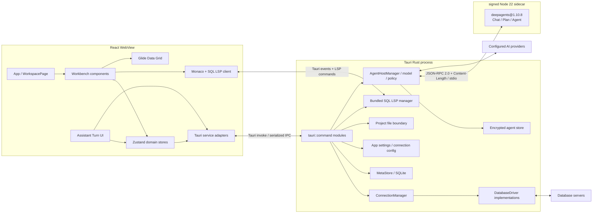
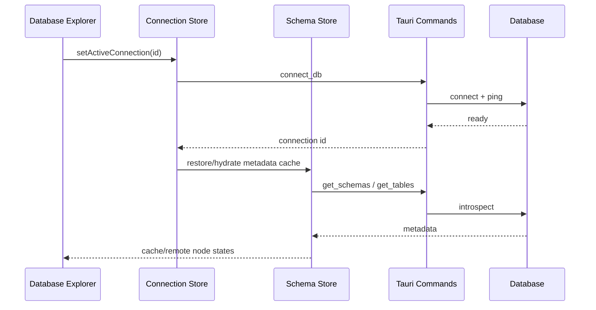

# OxideStudio 当前架构

> 文档基线：2026-07-15。本文描述当前仓库已经存在的实现；仍在发布接线中的能力会明确标注。

## 1. 架构目标

OxideStudio 是一个 Tauri 桌面数据库工作台。架构需要同时满足四个约束：

- React WebView 提供高密度、可拆分的数据库 IDE 交互。
- Rust 进程持有数据库连接、事务、文件系统和本地持久化等高权限能力。
- PostgreSQL、MySQL/MariaDB、MongoDB、Redis、Elasticsearch 共用能力模型，而不是把驱动判断散落到每个组件。
- AI、应用内助手、CLI 与 MCP 复用同一套工具定义和安全审批边界。

## 2. 系统全景

WebView 与 Rust 之间仍使用 `@tauri-apps/api/core` 的 `invoke()` 和 Tauri event；命令在 `src-tauri/src/lib.rs` 的 `tauri::generate_handler!` 中显式注册。只有 Rust 与 Deep Agents sidecar 之间使用自定义、版本化的 JSON-RPC 2.0 协议。WebView 没有 shell/spawn 权限，也不能直接访问 sidecar stdio。

## 3. 前端分层

### 3.1 启动与工作台

- `src/App.tsx`：加载设置与项目作用域内的数据源，注册快捷键，并挂载 LSP 同步器。
- `src/pages/workspace.tsx`：组合 Database Explorer、编辑器、结果面板、AI/Project Files 次级面板和状态栏。
- `src/components/workspace/WorkbenchChrome.tsx`：标题栏工具、Search Everywhere 入口和状态栏。
- `src/components/workspace/SplitEditor.tsx`、`TabBar.tsx`、`QueryEditor.tsx`：编辑器分组、Tab 生命周期和 Monaco/LSP 交互。

工作台布局由 `useSettingsStore` 持久化，`useWorkbenchLayoutStore` 负责运行时显隐、移动和尺寸调整；数据库浏览器与次级面板可以交换左右位置，结果面板固定在底部。

### 3.2 状态域

| Store | 主要职责 | 持久化 |
| --- | --- | --- |
| `useProjectStore` | 项目列表、活动项目、目录关联 | MetaStore + localStorage 活动项 |
| `useConnectionStore` | 项目内数据源、连接生命周期、活动连接 | MetaStore / config |
| `useSchemaStore` | schema、table、collection、routine 元数据及缓存快照 | MetaStore resources + 内存 |
| `useTabStore` | Query/Table/Create Table Tab、执行结果、编辑草稿、事务上下文 | 内存 |
| `useProjectFilesStore` | 项目目录树、文本文件、图片预览、乐观修订 | 文件系统 + 内存 |
| `useSettingsStore` | 外观、布局、快捷键、编辑器、Data Grid 设置 | Rust settings command |
| `useHistoryStore` | 项目级查询执行日志、乐观删除与旧数据迁移 | MetaStore `query_history` + 内存 |
| `useTaskStore` | 查询、元数据等后台任务状态 | 内存 |
| `useAi*Store` | 非敏感 AI 配置、Turn view model 和审计状态 | localStorage / 内存；provider secret 在 OS credential manager |

当前 Store 之间存在有意的领域协作，例如切换项目会清理连接与 schema 快照，执行 DDL 后会刷新元数据。新增跨 Store 行为时应放入可测试的领域函数，避免继续在组件事件中拼接多步副作用。

### 3.3 服务适配层

`src/services/tauri/` 把 IPC 参数、camelCase 映射、错误类型和路径校验收敛在前端边界。UI 不应直接拼装 `invoke()` 参数。主要服务包括：

- `connection.service.ts`：测试、连接、断开和保存数据源。
- `query.service.ts`：执行、取消、只读查询和补全。
- `schema.service.ts`：数据库、schema、表、集合、列、索引、约束和 routine 元数据。
- `table.service.ts`：分页、编辑、DDL 和表结构变更。
- `project-files.service.ts`：受项目根目录约束的文件操作与图片预览。
- `settings.service.ts`、`store.service.ts`、`transaction.service.ts`：设置、MetaStore 和事务。

### 3.4 数据库能力与 Provider 扩展

`src/lib/databaseDialect.ts` 定义前端 `DatabaseDriverProfile` 与离线 fallback capabilities。应用启动后非阻塞调用后端 `list_database_capabilities`，把该完整列表注册为当前构建的权威 driver catalog；Connection Form、Database Explorer 新建菜单和 AI `provider.list` 共用 `useDatabaseDriverCatalogStore`/同一 catalog。单 driver 的 `get_database_capabilities` 只更新能力，不得把未在完整列表中的 driver 误当成可创建。命令不可用或返回失败时保留内置 fallback，且不能阻塞主界面。`src/providers/` 将下列扩展点组合成 provider 注册：

- 驱动显示信息和连接参数；
- 数据库对象的创建、预览、删除查询模板；
- AI 工具族；
- runtime capability 覆盖。

组件应优先判断 capability，例如 `supportsTableBrowsing` 或 `supportsTransactions`，只在协议语义确实不同的地方判断 driver。

## 4. Rust 后端分层

### 4.1 应用装配

`src-tauri/src/lib.rs` 完成插件注册、全局 State 初始化和命令注册。关键 State 包括：

- `ConnectionManager`：活动数据库驱动实例；
- `MetaStore`：本地 metadata SQLite；
- `ConfigManager` 与 `CacheManager`：设置和遗留 JSON 缓存；
- `ParserState`、查询取消状态、AI 取消状态；
- 每个连接/语言会话的 LSP 状态。
- `AgentHostManager`：无副作用装配的 sidecar supervisor、模型/工具代理、批准 lease 与加密 AgentStore。

### 4.2 Command 边界

`src-tauri/src/commands/` 按领域组织 IPC：`connection`、`query`、`schema`、`schema_diff`、`table`、`transaction`、`project_files`、`store`、`settings`、`lsp`、`ai`、`window`。

Command 的职责是：

1. 校验 IPC 输入和活动上下文；
2. 获取 Tauri State；
3. 调用 core/driver；
4. 将错误转换为可序列化结果。

SQL 拼接、标识符引用、只读判断、修订冲突和路径穿越防护必须留在 Rust 可信边界，不能只依赖前端禁用按钮。

### 4.3 Core 与 Driver

`src-tauri/src/core/driver.rs` 的 `DatabaseDriver` 是运行时多态边界，覆盖：

- 连接、ping、断开；
- 普通、参数化、跟踪和 database-scoped 查询；
- 查询取消与命名事务会话；
- database/schema/table/collection/column/index/constraint/routine 元数据。

当前 driver 实现位于 `src-tauri/src/drivers/`：

- PostgreSQL
- MySQL / MariaDB
- MongoDB
- Redis
- Elasticsearch

SQLite 和 SQL Server 当前没有运行时 driver；Cargo 中的 `sqlx/sqlite` feature 只服务本地 `MetaStore`，不代表可连接 SQLite 数据源。任何面向用户或 AI 的支持列表都以后端 `list_database_capabilities` 为权威来源，前端 profile 只提供显示/连接表单信息和离线降级。

### 4.4 本地持久化

`MetaStore` 使用应用配置目录下的 `metadata.db`：

- `projects`：项目、别名和关联目录；
- `connections`：按项目隔离的数据源定义；
- `resources`：按项目和连接隔离的层级元数据缓存。
- `query_history`：按项目隔离的有界执行日志，保存上下文、状态、耗时、行数和错误。

`resources` 是 adjacency-list 结构，并为 parent、connection 和搜索组合建立索引。密码等连接敏感信息不得写入文档、测试快照或日志。

Deep Agents 状态不写入上述 metadata resource。`AgentStore` 使用独立的 `agent-state.db`：`agent_threads`、`agent_checkpoints`、`agent_artifacts` 以及 LangGraph 专用的 `agent_graph_checkpoints`、`agent_graph_writes` 按项目隔离，值以 AES-256-GCM 加密，每条记录使用独立 nonce，AAD 绑定 project/thread/namespace/checkpoint/task/write index，默认保留七天。主密钥保存在 OS credential manager；keyring 不可用时退回仅当前进程可读的加密 session store，不把明文落盘。旧 `assistant_tasks` 只保留迁移期的安全任务摘要/receipt，不是新的 Deep Agents 可执行 checkpoint。

### 4.5 Project Files 安全边界

`commands/project_files.rs` 将所有路径规范化为项目根目录内的相对路径，并通过 canonical path 防止 `..`、绝对路径和 symlink 越界。文本文件使用 SHA-256 revision 做乐观并发控制；图片预览走独立的只读二进制接口，限制格式和 25 MiB 最大读取量，避免图片进入 UTF-8、Monaco、LSP 或保存链路。

## 5. 关键运行链路

### 5.1 数据源激活与元数据

连接成功后才替换活动上下文。元数据节点保留 `loading / ready / stale / error` 状态和 `cache / remote` 来源，支持 cache-first 浏览和显式刷新。

### 5.2 查询执行

1. `QueryEditor` 根据选区、当前 statement 或整页 SQL 生成执行请求。
2. `useTabStore.runTabQuery` 创建 query id 和后台 task。
3. `query.service.ts` 调用 `execute_query`。
4. Rust 根据 database、schema、transaction 和 query id 路由到 driver。
5. 结果进入 Tab；DDL/DML 触发有界元数据刷新；取消操作通过 query id 下发。

### 5.3 表数据编辑

Table Tab 使用服务端分页。前端保存 cell edits、新增行、删除选择和列布局；Value Editor 通过 cell 右键或 `Shift+Enter` 打开，按 column type 提供 text/JSON/date/binary/boolean/number 大视图，并把 `NOT LOADED / DEFAULT`、`NULL`、空串和实际值作为不同状态。Value Editor 的 “Stage change” 只写入既有 `pendingEdits`，最终仍由 Table toolbar 的 Submit changes 进入同一 mutation gate。提交时 Rust 根据 driver dialect 生成参数化语句，并在后端执行批量 mutation。默认只读、编辑开关和 destructive confirmation 是 UX 防线，参数化与事务才是数据安全防线。

Foreign-key row navigation 不扫描 Explorer 树。当前表的 outgoing constraints 与 PostgreSQL/MySQL 系统目录返回的 incoming references 被转换为纯 `ForeignKeyNavigationPlan`；复合键必须全部有非 NULL 值，并映射为结构化参数化 filters。目标 tab 继承源 tab 的 connection/database scope，复用 tab 时仍经过草稿丢弃保护。详细边界见 [ADR-0007](decisions/0007-foreign-key-row-navigation.md)。

Table 与 Query grid 共用 selection aggregate：Glide range/row/column selection 先去重并限制为 50,000 cells，`useDeferredValue` 避免拖选重算阻塞 canvas。聚合层区分 SQL NULL 与新行 DEFAULT，只有元数据标记的数值列参与 sum/avg/min/max；`bigint`/`numeric` 使用 `BigInt coefficient + scale` 定点累计。跨 tab/result 的旧 selection 会被拒绝。详细性能与精度边界见 [ADR-0008](decisions/0008-selection-aggregate-budget.md)。

### 5.4 Explain Plan

编辑器只提交原始 SQL、target identity、mode 和 query id；不允许前端拼接 `EXPLAIN`。Rust 先复用 dialect-aware statement scanner，要求恰好一条只读源查询并拒绝已有 `EXPLAIN`，再生成 PostgreSQL/MySQL 的 estimate/analyze 语句，并通过既有 query cancellation 与 database/schema 路由在只读事务内执行。

驱动结果先保留为 `rawPlan`，再规范化成稳定的 `ExplainPlanNode` 树。UI 只消费规范模型来展示 node type、relation/index、cost、estimated/actual rows、time 和 loops，同时保留 Raw 视图便于诊断。Analyze 会真实执行源查询，必须由编辑器显式确认；`query.explain` AI 工具只允许 estimate。计划 attachment 使用 `tabId + planId + nodeId`，旧计划或不存在节点由 `UiActionRegistry` 拒绝，不能退化为 DOM selector 查找。详细决策见 [ADR-0003](decisions/0003-explain-plan-safety.md)。

### 5.5 Schema Snapshot 与 Diff

Schema baseline 不读取可变的 Explorer 展示树，而是调用 Rust `capture_schema_snapshot` 对指定 `project + connection + database + schema` 进行一次完整 introspection。表级 columns/indexes/constraints 并行获取，表间以六个 permit 限流；任一失败都会中止，避免把部分结构保存为有效 snapshot。版本化 snapshot 与 fingerprint 作为 project-scoped MetaStore resource 持久化。

`compare_schema_snapshots` 把 source 定义为 desired、fresh live target 定义为 actual，并在 Rust 纯领域层生成稳定 change、风险、可逆性、warning 和 dialect SQL。支持对象通过 dependency graph 拓扑排序并携带 phase/order/dependsOn；外键脱离 `CREATE TABLE`，changed index/constraint 拆为 drop/recreate。无法完整重建、依赖被阻断或出现 cycle 时清除 runnable SQL，而不是猜测或添加 `CASCADE`。artifact 另有 NOT NULL/UNIQUE/FK/drop 等只读 preflight surface。PostgreSQL migration preview 以 `ROLLBACK` 结束，MySQL 明示 DDL auto-commit。AI action 通过 `tabId + schemaDiffId + schemaChangeId` 定位精确 change。完整边界见 [ADR-0005](decisions/0005-schema-snapshot-diff.md) 与 [ADR-0006](decisions/0006-migration-dependency-preflight.md)。

### 5.6 AI 工具链

生产 Chat、Plan、Agent 统一由签名 Node 22 `deepagents@1.10.8` sidecar 编排。React 通过 `agent_start_turn`、`agent_resume_turn`、`agent_cancel_turn`、`agent_answer_clarification`、`agent_approve_action`、`agent_get_status` 和 `agent://event` 与 Rust 通信；旧 `AssistantRuntime` 只在显式 `VITE_ASSISTANT_LEGACY_RUNTIME=1` 的开发场景启用。完整边界见 [ADR-0012](decisions/0012-deep-agents-desktop-runtime-boundary.md)。

Rust `AgentHostManager` 在 setup 时不启动进程，首次已配置 AI 请求才懒启动 sidecar。双方先通过 protocol/version/capability handshake，再使用 4 MiB 上限的 `Content-Length` JSON-RPC。request/thread/turn/context/deadline 贯穿 model、tool、checkpoint 和 artifact 回调；sidecar 缺失或崩溃只让 Assistant unavailable，不影响工作台首屏。

`agent-contract` 把前端工具 manifest、provider capability、workspace identity 和 typed `AgentEvent` 固化为 Zod schema。Chat 不获得数据库或 subagent 工具；Plan 只接收只读工具；Agent 接收 Rust 过滤后的 manifest。同步 schema/query/verification subagent 默认只读且无文件系统。sidecar 禁用 FilesystemBackend、LocalShellBackend、shell 与通用子代理。

模型 API key 存在 OS credential manager，由 Rust `ModelGateway` 完成 OpenAI-compatible complete/SSE streaming、取消、deadline、usage 与 tool call 归一化。sidecar 不接收 key。工具实际执行也回到 Rust；Rust重新校验 project/connection/config revision/context、canonical input digest、SQL risk 和一次性 approval lease。大结果成为有界 observation 与项目级 artifact reference，不能以 raw rows 穿过 IPC。

上下文层使用真实 provider token profile、长问题切块/digest 和 Deep Agents summarization/offload。内部 summarization stream 不显示成最终回答；持久 `OxideCheckpointSaver` 通过 Rust RPC 保存 LangGraph checkpoint/pending writes，后续 Turn 只追加新 prompt，不重复注入全量历史。`ask_user` 与 approval 使用 LangGraph `interrupt()`，回答通过 `Command({ resume })` 恢复；sidecar 重启后可从加密 graph checkpoint 继续。approval lease 只存在 Rust/当前 sidecar 内存和单次 RPC 中，绝不写入 checkpoint；丢失 lease 时 mutation fail-closed。数据库 mutation receipt/exactly-once 与完整应用进程崩溃后的恢复 UX 仍不作完成承诺，任何不确定 mutation 都不得自动重放。

Assistant view model 固定为“问题 → 紧凑过程 → 最终答案”。tool/todo/subagent 合并到当前 Turn 的默认折叠单行 disclosure，只有 coordinator final answer 是普通 Assistant 正文。宽面板且真实溢出时，minimap 每个完整问答只生成一个灰色 marker；过程不产生独立历史记录。页面联动继续由 `src/ai/ui-actions` 提供 stable target 和 stale-context 校验。

外部 MCP/CLI 不经过 Deep Agents sidecar。Rust 原生 `oxide-agent mcp stdio` 与 tools list/inspect/call 首版只读，严格限定 MCP 2025-11-25、project grant、可选 connection grant 和结果上限，并作为 target-specific `externalBin` 随包发布。现存 TypeScript adapter 仅保留为迁移/契约资产；两条路径都不允许调用者通过 `_meta.approved`、`approved:true` 或 `--approve` 自我授权。

编辑器修改采用两段式边界：只读 `editor.proposePatch` 工具根据当前 tab/selection 生成绑定 document revision 的 patch artifact；`editor.previewPatch` 只打开 before/after surface。只有用户点击 Apply，tab store 才再次核对整篇 revision 与 range 的原始文本并更新 Monaco 内容，预览本身不会写入或执行 SQL。单侧文本限制为 50,000 字符，binary preview 不进入文本 patch 链路。目标状态机、Deep Agents 分层与完整页面动作协议见 [AI Agent 产品与技术规格](AI_AGENT_PRODUCT_SPEC.md)，补丁决策见 [ADR-0009](decisions/0009-revision-bound-editor-patch.md)。

## 6. 测试与质量门

- 前端：Vitest，覆盖 stores、服务适配、provider 注册、SQL 安全、工作台与文件生命周期。
- Agent：`agent-contract` 契约测试与 `agent-host` framing/model/tool/runtime/checkpoint 测试；production bundle 还需执行真实 sidecar handshake 与故障隔离 smoke。
- 后端：Rust unit/integration tests，覆盖 dialect、driver、命令、MetaStore、文件安全和 LSP。
- 必跑门禁：`npm run build`、`npm test`、`cargo fmt --check`、`cargo clippy --all-targets --all-features -- -D warnings`。
- 数据库驱动行为变化应补 live database 测试，但默认测试不得依赖本机数据库。
- 发布按 macOS arm64、macOS x86_64、Windows x86_64、Linux x86_64 分架构生成 sidecar；macOS 不构建 universal 包。

## 7. 当前架构债务

1. `SchemaSidebar.tsx` 和 `QueryEditor.tsx` 仍是高复杂度组件，领域操作需要继续拆到 hooks/lib。
2. 核心 connection/query/schema/table/project-file 已统一为结构化错误；低频 legacy command 仍有字符串 rejection，但前端 raw-command adapter 会规范化为稳定 `ApiError`，后续应随模块修改逐步迁移后端来源码。
3. `tauri::generate_handler!` 是手工总表，新增命令容易漏注册，应增加命令契约测试或代码生成。
4. Search Everywhere 目前只索引内存中已知范围，还没有覆盖 MetaStore 的全项目对象索引。
5. provider capability 同时存在前端默认值和后端运行时值，需要持续用契约测试防止漂移。
6. Deep Agents host、协议、模型/tool proxy、加密 LangGraph checkpoint/pending writes 与 sidecar-restart interrupt resume 已落地；剩余债务是数据库级 idempotency/receipt、完整应用进程恢复 UX、完整 provider tool bridge、Context Vault range/search、长期 trace/eval 与四平台 production-bundle smoke。页面 action 已有 stale-context 防护，生产旧 runtime 只保留开发 feature flag。
7. Rust 原生 `oxide-agent` 的只读 stdio/CLI 首版已接入 Cargo 和发布矩阵；后续若开放 mutation，必须先加入 GUI 签发的 60 秒单次 input-hash lease，不能复用调用者自报批准。

DataGrip 对标差距、优先级和验收标准见 [datagrip-gap-analysis.md](datagrip-gap-analysis.md)。
