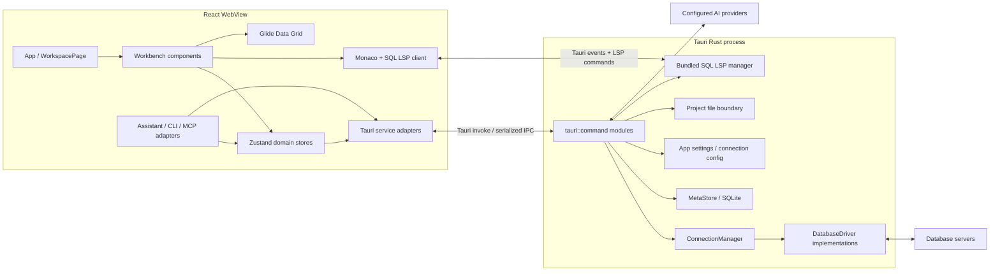
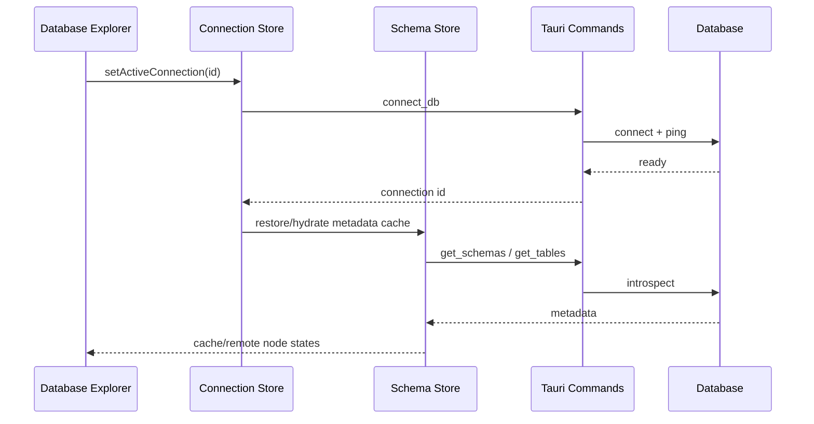

# OxideStudio 当前架构

> 文档基线：2026-07-13。本文描述当前仓库已经存在的实现，不代表未来愿景。

## 1. 架构目标

OxideStudio 是一个 Tauri 桌面数据库工作台。架构需要同时满足四个约束：

- React WebView 提供高密度、可拆分的数据库 IDE 交互。
- Rust 进程持有数据库连接、事务、文件系统和本地持久化等高权限能力。
- PostgreSQL、MySQL/MariaDB、MongoDB、Redis、Elasticsearch 共用能力模型，而不是把驱动判断散落到每个组件。
- AI、应用内助手、CLI 与 MCP 复用同一套工具定义和安全审批边界。

## 2. 系统全景

这里没有自定义 JSON-RPC 网关。前端通过 `@tauri-apps/api/core` 的 `invoke()` 调用 Rust 命令，命令在 `src-tauri/src/lib.rs` 的 `tauri::generate_handler!` 中显式注册；异步通知通过 Tauri event 传递。

## 3. 前端分层

### 3.1 启动与工作台

- `src/App.tsx`：加载设置与项目作用域内的数据源，注册快捷键，并挂载 LSP 同步器。
- `src/pages/workspace.tsx`：组合 Database Explorer、编辑器、结果面板、AI/Project Files 次级面板和状态栏。
- `src/components/workspace/WorkbenchChrome.tsx`：标题栏工具、Search Everywhere 入口和状态栏。
- `src/components/workspace/SplitEditor.tsx`、`TabBar.tsx`、`QueryEditor.tsx`：编辑器分组、Tab 生命周期和 Monaco/LSP 交互。

工作台布局由 `useSettingsStore` 持久化，`useWorkbenchLayoutStore` 负责运行时显隐、移动和尺寸调整；数据库浏览器与次级面板可以交换左右位置，结果面板固定在底部。

### 3.2 状态域

| Store | 主要职责 | 持久化 |
| --- | --- | --- |
| `useProjectStore` | 项目列表、活动项目、目录关联 | MetaStore + localStorage 活动项 |
| `useConnectionStore` | 项目内数据源、连接生命周期、活动连接 | MetaStore / config |
| `useSchemaStore` | schema、table、collection、routine 元数据及缓存快照 | MetaStore resources + 内存 |
| `useTabStore` | Query/Table/Create Table Tab、执行结果、编辑草稿、事务上下文 | 内存 |
| `useProjectFilesStore` | 项目目录树、文本文件、图片预览、乐观修订 | 文件系统 + 内存 |
| `useSettingsStore` | 外观、布局、快捷键、编辑器、Data Grid 设置 | Rust settings command |
| `useHistoryStore` | 项目级查询执行日志、乐观删除与旧数据迁移 | MetaStore `query_history` + 内存 |
| `useTaskStore` | 查询、元数据等后台任务状态 | 内存 |
| `useAi*Store` | AI 配置、审计和工作流状态 | localStorage / 内存 |

当前 Store 之间存在有意的领域协作，例如切换项目会清理连接与 schema 快照，执行 DDL 后会刷新元数据。新增跨 Store 行为时应放入可测试的领域函数，避免继续在组件事件中拼接多步副作用。

### 3.3 服务适配层

`src/services/tauri/` 把 IPC 参数、camelCase 映射、错误类型和路径校验收敛在前端边界。UI 不应直接拼装 `invoke()` 参数。主要服务包括：

- `connection.service.ts`：测试、连接、断开和保存数据源。
- `query.service.ts`：执行、取消、只读查询和补全。
- `schema.service.ts`：数据库、schema、表、集合、列、索引、约束和 routine 元数据。
- `table.service.ts`：分页、编辑、DDL 和表结构变更。
- `project-files.service.ts`：受项目根目录约束的文件操作与图片预览。
- `settings.service.ts`、`store.service.ts`、`transaction.service.ts`：设置、MetaStore 和事务。

### 3.4 数据库能力与 Provider 扩展

`src/lib/databaseDialect.ts` 定义前端 `DatabaseDriverProfile` 与默认 capabilities。后端 `get_database_capabilities` 返回运行时能力后，会覆盖前端默认值。`src/providers/` 将下列扩展点组合成 provider 注册：

- 驱动显示信息和连接参数；
- 数据库对象的创建、预览、删除查询模板；
- AI 工具族；
- runtime capability 覆盖。

组件应优先判断 capability，例如 `supportsTableBrowsing` 或 `supportsTransactions`，只在协议语义确实不同的地方判断 driver。

## 4. Rust 后端分层

### 4.1 应用装配

`src-tauri/src/lib.rs` 完成插件注册、全局 State 初始化和命令注册。关键 State 包括：

- `ConnectionManager`：活动数据库驱动实例；
- `MetaStore`：本地 metadata SQLite；
- `ConfigManager` 与 `CacheManager`：设置和遗留 JSON 缓存；
- `ParserState`、查询取消状态、AI 取消状态；
- 每个连接/语言会话的 LSP 状态。

### 4.2 Command 边界

`src-tauri/src/commands/` 按领域组织 IPC：`connection`、`query`、`schema`、`table`、`transaction`、`project_files`、`store`、`settings`、`lsp`、`ai`、`window`。

Command 的职责是：

1. 校验 IPC 输入和活动上下文；
2. 获取 Tauri State；
3. 调用 core/driver；
4. 将错误转换为可序列化结果。

SQL 拼接、标识符引用、只读判断、修订冲突和路径穿越防护必须留在 Rust 可信边界，不能只依赖前端禁用按钮。

### 4.3 Core 与 Driver

`src-tauri/src/core/driver.rs` 的 `DatabaseDriver` 是运行时多态边界，覆盖：

- 连接、ping、断开；
- 普通、参数化、跟踪和 database-scoped 查询；
- 查询取消与命名事务会话；
- database/schema/table/collection/column/index/constraint/routine 元数据。

当前 driver 实现位于 `src-tauri/src/drivers/`：

- PostgreSQL
- MySQL / MariaDB
- MongoDB
- Redis
- Elasticsearch

SQLite 和 SQL Server 当前没有运行时 driver；任何面向用户的支持列表都应以这里和 `databaseDialect.ts` 的交集为准。

### 4.4 本地持久化

`MetaStore` 使用应用配置目录下的 `metadata.db`：

- `projects`：项目、别名和关联目录；
- `connections`：按项目隔离的数据源定义；
- `resources`：按项目和连接隔离的层级元数据缓存。
- `query_history`：按项目隔离的有界执行日志，保存上下文、状态、耗时、行数和错误。

`resources` 是 adjacency-list 结构，并为 parent、connection 和搜索组合建立索引。密码等连接敏感信息不得写入文档、测试快照或日志。

### 4.5 Project Files 安全边界

`commands/project_files.rs` 将所有路径规范化为项目根目录内的相对路径，并通过 canonical path 防止 `..`、绝对路径和 symlink 越界。文本文件使用 SHA-256 revision 做乐观并发控制；图片预览走独立的只读二进制接口，限制格式和 25 MiB 最大读取量，避免图片进入 UTF-8、Monaco、LSP 或保存链路。

## 5. 关键运行链路

### 5.1 数据源激活与元数据

连接成功后才替换活动上下文。元数据节点保留 `loading / ready / stale / error` 状态和 `cache / remote` 来源，支持 cache-first 浏览和显式刷新。

### 5.2 查询执行

1. `QueryEditor` 根据选区、当前 statement 或整页 SQL 生成执行请求。
2. `useTabStore.runTabQuery` 创建 query id 和后台 task。
3. `query.service.ts` 调用 `execute_query`。
4. Rust 根据 database、schema、transaction 和 query id 路由到 driver。
5. 结果进入 Tab；DDL/DML 触发有界元数据刷新；取消操作通过 query id 下发。

### 5.3 表数据编辑

Table Tab 使用服务端分页。前端保存 cell edits、新增行、删除选择和列布局；Value Editor 通过 cell 右键或 `Shift+Enter` 打开，按 column type 提供 text/JSON/date/binary/boolean/number 大视图，并把 `NOT LOADED / DEFAULT`、`NULL`、空串和实际值作为不同状态。Value Editor 的 “Stage change” 只写入既有 `pendingEdits`，最终仍由 Table toolbar 的 Submit changes 进入同一 mutation gate。提交时 Rust 根据 driver dialect 生成参数化语句，并在后端执行批量 mutation。默认只读、编辑开关和 destructive confirmation 是 UX 防线，参数化与事务才是数据安全防线。

### 5.4 AI 工具链

应用内 Assistant、CLI 与 MCP 共用 `src/ai/tools` 的 registry、policy 和 audit。工具调用必须携带活动项目/连接上下文，并经过权限判定；后端只读执行仍会再次扫描 SQL，避免 AI 绕过 UI 审批。

当前 LangGraph 主要承担 `plan -> policy`，多轮工具循环仍由 Assistant React 组件编排，因此不能把它描述为 durable agent 已完成。页面联动的第一阶段已经由 `src/ai/ui-actions` 提供独立 typed navigation layer：Assistant tool result 会生成带 provenance 的 attachment，registry 负责项目/context/revision 校验，Database Explorer 与 Monaco 只接收稳定语义 target。patch preview、Explain Plan node 和 durable task action 仍须等待对应工作台 surface。目标状态机、Deep Agents 分层与完整页面动作协议见 [AI Agent 产品与技术规格](AI_AGENT_PRODUCT_SPEC.md)。

## 6. 测试与质量门

- 前端：Vitest，覆盖 stores、服务适配、provider 注册、SQL 安全、工作台与文件生命周期。
- 后端：Rust unit/integration tests，覆盖 dialect、driver、命令、MetaStore、文件安全和 LSP。
- 必跑门禁：`npm run build`、`npm test`、`cargo fmt --check`、`cargo clippy --all-targets --all-features -- -D warnings`。
- 数据库驱动行为变化应补 live database 测试，但默认测试不得依赖本机数据库。

## 7. 当前架构债务

1. `SchemaSidebar.tsx` 和 `QueryEditor.tsx` 仍是高复杂度组件，领域操作需要继续拆到 hooks/lib。
2. 核心 connection/query/schema/table/project-file 已统一为结构化错误；低频 legacy command 仍有字符串 rejection，但前端 raw-command adapter 会规范化为稳定 `ApiError`，后续应随模块修改逐步迁移后端来源码。
3. `tauri::generate_handler!` 是手工总表，新增命令容易漏注册，应增加命令契约测试或代码生成。
4. Search Everywhere 目前只索引内存中已知范围，还没有覆盖 MetaStore 的全项目对象索引。
5. provider capability 同时存在前端默认值和后端运行时值，需要持续用契约测试防止漂移。
6. Assistant 的多轮执行、调用上限和批准协调仍部分耦合在 UI；页面 action 已有 stale-context 防护，但 agent runtime 仍需要 checkpoint/resume 和批准 token 的 context binding。

DataGrip 对标差距、优先级和验收标准见 [datagrip-gap-analysis.md](datagrip-gap-analysis.md)。
