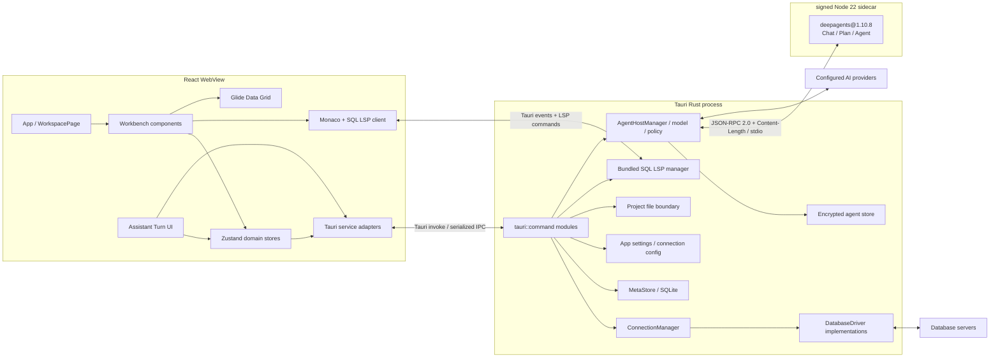
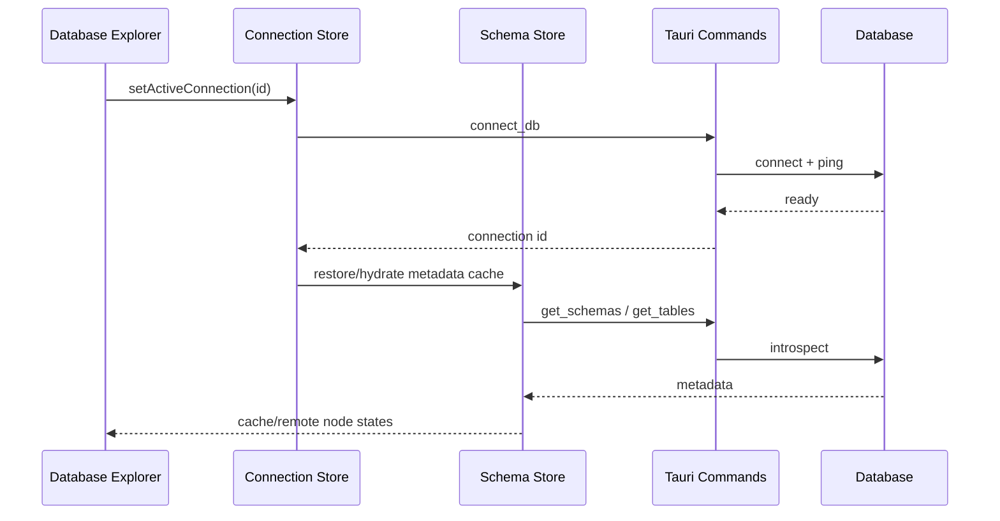

# OxideStudio 当前架构

> 文档基线：2026-07-26。本文描述当前仓库已经存在的实现；仍在发布接线中的能力会明确标注。

## 1. 架构目标

OxideStudio 是一个 Tauri 桌面数据库工作台。架构需要同时满足四个约束：

- React WebView 提供高密度、可拆分的数据库 IDE 交互。
- Rust 进程持有数据库连接、事务、文件系统和本地持久化等高权限能力。
- PostgreSQL、MySQL/MariaDB、MongoDB、Redis、Elasticsearch 共用能力模型，而不是把驱动判断散落到每个组件。
- AI、应用内助手、CLI 与 MCP 复用同一套工具定义和安全审批边界。

## 2. 系统全景

WebView 与 Rust 之间仍使用 `@tauri-apps/api/core` 的 `invoke()` 和 Tauri event；命令在 `src-tauri/src/lib.rs` 的 `tauri::generate_handler!` 中显式注册。只有 Rust 与 Deep Agents sidecar 之间使用自定义、版本化的 JSON-RPC 2.0 协议。WebView 没有 shell/spawn 权限，也不能直接访问 sidecar stdio。

## 3. 前端分层

### 3.1 启动与工作台

- `src/App.tsx`：加载设置与项目作用域内的数据源，注册快捷键，并挂载 LSP 同步器。
- `src/pages/workspace.tsx`：组合 Database Explorer、编辑器、结果面板、AI/Project Files 次级面板和状态栏。
- `src/components/workspace/WorkbenchChrome.tsx`：标题栏工具、Search Everywhere 入口和状态栏。
- `src/components/workspace/SplitEditor.tsx`、`TabBar.tsx`、`QueryEditor.tsx`：编辑器分组、Tab 生命周期和 Monaco/LSP 交互。

工作台布局由 `useSettingsStore` 持久化，`useWorkbenchLayoutStore` 负责运行时显隐、移动和尺寸调整；数据库浏览器与次级面板可以交换左右位置，结果面板固定在底部。

### 3.2 状态域

| Store | 主要职责 | 持久化 |
| --- | --- | --- |
| `useProjectStore` | 项目列表、活动项目、目录关联 | MetaStore + localStorage 活动项 |
| `useConnectionStore` | 项目内数据源、连接生命周期、活动连接 | MetaStore / config |
| `useSchemaStore` | schema、table、collection、routine 元数据及缓存快照 | MetaStore resources + 内存 |
| `useTabStore` | Query/Table/Create Table Tab、执行结果、编辑草稿、事务上下文 | 内存 |
| `useProjectFilesStore` | 项目目录树、文本文件、图片预览、乐观修订 | 文件系统 + 内存 |
| `useSettingsStore` | 外观、布局、快捷键、编辑器、Data Grid 设置 | Rust settings command |
| `useHistoryStore` | 项目级查询执行日志、乐观删除与旧数据迁移 | MetaStore `query_history` + 内存 |
| `useTaskStore` | 查询、元数据等后台任务状态 | 内存 |
| `useAi*Store` | 非敏感 AI 配置、Turn view model 和审计状态 | localStorage / 内存；provider secret 在应用的用户级 credential file |

当前 Store 之间存在有意的领域协作，例如切换项目会清理连接与 schema 快照，执行 DDL 后会刷新元数据。新增跨 Store 行为时应放入可测试的领域函数，避免继续在组件事件中拼接多步副作用。

### 3.3 服务适配层

`src/services/tauri/` 把 IPC 参数、camelCase 映射、错误类型和路径校验收敛在前端边界。UI 不应直接拼装 `invoke()` 参数。主要服务包括：

- `connection.service.ts`：测试、连接、断开和保存数据源。
- `query.service.ts`：执行、取消、只读查询和补全。
- `schema.service.ts`：数据库、schema、表、集合、列、索引、约束和 routine 元数据。
- `table.service.ts`：分页、编辑、DDL 和表结构变更。
- `project-files.service.ts`：受项目根目录约束的文件操作与图片预览。
- `settings.service.ts`、`store.service.ts`、`transaction.service.ts`：设置、MetaStore 和事务。

### 3.4 数据库能力与 Provider 扩展

`src/lib/databaseDialect.ts` 定义前端 `DatabaseDriverProfile` 与离线 fallback capabilities。应用启动后非阻塞调用后端 `list_database_capabilities`，把该完整列表注册为当前构建的权威 driver catalog；Connection Form、Database Explorer 新建菜单和 AI `provider.list` 共用 `useDatabaseDriverCatalogStore`/同一 catalog。单 driver 的 `get_database_capabilities` 只更新能力，不得把未在完整列表中的 driver 误当成可创建。命令不可用或返回失败时保留内置 fallback，且不能阻塞主界面。`src/providers/` 将下列扩展点组合成 provider 注册：

`src/features/database-drivers/model/referenceDriverCatalog.ts` 是另一层只读的产品覆盖
目录，用于 Driver Manager 审核 70+ 发布目标。它不参与可连接驱动选择；一个条目必须经过
签名 package 的安装、验证、激活（JDBC 还需受管理 Java runtime）后，才由后端 capability
catalog 暴露给前端。这样产品路线图与可执行驱动、连接固定的 package 版本、Editor/LSP
能力快照始终保持明确边界。

- 驱动显示信息和连接参数；
- 数据库对象的创建、预览、删除查询模板；
- AI 工具族；
- runtime capability 覆盖。

组件应优先判断 capability，例如 `supportsTableBrowsing` 或 `supportsTransactions`，只在协议语义确实不同的地方判断 driver。

## 4. Rust 后端分层

### 4.1 应用装配

`src-tauri/src/lib.rs` 完成插件注册、全局 State 初始化和命令注册。关键 State 包括：

- `ConnectionManager`：活动数据库驱动实例；
- `MetaStore`：本地 metadata SQLite；
- `ConfigManager` 与 `CacheManager`：设置和遗留 JSON 缓存；
- `ParserState`、查询取消状态、AI 取消状态；
- 每个连接/语言会话的 LSP 状态；会话有引用计数、空闲回收、健康恢复和标准 JSON-RPC 取消。同步 metadata 使用不含凭据的 `oxide://database-object` URI，内置 binary 由相邻 manifest 做 SHA-256 与 source revision 校验。
- `AgentHostManager`：无副作用装配的 sidecar supervisor、模型/工具代理、批准 lease 与加密 AgentStore。

### 4.2 Command 边界

`src-tauri/src/commands/` 按领域组织 IPC：`connection`、`query`、`schema`、`schema_diff`、`table`、`transaction`、`project_files`、`store`、`settings`、`lsp`、`ai`、`agent`、`window`。

Command 的职责是：

1. 校验 IPC 输入和活动上下文；
2. 获取 Tauri State；
3. 调用 core/driver；
4. 将错误转换为可序列化结果。

SQL 拼接、标识符引用、只读判断、修订冲突和路径穿越防护必须留在 Rust 可信边界，不能只依赖前端禁用按钮。

### 4.3 Core 与 Driver

`src-tauri/src/core/driver.rs` 的 `DatabaseDriver` 是运行时多态边界，覆盖：

- 连接、ping、断开；
- 普通、参数化、跟踪和 database-scoped 查询；
- 查询取消与命名事务会话；
- database/schema/table/collection/column/index/constraint/routine 元数据。

当前 driver 实现位于 `src-tauri/src/drivers/`：

- PostgreSQL
- MySQL / MariaDB
- MongoDB
- Redis
- Elasticsearch

非关系型对象仍通过同一 capability 边界进入工作区，但不伪装成 SQL：MongoDB collection、Redis key 与 Elasticsearch index 打开只读、有界的原生数据预览。Redis Explorer 保留 `db N` namespace 层；Elasticsearch 连接时探测 6/7/8 主版本，6.x 使用 typed mapping/document path，7/8 使用 typeless API。完整的服务端分页、过滤和编辑能力仍需各数据模型独立实现。

Elasticsearch Query DSL 使用独立的 Kibana Console 文档模型。编辑器按
`METHOD index/_endpoint` 请求行切分文档，光标执行只运行当前请求，选区执行运行选区，
整页执行运行全部请求；本地 Console provider 提供方法、端点、Query DSL 片段和逐请求
格式化；METHOD、path、operation、DSL key 和 mapping field 输入会触发同一个 Monaco suggest
surface，schema-aware LSP 继续补充当前 index mapping 字段，接受候选后 provider 保持可继续
刷新。为了避免大 Console 文件阻塞
WebView，全文诊断和 gutter 请求索引在专用 Web Worker 中 debounce 执行；Smart Tab/补全只扫描
光标附近的当前 request，编辑内容以短批次写回 workspace store，执行和切换文档前仍会同步
提交最新 Monaco model。关系型数据交换复用 Rust
后端：表数据通过参数化事务批次导入，CSV、
JSON 和 SQL `INSERT` 导出采用有界分页写盘，SQL dump 导入保留脚本自身的事务语义。

SQLite 现在使用独立的原生 `sqlx-sqlite` 数据源驱动：本地文件和 `:memory:` 均可连接，Explorer 可读取表、视图、列、索引和外键，编辑器可执行脚本并通过 SQLite LSP profile 获取 schema-aware completion；表/视图创建、表名/列名变更、列增删、索引增删、清空和删除由 SQLite 专用 DDL builder 执行，不复用 PostgreSQL DDL。`sqlite::memory:` 强制单连接池，避免同一会话被拆到不同的内存数据库。SQLite 暂不公布 Explain Plan、结构迁移执行或 Agent 只读事务包装能力，直至其专用的安全与渲染适配器完成。SQL Server 仍无内置运行时驱动，应通过已签名的外部 driver package 接入。任何面向用户或 AI 的支持列表都以后端 `list_database_capabilities` 为权威来源，前端 profile 只提供显示/连接表单信息和离线降级。

### 4.4 本地持久化

`MetaStore` 使用应用配置目录下的 `metadata.db`：

- `projects`：项目、别名和关联目录；
- `connections`：按项目隔离的数据源定义；
- `resources`：按项目和连接隔离的层级元数据缓存。
- `query_history`：按项目隔离的有界执行日志，保存上下文、状态、耗时、行数和错误。

`resources` 是 adjacency-list 结构，并为 parent、connection 和搜索组合建立索引。密码等连接敏感信息不得写入文档、测试快照或日志。

Deep Agents 状态不写入上述 metadata resource。`AgentStore` 使用独立的 `agent-state-v2.db`：`agent_threads`、`agent_checkpoints`、`agent_artifacts` 以及 LangGraph 专用的 `agent_graph_checkpoints`、`agent_graph_writes` 按项目隔离，值以 AES-256-GCM 加密，每条记录使用独立 nonce，AAD 绑定 project/thread/namespace/checkpoint/task/write index，默认保留七天。主密钥保存在 OxideStudio 用户私有 credential file（Unix 文件 `0600`/目录 `0700`，Windows 用户 profile ACL），运行时不访问 OS credential manager；密钥文件不可用时退回仅当前进程可读的加密 session store，不把明文落盘。旧 `assistant_tasks` 只保留迁移期的安全任务摘要/receipt，不是新的 Deep Agents 可执行 checkpoint。

### 4.5 Project Files 安全边界

`commands/project_files.rs` 将所有路径规范化为项目根目录内的相对路径，并通过 canonical path 防止 `..`、绝对路径和 symlink 越界。文本文件使用 SHA-256 revision 做乐观并发控制；Agent 文件读取/写入沿用同一边界并额外限制 256 KiB，替换必须提交精确 expected revision，创建与替换语义分开。图片预览走独立的只读二进制接口，限制格式和 25 MiB 最大读取量，避免图片进入 UTF-8、Monaco、LSP 或保存链路。

项目 Git 视图不开放 shell 字符串。Rust 以参数数组启动 `git -C <canonical-root>`，关闭 optional locks/fsmonitor 与 external diff/textconv，命令 8 秒超时，并分别限制 status、diff 与 stderr 输出；status 使用 `-- .` 只扫描配置的项目根范围，再过滤越界路径并最多展示 500 个文件。逐文件 diff scope 只映射为固定参数数组：All 使用相对 `HEAD` 的最终变化，Staged 使用 `--cached`，Working 只读取未暂存变化；仅当 `git ls-files --others --exclude-standard -z` 精确确认目标未跟踪时才生成有界的 synthetic new-file patch。当前能力只读：branch/head、porcelain status、staged/unstaged/untracked/conflict 与逐文件 unified diff，不包含 stage、commit、checkout 或 push。

Agent 文件归因不从模型回答或 Git 时间戳猜测。`project.writeFile` 在 Rust 项目文件边界成功提交后，由 Rust 直接向 WebView 发出 `file.changed`，只含 project-relative path、created/updated、写入前后 SHA-256 revision、Turn/Call ID，以及最多 2,048 个不含内容的保守新侧行号；同名 sidecar 事件不在允许列表中，会被丢弃。行证据只收录“写入前全文不存在、写入后出现”的文本行，因此重复/移动内容可能少标，但不会仅凭时间戳扩大归属。Turn 将证据纳入加密 conversation snapshot，Changes 可筛选全部变更、全部 Agent 文件或单个 Turn。选中文件时，All/Working 对项目根当前文件、Staged 对 index blob 计算与 Agent 写入相同的有界 SHA-256；界面只有在 revision 完全相等时才显示 `AI match` 并标出与 Git 新增行相交的可信行/hunk，否则明确显示 differs、missing 或 unverified。该核验不等同于完整 blame，未被保守证据覆盖的行不声称作者。

## 5. 关键运行链路

### 5.1 数据源激活与元数据

连接成功后才替换活动上下文。元数据节点保留 `loading / ready / stale / error` 状态和 `cache / remote` 来源，支持 cache-first 浏览和显式刷新。

### 5.2 查询执行

1. `QueryEditor` 根据选区、当前 statement 或整页 SQL 生成执行请求；当前 statement 由 Rust 使用 driver-aware scanner 解析，Monaco UTF-16 光标 offset 会先安全转换为 Rust UTF-8 byte offset。
2. `useTabStore.runTabQuery` 创建 query id 和后台 task。
3. `query.service.ts` 调用 `execute_query`。
4. Rust 根据 database、schema、transaction 和 query id 路由到 driver。
5. PostgreSQL/MySQL 普通查询在 driver stream 读取 1,001 条 sentinel 后只返回前 1,000 条，并在结果协议写入 `truncated/rowLimit`；结果进入 Tab，DDL/DML 触发有界元数据刷新，取消操作通过 query id 下发。
6. 查询失败时，Query Command 从 `anyhow` 链中的 `sqlx::DatabaseError` 提取白名单诊断：PostgreSQL 保留 SQLSTATE、severity、original character position 与 schema/table/column/constraint/type，MySQL 保留 SQLSTATE 与 vendor error number。响应 context 不包含 SQL、URL、凭据、PostgreSQL detail 或 internal query。
7. `useTabStore` 校验诊断结构，并把 PostgreSQL 1-based Unicode character position 换算为执行文本的 UTF-16 offset；执行整篇、选区或光标 statement 时再叠加来源 offset 得到 Monaco 文档行列。`QueryEditor` 使用独立 marker owner 展示位置，DataGrid 错误卡展示 code/object metadata，active-tab AI context 复用同一有界对象。

### 5.3 表数据编辑

Table Tab 使用服务端分页。前端保存 cell edits、新增行、删除选择和列布局；Value Editor 通过 cell 右键或 `Shift+Enter` 打开，按 column type 提供 text/JSON/date/binary/boolean/number 大视图，并把 `NOT LOADED / DEFAULT`、`NULL`、空串和实际值作为不同状态。Value Editor 的 “Stage change” 只写入既有 `pendingEdits`，最终仍由 Table toolbar 的 Submit changes 进入同一 mutation gate。提交时 Rust 根据 driver dialect 生成参数化语句，并在后端执行批量 mutation。默认只读、编辑开关和 destructive confirmation 是 UX 防线，参数化与事务才是数据安全防线。

Foreign-key row navigation 不扫描 Explorer 树。当前表的 outgoing constraints 与 PostgreSQL/MySQL 系统目录返回的 incoming references 被转换为纯 `ForeignKeyNavigationPlan`；复合键必须全部有非 NULL 值，并映射为结构化参数化 filters。目标 tab 继承源 tab 的 connection/database scope，复用 tab 时仍经过草稿丢弃保护。详细边界见 [ADR-0007](decisions/0007-foreign-key-row-navigation.md)。

Table 与 Query grid 共用 selection aggregate：Glide range/row/column selection 先去重并限制为 50,000 cells，`useDeferredValue` 避免拖选重算阻塞 canvas。聚合层区分 SQL NULL 与新行 DEFAULT，只有元数据标记的数值列参与 sum/avg/min/max；`bigint`/`numeric` 使用 `BigInt coefficient + scale` 定点累计。跨 tab/result 的旧 selection 会被拒绝。详细性能与精度边界见 [ADR-0008](decisions/0008-selection-aggregate-budget.md)。

Data Compare 从两个 idle、无 table draft 的 tab 捕获不可变 loaded-result snapshot。共同 primary key、`id` 或用户选择的复合列用于 type-aware key 对齐；不同结果列顺序按名称映射，重复列名 fail closed，重复 key 标记 ambiguous 而不静默覆盖。绝对/相对 tolerance 只作用于严格数值。Artifact 明确继承 source 的 truncated/current-page 边界，每侧最多比较 5,000 个 loaded rows，并限制前端 diff line 数量；它不执行隐式全表扫描或数据同步。详细边界见 [ADR-0015](decisions/0015-loaded-data-compare.md)。

### 5.4 Explain Plan

编辑器只提交原始 SQL、target identity、mode 和 query id；不允许前端拼接 `EXPLAIN`。Rust 先复用 dialect-aware statement scanner，要求恰好一条只读源查询并拒绝已有 `EXPLAIN`，再生成 PostgreSQL/MySQL 的 estimate/analyze 语句，并通过既有 query cancellation 与 database/schema 路由在只读事务内执行。

驱动结果先保留为 `rawPlan`，再规范化成稳定的 `ExplainPlanNode` 树。UI 只消费规范模型来展示 node type、relation/index、cost、estimated/actual rows、time 和 loops，同时保留 Raw 视图便于诊断。Analyze 会真实执行源查询，必须由编辑器显式确认；`query.explain` AI 工具只允许 estimate。用户已打开的 active-tab plan 会以最多 100 个节点的规范摘要进入 `workspace.getActiveTab`，只保留节点身份、关系/索引和有限数值指标，排除 `rawPlan`、condition 与 SQL；只有 mode 为 `analyze` 的摘要可作为实际耗时/行数证据。计划 attachment 使用 `tabId + planId + nodeId`，旧计划或不存在节点由 `UiActionRegistry` 拒绝，不能退化为 DOM selector 查找。详细决策见 [ADR-0003](decisions/0003-explain-plan-safety.md)。

### 5.5 Schema Snapshot 与 Diff

Schema baseline 不读取可变的 Explorer 展示树，而是调用 Rust `capture_schema_snapshot` 对指定 `project + connection + database + schema` 进行一次完整 introspection。表级 columns/indexes/constraints 并行获取，表间以六个 permit 限流；任一失败都会中止，避免把部分结构保存为有效 snapshot。版本化 snapshot 与 fingerprint 作为 project-scoped MetaStore resource 持久化。

`compare_schema_snapshots` 把 source 定义为 desired、fresh live target 定义为 actual，并在 Rust 纯领域层生成稳定 change、风险、可逆性、warning 和 dialect SQL。支持对象通过 dependency graph 拓扑排序并携带 phase/order/dependsOn；外键脱离 `CREATE TABLE`，changed index/constraint 拆为 drop/recreate。无法完整重建、依赖被阻断或出现 cycle 时清除 runnable SQL，而不是猜测或添加 `CASCADE`。artifact 另有 NOT NULL/UNIQUE/FK/drop 等只读 preflight surface。PostgreSQL migration preview 以 `ROLLBACK` 结束，MySQL 明示 DDL auto-commit。AI action 通过 `tabId + schemaDiffId + schemaChangeId` 定位精确 change。

PostgreSQL 的显式 Apply 不接收前端 SQL：Rust 校验 snapshot 内容与 fingerprint、approved plan id、typed schema 和分级批准，再重新抓取 live target 并重算计划。机器可判定的 preflight 失败会阻断；通过后复用 driver 的 database-scoped 原子 batch，失败自动回滚。MySQL 使用同一重新校验和 preflight 边界，但必须有额外的非事务确认；DDL 逐条执行、每条成功后写入 journal，失败保留可能已提交的精确进度，不能被描述为可回滚事务。两者提交后都再次抓取并 diff，区分 succeeded 与 committed-but-verification-failed；执行前生成的 reverse plan 只有在全量可逆且无 blocked change 时才作为 ROLLBACK-guarded artifact 发布。运行中、阻断、失败、复验失败、意外中断和成功状态写入项目/连接级 MetaStore journal；来自旧进程的 `running` 条目会被标成不可恢复的 `interrupted`，要求重新抓取 live schema，结果不保存业务行值。完整边界见 [ADR-0005](decisions/0005-schema-snapshot-diff.md)、[ADR-0006](decisions/0006-migration-dependency-preflight.md) 与 [ADR-0013](decisions/0013-schema-migration-execution.md)。

Schema Diagram 复用同一完整 snapshot，不从可变 Explorer tree 重建结构。前端领域层把 in-schema FK 规范化为保留复合列映射的 edge，以 parent → child 做确定性分层布局；cycle 不会导致节点丢失。每个 connection/database/schema 复用一个 artifact tab，刷新 snapshot 时只保留仍存在的选中 relation。搜索、keys-only、列数上限、zoom/Fit 是视图投影；跨 schema/快照外 FK 只计入 external 数量，不伪造目标节点。双击 relation 通过稳定身份联动 Explorer。边界见 [ADR-0014](decisions/0014-schema-diagram-artifact.md)。

### 5.6 AI 工具链

生产 Chat、Plan、Agent 统一由签名 Node 22 `deepagents@1.10.8` sidecar 编排。React 通过 `agent_start_turn`、`agent_resume_turn`、`agent_cancel_turn`、`agent_answer_clarification`、`agent_approve_action`、`agent_get_status` 和 `agent://event` 与 Rust 通信；旧 `AssistantRuntime` 只在显式 `VITE_ASSISTANT_LEGACY_RUNTIME=1` 的开发场景启用。完整边界见 [ADR-0012](decisions/0012-deep-agents-desktop-runtime-boundary.md)。

Rust `AgentHostManager` 在 setup 时不启动进程，首次已配置 AI 请求才懒启动 sidecar。双方先通过 protocol/version/capability handshake，再使用 4 MiB 上限的 `Content-Length` JSON-RPC。request/thread/turn/context/deadline 贯穿 model、tool、checkpoint 和 artifact 回调；sidecar 缺失或崩溃只让 Assistant unavailable，不影响工作台首屏。

`agent-contract` 把前端工具 manifest、provider capability、workspace identity、trusted database/schema/object/plan citation 和 typed `AgentEvent` 固化为 Zod schema。Chat 不获得数据库或 subagent 工具；Plan 只接收只读工具；Agent 只接收 Rust `installedTools` 与前端 registry 的交集。Rust host 的单一枚举同时生成 installed catalog、dispatch 和权限要求，防止界面广告不存在的工具或把 write 降级伪装为 read。同步 schema/query/verification subagent 默认只读且无文件系统；coordinator 可使用 `project.listFiles`、`project.readFile` 与真实声明 `write` 的 `project.writeFile`。后者是串行执行、即时落盘并支持 revision-bound Undo 的 reviewable workspace write，不经过预批准；数据库、destructive 与 external mutation 仍需一次性 approval lease。sidecar 禁用 FilesystemBackend、LocalShellBackend、shell 与通用子代理。

模型 API key 存在 OxideStudio 用户配置目录的独立 credential file；文件名仅含 normalized endpoint 的 hash，不进入项目、Zustand/localStorage、checkpoint 或 sidecar。Unix 使用 `0700` 目录与 `0600` 文件，Windows 继承当前用户 profile ACL；设置页保存后重新打开文件验证，测试请求与 Agent `ModelGateway` 只走同一文件路径。Rust 完成 OpenAI-compatible complete/SSE streaming、取消、deadline、usage 与 tool call 归一化。工具实际执行也回到 Rust；Rust 重新校验 project/connection/config revision/context、canonical input digest、SQL risk 和一次性 approval lease。大结果成为有界 observation 与项目级 artifact reference，不能以 raw rows 穿过 IPC。Agent checkpoint 的 AES-GCM 主密钥使用另一份用户私有 credential file，与 provider secret 分离。

上下文层使用真实 provider token profile、长问题切块/digest 和 Deep Agents summarization/offload。内部 summarization stream 不显示成最终回答；持久 `OxideCheckpointSaver` 通过 Rust RPC 保存 LangGraph checkpoint/pending writes，后续 Turn 只追加新 prompt，不重复注入全量历史。`ask_user` 与 approval 使用 LangGraph `interrupt()`，回答通过 `Command({ resume })` 恢复；sidecar 重启后可从加密 graph checkpoint 继续。应用进程重启时，项目级对话快照恢复最后 100 个 Turn 与最多 8 个 resumable request，之前活动的 Turn 一律变为 paused，只有用户显式 Resume 才会从 checkpoint 继续；provider API key 不进入快照。approval lease 只存在 Rust/当前 sidecar 内存和单次 RPC 中，绝不写入 checkpoint；丢失 lease 时 mutation fail-closed。数据库 mutation receipt/exactly-once 仍不作完成承诺，任何不确定 mutation 都不得自动重放。

Assistant view model 固定为“问题 → 紧凑过程 → 最终答案”。tool/todo/subagent 在 Turn 活动期间按时间顺序直接平铺，当前步骤高亮且不显示外层 `Working`；完成、失败、取消或暂停后才合并为默认收起的单行 disclosure，只有 coordinator final answer 是普通 Assistant 正文。文件步骤使用读取/编辑/删除图标，读取打开源文件，编辑打开主 Monaco Diff，并保留每次工具事件的新增/删除行统计。metadata list/describe、`query.explain` 与 `workspace.getActiveTab` 中用户已打开的规范计划摘要会附带 Host 生成的稳定 citation id；聚合列表产生 database/schema 级证据，对象明细产生 object 级证据，active analyzed plan 可产生实际计划节点证据。模型只能用 `[[cite:id]]` 标记依赖该证据的事实句，Host 删除未知 id、把有效标记替换为编号，并在 `final.answer` 中只发布实际引用的最多八条证据。Sources 证据轨可通过 stable target 跳到精确 schema、对象或计划节点。composer 自动增高并使用 Enter 发送/Shift+Enter 换行；文本附件只能经 Rust 原生对话框导入，限制扩展名、UTF-8、64 KiB 单文件、4 个文件/128 KiB 总量。回答以安全 React Markdown 子集展示，提供代码块/全文复制、prompt 编辑/重用/重试、停止和滚动回最新。查询错误卡把不含 SQL 的 vendor diagnostic fix prompt 放入一次性 composer queue；若已有用户草稿则显示 Use/Dismiss 而不覆盖。Assistant fenced `sql/postgres/mysql` 代码块的 Preview in editor 是用户动作，点击后才对当前可写 SQL tab 建立优先覆盖失败语句、其次选区、最后全文且受 50,000 字符上限和 document revision 保护的 Patch Preview，既不应用也不执行。Preview 的 Validate 对虚拟修改后全文调用 Rust `sqlparser` 做 PostgreSQL/MySQL 方言解析，只返回有界结构化诊断，不打开连接；Apply 后由 LSP 继续重检。只要完整虚拟修改后文档是单条只读查询，用户就可显式触发 Plans：服务比较当前完整文档与完整虚拟文档，而不是错误地解释局部 replacement；前后两次请求固定为 `EXPLAIN estimate`，面板比较 planner cost、estimated rows 和节点数，并最多展示三条结构变化与三条确定性 estimate signal。Actual 使用另一条内联二次确认路径，确认后才对完整虚拟文档执行一次 `EXPLAIN ANALYZE`；后端继续强制单条只读 SQL、只读事务和取消，面板显示 actual time/rows/loops、最多三个最慢节点与估算偏差信号，并提示缓存/负载会影响结果。关闭预览或文档 stale 会取消活动请求。宽面板且真实溢出时，minimap 每个完整问答只生成一个 marker；过程不产生独立历史记录。页面联动继续由 `src/ai/ui-actions` 提供 stable target 和 stale-context 校验。输入框上方的 changed files review 汇总 Agent 即时落盘的净变化与增删行，可打开主 Monaco Diff，并支持整文件或逐 hunk Keep/Undo；Undo 使用 Agent applied revision，检测到后续编辑即 fail closed。顶部 Git Changes 面板仍提供只读的 branch/status、Turn 归因和 All/Staged/Working diff；unified diff 的新增/上下文行号可打开当前文件并精确 reveal，删除行不映射到不存在的 current-side 坐标。revision 完全匹配时，可信新侧行证据会为对应新增行加左侧标记，并在 hunk header 汇总 `AI n`。应用重启后 Resume 会重置 WebView 的 event sequence cursor，再接受新 Host 从 1 开始的事件序列，避免把恢复后的早期增量误判为重复事件。

Changes 的逐文件审阅可切换 All、Staged、Working；不可用范围明确禁用，切换时先清空旧 patch 以免范围标签与内容短暂错配。该面板保持只读，不执行 Git mutation。

外部 MCP/CLI 不经过 Deep Agents sidecar。Rust 原生 `oxide-agent mcp stdio` 与 tools list/inspect/call 首版只读，严格限定 MCP 2025-11-25、project grant、可选 connection grant 和结果上限，并作为 target-specific `externalBin` 随包发布。现存 TypeScript adapter 仅保留为迁移/契约资产；两条路径都不允许调用者通过 `_meta.approved`、`approved:true` 或 `--approve` 自我授权。

编辑器修改采用两段式边界：只读 `editor.proposePatch` 工具根据当前 tab/selection 生成绑定 document revision 的 patch artifact；`editor.previewPatch` 只打开 before/after surface。只有用户点击 Apply，tab store 才再次核对整篇 revision 与 range 的原始文本并更新 Monaco 内容，预览本身不会写入或执行 SQL。单侧文本限制为 50,000 字符，binary preview 不进入文本 patch 链路。目标状态机、Deep Agents 分层与完整页面动作协议见 [AI Agent 产品与技术规格](AI_AGENT_PRODUCT_SPEC.md)，补丁决策见 [ADR-0009](decisions/0009-revision-bound-editor-patch.md)。

## 6. 测试与质量门

- 前端：Vitest，覆盖 stores、服务适配、provider 注册、SQL 安全、工作台与文件生命周期。
- Agent：`agent-contract` 契约测试与 `agent-host` framing/model/tool/runtime/checkpoint 测试；production bundle 还需执行真实 sidecar handshake 与故障隔离 smoke。
- 后端：Rust unit/integration tests，覆盖 dialect、driver、命令、MetaStore、文件安全和 LSP。
- 必跑门禁：`npm run build`、`npm test`、`cargo fmt --check`、`cargo clippy --all-targets --all-features -- -D warnings`。
- 数据库驱动行为变化应补 live database 测试，但默认测试不得依赖本机数据库。
- 发布按 macOS arm64、macOS x86_64、Windows x86_64、Linux x86_64 分架构生成 sidecar；macOS 不构建 universal 包。

## 7. 当前架构债务

1. `SchemaSidebar.tsx` 和 `QueryEditor.tsx` 仍是高复杂度组件；QueryEditor 的命名事务、query/explain/parameter execution、SQL 脚本审阅导入与 Elasticsearch Console 文件操作已分别移入 `features/query-editor/hooks/` 和共享的 `features/sql-script-import/`，下一步继续迁出 model lifecycle 与 provider coordinator。
2. 核心 connection/query/schema/table/project-file 已统一为结构化错误；低频 legacy command 仍有字符串 rejection，但前端 raw-command adapter 会规范化为稳定 `ApiError`，后续应随模块修改逐步迁移后端来源码。
3. `tauri::generate_handler!` 是手工总表，新增命令容易漏注册，应增加命令契约测试或代码生成。
4. Search Everywhere 目前只索引内存中已知范围，还没有覆盖 MetaStore 的全项目对象索引。
5. provider capability 同时存在前端默认值和后端运行时值，需要持续用契约测试防止漂移。
6. Deep Agents host、协议、模型/tool proxy、加密 LangGraph checkpoint/pending writes、conversation snapshot 与 sidecar/app restart 显式 resume 已落地；剩余债务是数据库级 idempotency/receipt、普通后台任务恢复、完整 provider tool bridge、Context Vault range/search、长期 trace/eval 与四平台 production-bundle smoke。页面 action 已有 stale-context 防护，生产旧 runtime 只保留开发 feature flag。
7. Rust 原生 `oxide-agent` 的只读 stdio/CLI 首版已接入 Cargo 和发布矩阵；后续若开放 mutation，必须先加入 GUI 签发的 60 秒单次 input-hash lease，不能复用调用者自报批准。

DataGrip 对标差距、优先级和验收标准见 [datagrip-gap-analysis.md](datagrip-gap-analysis.md)。
