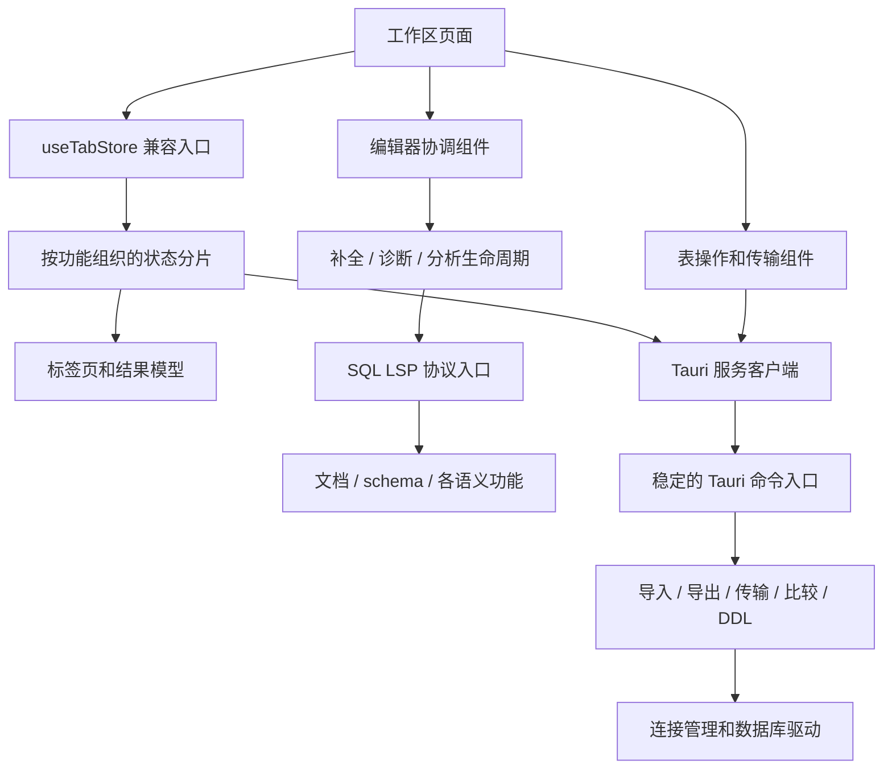

# 功能模块边界与大文件治理

本轮以本地 `source/dbx` 的功能划分为参考，先拆分已有职责，再在稳定接口上完善语义、数据与性能能力。参考版本：`8e7d4c387f0bff0b237112028cdb697078eacc44`。

## 1. 对应的 DBX 思路

- SQL：参考 `apps/desktop/src/lib/sql/semantic/README.md`，按文档、补全、引用、诊断等职责组织。
- 数据：参考 `crates/dbx-core/src/table_import.rs`、`table_export.rs`、`database_export.rs`、`query_result_export.rs`，分离导入、导出、数据库备份和格式处理。
- 客户端：参考 `apps/desktop/src/components/layout/QueryEditorSurface.vue` 的明确表面接口，以及 `components/transfer/DataTransferDialog.vue` 对选择、策略、任务加载和树组件的分工。
- 状态：参考 `apps/desktop/src/stores/queryStore.ts` 与 `lib/tabs/tabResultCache.ts`，将工作区状态与结果载荷的职责分开。磁盘结果缓存尚未实现。

参考源码只读。本轮主要迁移已有实现，不扩展数据库能力声明，也不改变数据库写入的确认流程。

## 2. 已建立的模块

| 模块 | 职责与入口 |
| --- | --- |
| `src/features/workspace-tabs/model/` | 标签页类型、身份、结果历史、草稿变更、关闭清理、编辑器视图状态等模型 |
| `src/features/workspace-tabs/state/` | 15 个 Zustand 状态分片；创建/关闭、项目文件、SQL 执行、结果历史、行修改、表元数据及各类分页独立实现 |
| `src/store/useTabStore.ts` | 组合状态分片，保留页面使用的 store 和原有公开类型、辅助函数 |
| `src/features/query-editor/model/createQueryCompletionProvider.ts` | SQL 补全生成和补全文档解析，保留请求版本与取消检查 |
| `src/features/query-editor/hooks/` | AI 行内补全、MongoDB/Elasticsearch 补全、编辑器诊断、键盘绑定、Elasticsearch 分析 Worker、SQL 编辑操作和拖入表引用 |
| `src/features/database-explorer/model/` | 侧栏展示/身份辅助函数、请求类型、批量元数据刷新与导出操作 |
| `src/features/database-explorer/ui/` | 连接、表、视图、例程、集合及其他 schema 对象渲染；分域菜单、远程数据库内容、弹窗和懒加载注册 |
| `src/features/table-data/model/` | 表结构操作、表导出、文件导入；显式接收表上下文和状态更新接口 |
| `src/features/table-data/useTableInspection.ts` | 元数据与 DDL 的只读加载和作用域隔离 |
| `src/features/table-data/ui/` | 表结构面板，以及文件导入、表传输和 MongoDB 文档操作弹窗 |
| `src/features/table-transfer/model/transferPolicy.ts` | 传输能力判断、对象清单与目标展示辅助函数 |
| `src/features/table-transfer/ui/` | 来源/目标设置、预览与确认、固定行高虚拟列表；沿用现有 UI 样式和交互 |
| `src-tauri/src/commands/table/` | 表命令的类型、能力策略、SQL 构造、导入、各类导出编码、跨库传输、数据比较、DDL 和测试 |
| `vendor/sql-lsp/src/server/` | 协议、文档、服务运行状态、补全、schema 解析、引用索引、诊断、代码修复、签名提示、语义标记和测试 |

### 依赖约束

1. 页面负责组合模块。新增 SQL 规则进入对应语义模块；新增文件格式进入导入或导出模块。
2. 状态分片通过共同的 `set/get` 访问完整状态，不创建第二份 store。跨分片动作通过 `get()` 调用现有动作。
3. 类型依赖使用 `import type`；功能代码直接导入所属模块，避免用大范围 barrel 导出掩盖循环依赖。
4. Rust 兄弟模块显式导入依赖。内部函数和字段最多开放到父模块；保留原有公共命令与数据类型入口。
5. 只读资源作用域保护不代表数据库写入已经取消。写入结果、事务提交和取消回执仍由后端确定。
6. Provider 注册、监听和 Worker 创建的清理逻辑与实现一起迁移；新的模块不能绕过文档身份或请求版本校验。

## 3. 文件大小约束

`npm run verify:module-size` 检查 `src`、`src-tauri/src`、`vendor/sql-lsp/src`，并已接入 `npm run build`。

- 新增 TS/TSX 文件最多 1,000 行，Rust 文件最多 1,200 行，包含测试。
- 现存超限文件记录在 `scripts/module-size-baseline.json`，不能继续增长。
- 迁移后应降低或移除原文件的基线；不能通过扩大基线代替拆分。
- 行数是回归保护。设计仍须按功能边界拆分，不以任意行数切块或 `include!` 拼回同一个模块。

## 4. 后续完善的边界

本轮并未消除所有历史大文件。`SchemaSidebar.tsx` 已移出主要对象渲染、菜单和弹窗，但仍保留元数据缓存、搜索加载、schema 对象分组与多个工作流状态；`QueryEditor.tsx`、`TableDataView.tsx`、`TableDataTransferDialog.tsx` 还保留较多页面协调状态。这些文件受到不增长约束，后续应按具体工作流继续缩小，尤其避免把大量 setter 变成长期的组件接口。

后续功能迭代可进入明确的所有者：

- LSP：统一作用域/投影模型，减少补全、引用、诊断之间的重复推导；补全复杂嵌套 SQL 和大文档的降级策略。
- 查询结果：在结果历史和分页分片之下增加载荷存储接口，再实现有配额和回收策略的磁盘缓存。
- 导入导出：在对应 Rust 模块补全全量查询流式导出、SQL 文件逐句执行及取消回执；UI 复用稳定的进度协议。
- 状态：传输设置、预检、执行与取消进一步建立明确状态转换，保持数据库回执的权威性。
- 性能：模块拆分本身不证明启动或切页变快。应单独测量打包桌面应用的冷启动、切页和长时间运行。

能力缺口的完整清单见 [DBX 对标审计](../dbx-modularity-performance-audit-2026-09-15.md)。

## 5. 拆分规模与验证

| 原入口 | 拆分前行数 | 当前入口行数 |
| --- | ---: | ---: |
| `src-tauri/src/commands/table.rs` | 27,993 | 90 |
| `vendor/sql-lsp/src/server.rs` | 10,693 | 35 |
| `src/store/useTabStore.ts` | 4,793 | 84 |
| `src/components/workspace/SchemaSidebar.tsx` | 11,538 | 5,904 |
| `src/components/workspace/QueryEditor.tsx` | 4,783 | 1,974 |
| `src/components/workspace/TableDataView.tsx` | 2,413 | 1,508 |
| `src/components/workspace/TableDataTransferDialog.tsx` | 2,372 | 1,371 |

这里统计的是入口文件；实现保留在功能模块中。85 个 store 动作经 TypeScript AST 归一化比较，函数体均与迁移前一致。

第一批拆分验证：

- 前端回归合计：84 个文件、461 项测试通过，覆盖编辑器、行内补全、标签页、查询取消、表格编辑、导入传输以及依赖 store 的工作流。Redis 导航用例首次在并发测试中超过 5 秒超时，单独使用原超时配置复测通过（测试本身约 3 秒）。
- LSP 全套：318 项测试通过。
- 表格后端：178 项测试通过，覆盖类型序列化、SQL 构造、格式读写、传输规划、取消和事务等；原测试完整迁移。
- `npm run build`：类型检查、文件大小检查、Vite 构建、启动入口与静态导入循环检查通过；Elasticsearch 与 CSV Worker 都生成独立资源。
- 未运行打包桌面应用的冷启动基准，也未进行外部数据库的真实导入/导出验收。本轮结果不能视为这些能力已完成。

## 6. 第二批：客户端继续拆分

新增 34 个生产模块和 1 个生命周期测试文件。本批没有继续修改 Rust/LSP 实现。

| 入口 | 本批开始 | 本批结束 |
| --- | ---: | ---: |
| SchemaSidebar | 11,538 | 5,904 |
| QueryEditor | 2,311 | 1,974 |
| TableDataView | 1,830 | 1,508 |
| TableDataTransferDialog | 1,502 | 1,371 |

- 导航树：连接、表、视图、例程、集合和 schema 描述对象各有独立渲染模块；菜单分为连接/数据库/schema，以及表导航、结构、传输。共享菜单仍只创建一份 Radix 根节点。
- 弹窗：连接分组、对象过滤、移除连接、传输与对象管理分开组合；原有动态导入路径和懒加载边界保留。
- 编辑器：`useEditorExecutionConfirmation` 管理待确认请求、替换和卸载清理、关闭后的焦点恢复；`useEditorChangePreview` 管理变更预览忙碌状态；`useBatchColumnSelection` 管理批量列会话和命令注册/释放。历史操作和状态栏分别进入 model 与 ui。
- 表格：结构面板与数据操作弹窗独立。传输的目标建表、预览、执行/取消分别有操作模块；预览身份、确认令牌和提交后回执的判断保留在动作中。
- 接口：复用 store 类型和子组件契约，菜单样式从共享常量导入，不再通过多层参数传递；尚未消除所有协调层的宽接口。

### 行为保护与验证

- 对本批迁移前后 90 个命名操作函数做 TypeScript AST 归一化比较，函数体全部一致。
- 修复拆分中发现的 React 回调边界问题：当前数据库必须直接返回 `null`，才能让目录树使用本地 schema 子树；不能用一个渲染为 `null` 的组件元素替代该信号。
- 前端回归去重后 89 个文件、403 项测试通过：功能模块组 69 文件/302 项，编辑器组 15 文件/77 项，客户端流程组 7 文件/29 项；其中确认生命周期和侧栏布局各重复覆盖一次。侧栏布局在修复上述回调问题后复测通过。
- 新增 3 项确认生命周期测试：新请求替换旧请求、卸载时结束等待、旧关闭帧不抢占新确认窗口焦点。
- `npm run build` 通过类型检查、文件大小约束、Vite 打包及静态导入循环检查；构建仍有第三方 PURE 注释和大 chunk 提示。
- 已降低四个入口的大小基线；本批新文件均低于 1,000 行，没有新增超限豁免。

这仍不是“整个客户端已充分模块化”：侧栏的加载与搜索协调、编辑器挂载和页面状态、传输设置与异步资源状态还可继续细分。本批未验证打包桌面冷启动、真实数据库传输或在线 AI 服务，也不以文件拆分证明页面性能提升。

## 7. 全量目标：服务契约与状态边界

完整范围和剩余工作见 [全量推进清单](./modularization-progress.md)。本批将 Tauri 类型入口从 2,391 行降为 286 行，元数据 store 从 2,574 行降为 15 行，连接 store 从 1,139 行降为 19 行。入口只保留组合或兼容导出，实现按领域进入 `services/tauri/types/`、`features/schema-metadata/` 与 `features/connections/`。

两个 store 的跨状态调用由 `store/workspaceDataStores.ts` 注入：连接操作只访问元数据的保存/恢复/清空快照方法；元数据加载只读取连接身份和连接列表。各自保留一个 Zustand 实例，独立运行时持有请求版本和进行中请求队列，避免静态循环与共享可变状态意外扩散。远程 SQLite worker 准备缓存仍是进程级缓存，保持原行为。

`npm run verify:workspace-store-boundaries` 检查组合入口可达的 59 个模块，验证不存在运行时导入循环、实现层不反向导入 store 入口；该检查已加入构建。它证明的是工作区状态模块边界，不代表整个项目的架构审计已经完成。

本批验证：244 个协议定义未变，34 个 store 动作在替换依赖访问后 AST 一致。扩大回归 24 文件/287 项与契约/实例隔离 9 文件/31 项通过，最终构建全部门禁通过。未修改或重新宣称 Rust/LSP、企业工作区的全量测试结果。

## 8. 设置、连接表单和客户端顶栏

| 原入口 | 拆分前 | 当前 |
| --- | ---: | ---: |
| `src/components/settings/SettingsDialog.tsx` | 4,711 | 323 |
| `src/components/connection/ConnectionForm.tsx` | 2,656 | 723 |
| `src/lib/appSettings.ts` | 1,365 | 32 |
| `src/components/AppBar.tsx` | 1,314 | 356 |

- `features/settings/model/`：配置类型、默认值、持久化数据归一化、启动外观缓存与设置导航。
- `features/settings/ui/`：各领域设置面板、共享字段、SQL 片段与 provider headers 编辑器。
- `features/settings/hooks/useAiSettingsController.ts`：AI 密钥状态、保存、清除、测试和关闭流程；凭证仍走既有服务，不增加新存储。
- `features/database-drivers/settings/`：驱动管理控制 hook、来源策略和 UI；运行健康轮询由 hook 创建和清理。
- `features/connections/model/createConnectionDraftActions.ts`：字段/URL、驱动切换、OIDC、SSH 跳板以及 worker 授权失效规则。驱动安装与 SSH 测试各有独立动作模块。
- `features/connections/ui/`：常规、SSH/SSL、高级选项、驱动可用性和外观选择。组件通过领域类型接收草稿和动作。
- `features/projects/`：项目身份规则、单一流程 hook、项目菜单、新建/删除弹窗和 GitHub 来源选择；`ProjectSwitcher` 组合这些模块。
- `features/workbench/ui/SettingsMenuItem.tsx`：顶栏菜单项；窗口控制和设置/更新弹窗的原有懒加载边界保留。

这四个旧大文件已移除大小豁免，剩余 70 项仍列在全量清单中。77 个迁移回调体经 AST 比较保持一致。此次调整保留已有交互与样式，不以模块变小证明真实桌面应用的启动或切页性能已提升。

设置与顶栏批次回归：23 个文件、140 项测试通过，覆盖设置持久化、AI 配置、连接表单、驱动管理、工作台入口、项目创建/删除和更新流程。

本批最终 `npm run build` 通过 TypeScript、文件大小、工作区状态边界（64 个可达模块）、Vite 与产物静态循环检查。构建保留既有第三方 PURE 注释和大 chunk 提示；尚未测量真实桌面冷启动或切页性能。

## 9. 数据表格与值编辑器

| 原入口 | 拆分前 | 当前 |
| --- | ---: | ---: |
| `src/components/workspace/DataGrid.tsx` | 3,469 | 718 |
| `src/components/workspace/ValueEditorDialog.tsx` | 1,185 | 618 |

数据表格的运行流程进入 `features/data-grid/hooks/`，按列布局/格式、列搜索、视觉行映射、选区聚合、单元格绘制、编辑与粘贴、值详情、复制导出、菜单及主题划分。`useGridContextMenu` 组合动作与菜单条目，内部持有菜单和悬停状态；列搜索、值详情目标、恢复标记及工具栏观察器由各自 hook 管理。入口保留一个 DataEditor、共享的结果/选区上下文和公共 ref，不复制数据载荷或创建新的 tab store。

`features/value-editor/` 分离模型类型、草稿/预览 hook、提交动作、JSON 树遍历和虚拟列表。`flattenJsonTreeRows` 保留原入口兼容导出，迭代遍历的队列上限、稳定 pointer 路径、截断标记及虚拟列表超前渲染范围保持不变。

本批验证：89 个回调/缓存定义、11 个辅助函数和 12 处 effect/ref 注册与迁移前 AST 一致；23 文件/131 项测试通过，包括 4 项新表格组合测试和已有 JSON、XML、图像预览、只读/暂存语义、宽 JSON 树边界测试。组合测试替换 Glide 的画布层，检查真实 DataGrid 输出给画布的事件、行列与单元格数据；没有据此声称真实桌面滚动、绘制或冷启动已优化。两个历史大小豁免已移除，剩余全量清单为 68 项。

数据表格批次最终 `npm run build` 通过类型检查、1,402 个文件的大小检查、工作区状态边界检查、Vite 与产物静态循环检查；参考 `source/dbx` 工作区保持干净。既有第三方 PURE 注释与大 chunk 提示仍存在。

## 10. LSP 客户端同步与项目文档会话

`src/components/lsp/LspConnectionSyncer.tsx` 从 1,322 行降为 145 行。`features/lsp-sync/model/` 管理快照比较、策略和共享类型；`hooks/` 管理 SQL 输入防抖、连接能力解析及同步调度/清理；`runtime/` 管理 schema 身份和对象 URI、catalog 发现、表元数据缓存、分批配置发布及项目文档会话。

元数据缓存与代次计数由同步 hook 单独持有。项目文档改由 `createProjectDocumentSync` 实例持有记录及串行 RPC 队列：关闭时立即推进代次并清空已记录文档，等待中的新打开完成后补发关闭；旧代次不再写回文档记录。传输失败不会毒化队列；后续请求仍可执行。配置发布在文档同步后再次检查是否过期，防止旧工作发布完成状态。

先用延迟 `didOpen` 复现旧实现关闭后仍保留文档的问题，再增加会话替换、排队请求取消、打开失败恢复、更新期间关闭以及组件移除项目 root 的回归。17 文件/84 项测试与完整构建通过；12 个快照、身份、catalog 和表元数据定义经 AST 对比一致。此验证不代表 SQL parser 功能或真实数据库性能已经全部完成，剩余 67 个历史文件仍记录在全量清单。

## 11. 查询语言的分析、补全与编辑器适配

| 原入口 | 拆分前 | 当前 |
| --- | ---: | ---: |
| `src/lib/sqlAnalysis.ts` | 1,074 | 22 |
| `src/lib/mongodbCompletion.ts` | 1,256 | 20 |
| `src/lib/elasticsearchConsole.ts` | 2,654 | 50 |

原入口保留 61 个显式公共导出；36 个实现模块位于 `features/query-languages/`，最大的候选目录为 563 行。实现层直接引用领域模块，不反向依赖兼容入口、UI、store 或运行时服务。

- SQL：词法规则是底层依赖；占位符和噪声屏蔽、语句切分、关系/CTE 识别、schema 上下文和元数据影响各自独立。标识符与偏移量处理保持原逻辑，本次没有扩展 SQL parser 语法。
- MongoDB：JSON 扫描和上下文分析独立，shell 上下文将参数包装后直接交给 JSON 分析；总入口只选择语法。这样不再形成“总入口 → shell → 总入口”的静态循环。JSON/shell 候选目录、条目生成、自动触发与语言注册分别管理。
- Elasticsearch：请求解析与导航、注释屏蔽、变量编译、诊断、格式化、上下文分类、HTTP/DSL 目录、版本规则、候选生成、schema 字段过滤、行内提示和 Monaco 注册分离。后台分析 Worker 直接依赖请求与诊断模块，不通过导出编辑器注册的兼容入口。
- 生命周期：语言注册仍由已有 Monaco 实例上的注册记录持有，重复注册与旧版本释放逻辑保持不变；纯分析模块不引入新的全局状态。

195 个原样迁移定义经 AST 对比一致。MongoDB JSON 分支的语句也与原分支一致，shell 参数只改变被调用的分类器；20 文件/171 项回归通过。构建新增 `verify:query-language-boundaries`，检查 36 个模块的运行时循环以及与兼容入口、UI/store/service、Monaco 注册的方向约束。通过临时导入验证了循环、静态/动态反向入口、UI 与注册层依赖均会被拒绝。

三个历史大小豁免已移除，全量清单还剩 64 项。本次结果不代表 DBX 功能对标、SQL LSP、真实数据库或桌面性能的最终验收。

查询语言批次最终 `npm run build` 通过 TypeScript、1,451 个文件的大小检查、64 个工作区状态可达模块与 36 个查询语言模块的依赖检查、Vite 及产物静态循环检查。既有第三方 PURE 注释和大 chunk 提示仍存在。`source/dbx` 保持干净；本批没有进行真实桌面性能基准或外部数据库验收。

## 12. 数据库驱动目录与查询安全规则

| 原入口 | 拆分前 | 当前 |
| --- | ---: | ---: |
| `src/lib/databaseDialect.ts` | 1,776 | 71 |
| `src/lib/querySafety.ts` | 1,149 | 7 |

`features/database-drivers/model/` 新增 28 个模块。13 个内置驱动描述分别存放在 `profiles/`，由 `builtinProfiles` 聚合；复制与归一化、协议兼容身份、未知驱动回退、连接默认值、命名空间选择、类型与自增规则、标识符引用、关系对象规则及编辑器/LSP 路由各有独立模块。

`createDatabaseDriverCatalog` 工厂在一个闭包中持有能力缓存、已注册 profile、外部来源键和权威 driver 集合。`runtimeCatalog` 是应用唯一组合入口，创建一个目录实例并保持原 API；测试可创建独立目录。外部安装有效性、能力门禁、别名、保守回退和输入复制逻辑不变。既有 `effectiveDriverOrigin` 直接引用目录 API，不再反向引用兼容入口。

`features/query-safety/model/` 新增 9 个模块。总分类器选择数据库语义；SQL 函数策略、语句扫描和读写判断分开，MongoDB 命令与 shell、Redis、Elasticsearch 和 JSON 搜索分别管理。该层保持纯计算，既有安全扫描器的边界不因与编辑器工具同名而被合并。

127 个迁移定义及 13 份内置配置经 AST 对比一致；60 个原公共导出完整保留。新增 3 项测试验证目录实例隔离、输入数组复制以及兼容/领域 API 使用同一应用实例。扩大回归 23 文件/192 项通过，覆盖连接表单与状态、驱动来源与安装、方言能力、namespace、LSP 同步、SQL 分析与查询执行。

`verify:query-language-boundaries` 现在检查查询语言、查询安全和驱动模型，共 77 个模块。类型引用不作为运行时循环；实现层不能加载兼容入口、其他运行时领域、UI、store 或服务。本次先通过此门禁发现旧驱动来源模型的反向引用，再改为直接目录依赖。两个历史豁免已移除，完整清单仍有 62 项；没有将此次模块化作为真实数据库能力或桌面性能的最终验收。

驱动与安全规则批次最终 `npm run build` 通过：TypeScript、1,489 文件大小门禁、91 个工作区状态可达模块、77 个查询领域模块、Vite 与产物静态循环检查。第三方 PURE 注释和大 chunk 提示仍存在；`source/dbx` 保持干净。本批未执行真实数据库或打包桌面性能验收。

## 13. AI 助手会话与侧栏组合

| 原入口 | 拆分前 | 当前 |
| --- | ---: | ---: |
| `src/hooks/useAssistantAgentSession.ts` | 2,683 | 380 |
| `src/components/workspace/AssistantSidebar.tsx` | 2,368 | 869 |

`features/assistant-session/` 的 20 个模块分离模型状态、事件归并、数据恢复、会话运行时与 React 生命周期。事件 broker 保留一个应用实例及既有缓冲上限；跨会话缓存由运行时模块持有，通过明确操作访问；快照队列独立封装串行写入及失败追踪。入口持有跨流程使用的状态/ref，恢复、持久化、命令、文件审阅各自有 hook，文件写入去重集合归审阅 hook 所有。

`features/assistant-panel/` 的 11 个模块分离 provider 身份/状态、会话身份/内容版本、选中会话持久化、工具 manifest、prompt 组合、CLI 安装/授权/probe 生命周期、提交动作、文件审阅事件与展示组件。入口负责 store 选择、上下文计算及组合；展示组件沿用原有子组件与 JSX。控制层按需要使用 `Pick<AssistantAgentSession, ...>`，并引用 CLI setup store、i18n 和快照队列的契约，避免复制私有类型和翻译 key 联合。

取消、审批与澄清仍使用回合绑定的 workspace；恢复的快照与事件日志仍走原先的筛选和重放；文件撤销继续检查目标 root 和修订版本。73 个辅助函数、51 个回调和 21 处 effect 经 AST 归一化验证一致，缓存的直接 Map 访问替换为等价访问器。展示 JSX 按 React 文本空白规则归一后相同，16 个公共导出完整保留。

回归覆盖 13 文件/115 项，通过扩大回归与侧栏整文件复测完成验证。扩大运行时，侧栏的 2 项模型交互用例触发原有 5 秒超时；构建结束后单独复测该文件，56 项全部在原超时配置下通过。其余 12 文件/59 项在扩大回归中通过。

完整构建通过 TypeScript、1,520 个文件的大小检查、91 个状态可达模块、77 个查询领域模块、Vite 和产物静态循环检查。第三方 PURE 注释及大 chunk 提示仍存在；`source/dbx` 保持干净。本批没有进行真实桌面性能或外部 CLI/在线 AI 验收。两个大小豁免已移除，全量清单仍有 60 项。

## 14. AI 工具定义、适配器与测试分组

| 原入口 | 拆分前 | 当前 |
| --- | ---: | ---: |
| `src/ai/tools/coreTools.ts` | 1,916 | 202 |
| `src/ai/tools/defaultRegistry.ts` | 1,310 | 21 |
| `tests/frontend/ai-integration.test.ts` | 1,301 | 14 |

`ai/tools/core/` 的 13 个模块按领域组织工具定义、输入 schema、校验和适配器调用，共用基础输入读取器。`coreTools` 保留 20 个工具组的组合、扩展合并与可用性描述；32 个工具定义的内容和顺序保持不变。

`ai/tools/workspace/` 的 16 个模块负责工作区 context、连接/namespace 目标、文件、编辑器快照与 patch、元数据、查询执行、计划摘要、结构化修改和 LSP。8 个工厂以 `Pick<AiToolAdapters, ...>` 声明各自提供的方法；`createWorkspaceAdapters` 按原顺序组装全部 21 个适配器。工具层的权限、审批及输入检查和适配器的受管连接、能力、修订与取消检查保留原逻辑。

`tests/frontend/ai-integration/` 含 6 个 `.cases.ts` 测试组及一个 fixture 模块。原 `.test.ts` 入口统一注册全部测试组，既有针对该文件的测试命令仍运行整组用例。fixture 在调用时创建独立 registry/context；测试顺序和断言不变。

本批 112 个定义、21 个适配器属性、6 组测试及 4 个 fixture 的 AST 对比一致，7 个公共导出完整保留。新增构建门禁检查 39 个 AI 工具模块的内部循环、定义与工作区层的直接互引、实现层反向导入组合入口；其他模块间的循环继续由全局产物检查覆盖。5 个临时探针验证拦截规则后已清理。

依赖读取、类型擦除与循环检测抽到 `scripts/lib/runtime-import-graph.mjs`，供状态、查询领域和 AI 工具门禁复用。4 项 Node 测试验证静态/动态导入、路径解析、类型引用擦除、文件发现和循环报告；原状态与查询门禁的范围保持为 91 / 77 个模块。

前端扩大回归 10 文件/94 项、4 项依赖图测试及完整构建通过。集成测试拆分后再次通过 1,556 文件大小门禁。构建仍有第三方 PURE 注释和大 chunk 提示；`source/dbx` 保持干净。三个历史大小豁免已移除，全量清单还有 57 项；本批结果不代表真实数据库、外部 CLI/在线 provider 或桌面性能已完成验收。

## 15. 助手输入框与模型控制

| 原入口 | 拆分前 | 当前 |
| --- | ---: | ---: |
| `src/components/workspace/assistant/AssistantPromptBox.tsx` | 1,135 | 317 |
| `src/components/workspace/assistant/AssistantModelControl.tsx` | 1,191 | 225 |

`features/assistant-composer/` 的 22 个模块分为 `model/`、`hooks/`、`ui/`。模型层提供公共输入/模型契约、斜杠词元、上下文摘要、模型选项归一化和推理强度规则；UI 层分别负责上下文预览、表/附件引用、schema/模式/命令菜单、模型面板、选项列表、推理轨道与状态图标。组件 props 引用公共契约的 `Pick`，没有复制翻译 key 联合或生成机器绝对路径类型。

`useAssistantPromptInteraction` 独占 textarea ref、IME 标记、当前词元、候选索引和关闭状态；输入框入口持有模型按钮 ref 与弹层开关，协调命令弹层和模型弹层。输入 DOM 在中文输入法组合期间仍拥有自身值，提交保留 `isComposing` 与 WebKit 229 保护，接受命令仍只替换当前光标的词元并恢复焦点/选区。上下文设置继续在运行中锁定。

`useAssistantModelPanel` 独占搜索、自定义模型、快捷/高级视图与展开菜单状态，提供模型/推理/速度切换动作。目录去重、搜索阈值、100 项渲染上限、保留选中模型、能力变化时归默认选项的规则保持原样。Ultra 权限确认继续归模型控制入口负责；Radix `asChild` 下的实际按钮、焦点恢复与键盘路径保持不变。

迁移核对覆盖 27 个辅助函数、12 个回调、7 处 effect、7 个 textarea 事件处理器和 3 组 JSX；按 React 文本空白规则归一化后相同。5 个原公共导出保持原路径。24 个模块（含两个原入口）的静态核查未发现内部运行时循环、实现反向加载旧组件入口或模型层依赖 UI/hook。两个历史大小豁免已移除，新模块最大 358 行；全量清单仍有 55 项。

前端回归 9 文件/90 项通过，覆盖完整助手侧栏、provider 命令列表、上下文预览、模型边界、模式、附件、表引用、聊天上下文和工作区入口。完整构建通过 TypeScript、1,578 文件大小门禁、91 / 77 / 39 个状态/查询/AI 工具模块依赖检查、Vite 和产物静态循环检查。第三方 PURE 注释与大 chunk 提示仍存在；`source/dbx` 保持干净。本批未进行真实数据库、外部 provider 或打包桌面性能验收。

## 16. 查询编辑器组合、状态所有权与展示

| 原入口 | 拆分前 | 当前 |
| --- | ---: | ---: |
| `src/components/workspace/QueryEditor.tsx` | 1,974 | 935 |

新增 12 个 `features/query-editor/hooks/` 模块分离连接能力与目录发现、Elasticsearch 服务版本、文档写入、防抖提示、应用事件、格式化、主题/挂载、SQL 文件拖入、文档元数据刷新、SQL 补全和语言服务组合。已有执行、事务、文件导入、LSP 生命周期、补全/悬停/诊断 provider 仍保留各自的专用实现，入口组合这些接口。

文档内容 hook 持有待写内容与计时器，切换标签或卸载时仍先写回原标签；提示 hook 持有清理计时器；连接能力和服务版本各自保留取消标记，防止旧请求发布结果。SQL 补全 hook 持有批量列候选会话，语言服务 hook 持有行内补全的缓存、AbortController、监听集合与状态，并直接订阅对应 AI/项目配置。MySQL 例程诊断缓存归自己的 hook，元数据版本和完成后重触发逻辑归刷新 hook。共享编辑器、动作和视图引用仍由入口协调。

`QueryEditorCommandBar`、`QueryEditorPatchReview` 与 `QueryEditorSurface` 分离工具栏、补丁审阅和 Monaco/差异/图片展示，最大 359 行。当前语句的 pointer-down 选区快照、文件保存/加载、补丁修订校验、计划比较的取消信号、文本范围导航及只读差异模型路径保留原行为。展示与 hook 契约引用 `TabData`、`AppSettings["editor"]` 等公共类型，避免展开复制设置对象。

`connectionCatalogDatabaseName` 从树组件移到 `features/connections/model/catalogDatabase.ts`，编辑器和 3 个 Explorer 调用方直接依赖模型；旧树组件保留兼容导出与 PostgreSQL 包装函数。显式 URL、数据库字段、旧 URL、驱动默认值的解析优先级以及文件型驱动处理保持不变。

191 个变量初始化、13 处 effect、展开后的 JSX 与目录规则通过 AST 归一化比较（类型的 import 限定引用归一为同一公共类型）。本次检查的 21 个相关模块没有局部运行时循环，新 hook 不反向依赖查询入口 barrel 或组件。新增 6 项生命周期测试覆盖连续输入合并、标签切换写回、卸载清理、服务版本晚到/卸载和连接能力响应隔离。QueryEditor 大小豁免已移除，全量清单仍有 54 项。

本次门禁核查进一步发现，`createQueryCompletionProvider` 经总导出入口依赖 `useCachedSqlCompletionSource` 内的纯函数。缓存补全的范围、候选、类型和请求构造现归 `model/cachedSqlCompletion.ts`；hook 从 482 行降到 48 行，只负责稳定工厂、当前配置引用和缓存生命周期，旧 7 个公共导出保留。19 个迁移定义及 5 个直接导入模块的实现体经 AST 比较一致。本批最终新增 17 个生产模块，最大 448 行。

新增 `verify:query-editor-boundaries` 已接入构建，检查 78 个查询编辑器模块：运行时循环、反向依赖总入口/组件、模型依赖 hook，以及 model/hook 依赖 UI。它通过类型擦除后读取依赖，包含字面量动态导入。5 类临时探针分别验证总入口、组件入口、model→hook、动态 UI 导入和内部循环的拒绝行为，随后清理并通过门禁；其他领域的外部依赖仍由已有门禁和全局产物检查覆盖。

最终回归 56 文件/288 项全部通过（包含新增 6 项生命周期用例）；依赖整理后已重复运行该范围。最终完整构建通过 TypeScript、1,596 文件大小门禁、91 / 77 / 39 个状态/查询领域/AI 工具模块检查、新增 78 模块查询编辑器门禁、Vite 和产物静态循环检查。第三方 PURE 注释和大 chunk 提示仍存在；`source/dbx` 保持干净。本批未进行真实数据库、在线 provider 或打包桌面性能验收。

## 17. 表数据视图与数据传输会话

| 原入口 | 拆分前 | 当前 |
| --- | ---: | ---: |
| `src/components/workspace/TableDataView.tsx` | 1,508 | 927 |
| `src/components/workspace/TableDataTransferDialog.tsx` | 1,371 | 821 |

本批新增 17 个模块，最大 290 行。表数据侧分离导入文件选择、导入事件路由、任务进度、历史报告、驱动能力、视图加载/切换、分页与文档筛选动作和工具栏。已有导入、导出、结构修改动作工厂及数据检查资源继续复用。文件选择逻辑是普通动作工厂，不使用 React hook 名称。

传输侧分离源表/对象清单、历史报告、单表/批量/建表请求、进度订阅、外部驱动资格、目标数据库/schema/表元数据、步骤导航和侧栏。弹层统一持有跨配置、预览、确认、执行流程使用的会话状态；加载 hook 各自持有加载状态，资格和报告 hook 持有异步结果，导航 hook 持有步骤与锚点。目标元数据通过明确的写入回调更新会话配置和使旧预览失效，不额外创建 store。

源与目标请求仍检查取消标记；进度按 transferId 或任务身份路由，延迟完成的监听注册仍在关闭后释放；请求及其序列化 key、计划令牌匹配、确认与取消条件保持原样。只读、原生文档和跨库操作限制，以及分页后的源行引用没有改变。254 个变量初始化、22 处 effect、两组展开后的 JSX 通过 AST 归一化比较。

新增 5 项生命周期回归分别覆盖：关闭期间延迟注册的监听清理、旧 transferId 回调隔离、旧 schema 清单晚到、readiness 晚于关闭时不再请求元数据，以及外部连接列表变化后的能力结果隔离。两个历史大小豁免已移除，全量清单仍有 52 项。

新增 `verify:table-data-boundaries` 接入构建，检查 33 个表数据/传输模块的内部运行时循环、实现反向导入自己的组合入口、模型依赖 hook，以及 model/hook 依赖 UI。类型引用擦除后再建依赖图，字面量动态导入也参与检查。UI 可以组合其他功能入口，但不能反向依赖自身入口。

5 类临时违规探针验证组合入口、跨功能 UI、model→hook、动态 UI 导入和内部循环的拦截，随后清理并复验通过。原有 7 个公共导出保持原路径。最终回归 21 文件/102 项通过，覆盖表视图与传输弹层、导入解析/Worker、导出格式、元数据缓存、受作用域异步资源、任务状态与传输选择/策略。完整构建通过 TypeScript、1,614 文件大小门禁、已有 91 / 77 / 39 / 78 个模块边界检查、新增 33 模块表数据门禁、Vite 及产物循环检查。第三方 PURE 注释与大 chunk 提示仍存在；`source/dbx` 保持干净。本批不作为真实数据库导入导出或桌面性能的最终验收。

## 18. 数据库侧栏动作、加载与节点展示

`SchemaSidebar.tsx` 从 5,904 行降到 1,581 行。本批新增 35 个生产模块，最大 968 行，没有增加大小豁免。侧栏入口仍负责跨模块组合、共享弹窗状态与可见目录协调，尚未低于 1,000 行，因此保留在全量待办中并把原大小基线收紧到当前行数。

对照本地 DBX（`8e7d4c387f0b`）的 `SidebarTreeRuntimeHost.vue`、`useSidebarDataOpenRuntime.ts` 和 `sidebarRuntimeDecomposition.test.ts`，将节点展示、目标绑定、数据打开、对象变更、传输和后台加载分开。采用职责边界，不把 Vue 运行时直接移植到 React。

- `model/createExplorer*` 分离连接创建/复制/删除、表打开、集合查询/变更、schema 变更、对象 DDL、传输/比较、关系图、刷新和树定位动作。动作仍使用节点对应的连接、数据库与 schema；没有把非活动连接的操作改绑到全局活动连接。
- `useExplorerWorkspaceData` / `useExplorerTabActions` 组合原有 store 订阅；`useExplorerTreePreferences` 持有项目范围选择、展开、分组、过滤、排序和虚拟滚动状态。连接行虚拟化的启用条件、滚动观察器释放及过滤规则保留。
- `useExplorerCapabilities` 独占驱动能力请求结果，保留连接/包版本变化时的取消标记。`useExplorerExpandedMetadata` 持有补充对象描述、所属 schema 与加载状态，向手动刷新动作提供明确的更新接口。普通表、函数和集合仍使用唯一 schema store。
- namespace 初始加载、可见 schema/数据库偏好恢复、远程目录重置、展开对象加载、折叠目录搜索和对象定位分别由生命周期模块负责。搜索请求代次归 `useExplorerCatalogSearch`，远程目录的请求 ID/上下文版本仍由侧栏协调并传给相应动作和 hook。旧连接/schema 请求的失效检查、防抖与清理保持原样。
- `createSchemaObjectsRenderer` 绑定节点数据与动作，组合已有的表/视图/例程/集合/描述对象 renderer；`SchemaObjectsTree` 展示目录节点。`ExplorerSidebarView` 与 `ExplorerSidebarDialogs` 分离侧栏外壳、树容器和弹窗组合，公共 props 契约独立存放。原有 Radix `asChild` DOM 和非活动 PostgreSQL 分支的直接 `null` 保留。
- DOM 树遍历与焦点辅助方法进入 `runtime/explorerTreeDom.ts`，原 UI 路径保留三个兼容导出；新的选择 hook 直接依赖 runtime。目录数据库名解析直接使用 connections 模型。

迁移核对：原侧栏 553 个变量初始化、19 处 effect，以及展开三个新展示组件后的 JSX，经类型引用和 React 文本空白归一化后保持一致。公共 `SchemaSidebar` 入口保留。新增 6 项生命周期测试覆盖旧连接能力结果、取消选择、折叠不加载、schema 切换后的旧结果、折叠后的待返回结果及手动缓存模式。扩大回归 39 文件/202 项通过。

`verify:database-explorer-boundaries` 已接入构建，覆盖 94 个模块（含组合入口），拒绝内部运行时循环、实现反向依赖旧侧栏入口、模型/hook 加载 UI，以及模型依赖 hook；同时检查字面量动态导入。5 个临时反向导入/循环探针均被拒绝，清理探针后正常图通过。

本批是模块化推进，不代表 CLI、AI provider、DBX LSP 功能差距或打包桌面性能已完成验收。剩余 52 个历史大文件仍按全量清单推进。

本批最终构建通过 TypeScript、1,650 文件大小门禁、91 / 77 / 39 / 78 / 33 / 94 个状态/查询/AI/编辑器/表数据/Explorer 模块依赖检查、Vite 和产物静态循环检查。第三方 PURE 注释与大 chunk 提示仍存在；`source/dbx` 工作区保持干净。

## 19. 侧栏状态所有权与功能组合

`SchemaSidebar.tsx` 从 1,581 行进一步降到 764 行，移除其历史大小豁免。本批新增 8 个生产模块，最大 299 行；全量待办还有 51 项。

- `useExplorerCatalogVisibility` 持有 schema/数据库可见性状态、偏好身份、显示列表与切换动作，组合已有恢复 hook。项目/连接/驱动范围的存储键、当前 schema 必须可见、数据库目录独立筛选、去重和忽略旧连接发现结果等规则保留。
- `useExplorerSourceContext` 统一活动数据源、能力、目录发现、设置、对象类型标签与例程缓存失效。`useExplorerRemoteCatalogState` 持有远程目录快照、刷新请求、请求 ID 和上下文版本；刷新与搜索仍通过显式接口使用同一组引用。
- `useExplorerObjectWorkspace` 持有表/视图编辑弹窗目标、DDL 内容和状态，组合表操作与对象动作。`useExplorerDataWorkspaces` 持有传输、比较、关系图及快照的请求/目标状态，组合已有准备动作；`useExplorerSqlImport` 负责 SQL 导入与元数据刷新的连接规则。
- `createExplorerConnectionMetadataLookup` 分离活动 schema store 与非活动连接快照的读取策略。
- `ExplorerSidebarPresentation` 组合 schema 菜单、对象树、连接树与侧栏视图，自己持有悬停、schema 选择器、对象成员展开和引用点击抑制状态。props 从既有组件/renderer 契约推导；重复字段只选择一份来源类型，各 renderer 的实际调用仍逐项接受类型检查。入口通过各职责模块的返回对象组合，避免重复展开成百上千行字段转发。叶节点仍使用原有 renderer 和 DOM，普通侧栏重渲染不会重建该组件类型。

迁移核对覆盖 144 个变量初始化与 1 处 effect；3 个 renderer 和侧栏视图共 394 处参数绑定逐项保持原值。核对包含按职责返回对象的展开与展示组件私有状态，未用“新增 props 大致相同”代替字段检查。新增 5 项目录偏好测试，覆盖归一化/持久化、当前 schema 保留、连接与项目切换、数据库筛选和取消活动连接时的清理；5 文件/15 项初步侧栏回归通过。

Explorer 依赖门禁自动扩大到 102 个模块，继续检查模型、生命周期与 UI 边界及内部循环。此批移除一个大文件豁免，不代表其余客户端、Rust、LSP 或企业模块已完成，也不代表真实数据库、外部 AI/CLI 或打包桌面性能验收。

本批最终前端构建通过 TypeScript、1,659 文件大小门禁、91 / 77 / 39 / 78 / 33 / 102 个状态/查询/AI/编辑器/表数据/Explorer 模块边界检查、Vite 和产物静态循环检查。第三方 PURE 注释与大 chunk 提示仍存在。

最终扩大回归 40 文件/207 项以单 worker、关闭文件并行的方式通过，沿用默认 5 秒超时。之前并行运行的两份侧栏文件有 3 项超时，串行整组未复现；未把资源竞争直接认定为原因。连接/发现结果测试夹具补齐公共模型必填字段，两份生命周期/可见性测试的语义类型检查通过。`source/dbx` 保持干净。

## 20. 关系图画布、持久化与展示

`SchemaDiagramView.tsx` 从 1,996 行降到 413 行；新增 21 个生产模块，最大 328 行。移除关系图入口的历史大小豁免，全量待办剩余 50 项。

- `useDiagramLayout` 持有筛选条件并派生布局、区域边界和关系索引；完整布局仍用于隐藏关系定位。`useDiagramViewport` 持有缩放、可见窗口、动画帧和尺寸观察器，保留原有视口分桶、额外渲染范围及清理规则。
- `useDiagramCanvasPersistence` 独占加载代次、保存队列、每个标签的最新快照与加载/保存状态。加载期间的用户编辑、已有撤销历史、旧标签结果失效、450ms 防抖和关闭前保存规则均保留；画布历史的权威状态仍在 tab store。
- `useDiagramHistory` 负责撤销/重做快捷键和已删除区域选择的清理，保留输入框及编辑弹窗的快捷键保护。`useDiagramExport` 负责 SVG、PNG/JPG、DBML 导出选项和栅格导出状态。
- 三个动作模块分别负责关系导航、区域编辑和便签编辑。入口只组合共享编辑状态、store 与功能模块；动作在原来的有效标签/快照检查之后创建，hook 保持无条件调用。
- Header、Toolbar、AreaToolbar、AreaMenu、Inspector、Dialogs、WorkspaceCanvas、RelationNode 和 Edges 分为展示组件。结构化草稿继续按需加载；Radix `asChild` 的直接 DOM 子节点与原有事件绑定保留。

此划分沿用本地 DBX 将图状态/算法放在 `lib/diagram`、节点和 Inspector 放在 `components/diagram` 的职责分离思路；没有引入第二套图状态。DBX 参考仍为只读。

迁移核对覆盖原有 171 个变量初始化、9 处 effect、展开后根 JSX 和 9 个辅助函数/组件；归一化类型引用、等价导入路径与 React 文本空白后未发现差异。新增 6 项持久化生命周期测试，覆盖标签切换、加载期间编辑、已有撤销历史、卸载保存、防抖清理、写入串行/失败恢复及旧保存状态隔离。扩大回归 15 文件/70 项通过。

新增 `verify:schema-diagram-boundaries` 并接入构建，覆盖 31 个模块（新功能模块、现有画布算法/存储和公共入口）。禁止实现反向依赖入口、模型依赖 hook、模型/hook 加载 UI 与内部运行时循环，字面量动态导入同样参与。5 类违规探针均被拦截，清理后正常依赖图通过。

关系图批次最终 `npm run build` 通过 TypeScript、1,681 文件大小门禁、全部依赖边界检查、Vite 和产物静态循环检查。新增生命周期测试的语义类型检查也通过。既有第三方 PURE 注释与大 chunk 提示仍存在；`source/dbx` 保持干净。本批没有进行真实数据库、外部 CLI/AI provider 或打包桌面性能验收。

## 21. 工作台启动、窗口交互与结果展示

`pages/workspaceRuntime.tsx` 从 1,310 行降到 426 行，新增 12 个生产模块，最大 310 行，移除工作台入口的大小豁免。全量历史大文件清单剩余 49 项。

- `WorkspaceStartupHydration` 负责首帧后恢复设置/项目/连接、空闲时加载驱动目录，以及窗口重新激活时读取设置。原来的 disposed 标记、动画帧/空闲回调/定时器和事件监听清理均保留。
- 数据库搜索、命令面板和查询历史同步分别由三个 Deferred 组件管理首次激活或空闲挂载。其动态导入放在所属组件模块；其他工作区视图的 lazy 声明集中到 `WorkbenchLazySurfaces`，没有改成静态加载视图。
- `useWorkbenchSessionLifecycle` 管理项目 SQL 加载、无查询标签时重置拆分组、结果出现时打开面板。`useWorkbenchSurfaceEvents` 管理工具窗口事件和启动意图。`useWorkbenchWindowNavigation` 独占 Vim 窗口前缀状态、900ms 超时和监听器生命周期。
- 窗口尺寸拖动动作和侧栏展示组合分别独立。`WorkbenchQueryResults` 负责结果运行记录、固定/关闭、多个结果、Explain Plan、错误和结果内容；原有焦点、尺寸和事件处理保留。公共页面入口仍负责 store 订阅和工作台组合。

迁移核对覆盖 128 个变量初始化、13 处 effect/layout effect、展开后的根 JSX 和 7 个原有辅助组件。整理导入期间的延迟加载误改被核对及渲染测试发现并恢复；最终迁移核对无差异。

新增 `verify:workbench-boundaries` 接入构建，覆盖 14 个工作台模块和入口，防止反向依赖入口、模型依赖 hook、模型/hook 加载 UI，以及内部运行时循环；动态导入参与检查。5 类临时违规探针均被拒绝，清理后正常依赖图通过。

工作台批次回归 6 文件/35 项通过，包含新增 6 项生命周期测试：首帧前取消、恢复期间卸载、空闲回调取消、定时器/焦点监听清理、Vim 窗口前缀超时与卸载清理。最终 `npm run build` 通过 TypeScript、1,694 文件大小检查、全部依赖边界检查（含新增 14 模块工作台检查）、Vite 和产物静态循环检查。既有第三方 PURE 注释及大 chunk 提示仍存在，`source/dbx` 保持干净。真实数据库、外部 CLI/AI 和打包桌面性能验收仍独立跟进。

新增工作台生命周期测试的语义类型检查通过；测试 mock 的动画帧取消函数使用显式函数签名。

## 22. 远程数据库目录的加载与树展示

`PostgresRemoteDatabaseContents.tsx` 从 1,294 行降到 150 行，新增 10 个生产模块。树的展开/选择、元数据加载、目录定位与刷新分别由三个 hook 管理；关系节点、对象成员节点和 schema 目录分别展示，类型与展示辅助方法独立。树仍使用原有 Explorer scope、连接/数据库 namespace 和展开状态存储，保留多选、键盘操作、目录虚拟列表、激活模式及原有公共入口。

纯迁移阶段核对 91 个变量初始化、5 处 effect、展开 renderer 后的根 JSX 与 3 个辅助函数，均保持一致。随后修复对象成员请求缺少作用域检查的问题：加载模块新增成员请求代次，成功与失败返回都检查挂载状态、连接/数据库上下文版本和同对象请求版本，旧请求不能覆盖新目录。表清单原有去重与请求代次保护保留。

新增 6 项生命周期测试，其中 3 项先复现旧数据库成员覆盖、旧连接错误污染、同对象旧失败覆盖新结果，再在修复后通过。另 3 项覆盖表清单去重、跨数据库加载隔离和卸载后的宿主回调隔离。原有远程目录视图测试与新测试合计 13 项通过。

Explorer 边界检查扩大到 113 个模块并纳入远程目录入口，禁止远程目录实现反向导入自己的公共入口；宿主侧栏继续通过公共入口组合远程目录。6 类违规探针均被拒绝，清理后正常图通过。

## 23. 数据比较会话、同步动作与展示

对照本地 DBX 的 `composables/useDataCompareSession.ts` 与 `lib/dataGrid/dataCompare.ts`，采用会话生命周期与纯比较模型分离的职责边界；不把 DBX 的 Vue 全局会话 Map 复制为另一套标签状态。

`DataCompareView.tsx` 从 1,185 行降到 345 行，新增 14 个生产模块，最大 243 行。行/字段格式、同步行选择和服务端结果转换成为纯模型；`useDataCompareSession` 持有比较设置、比较进度、同步计划与回执状态，管理进度监听、迟到监听释放、数据源切换取消和卸载取消。

筛选修改、全量比较/取消、同步行选择/预览/执行各由动作模块处理；Header、Toolbar、Options、SyncPlan、CompareLine、SourceIdentity、SummaryBadge 分为展示组件。公共入口负责有效标签检查、来源连接匹配和模块组合。保持原来的完整主键要求、精确且未截断结果才允许同步、冻结计划 token/digest/确认文本与原子执行协议。

迁移核对 80 个变量初始化、2 处 effect、展开后的根 JSX 和 14 个辅助函数/组件，均无差异。新增 4 项会话生命周期测试覆盖迟到监听释放、来源切换取消、卸载取消和过期操作进度隔离。

新增 `verify:data-compare-boundaries` 接入构建，覆盖 16 个功能/算法/入口模块；检查内部运行时循环、反向依赖入口、模型依赖 hook、模型/hook 加载 UI，并包含字面量动态导入。5 类违规探针均被拦截。

本批保留数据比较的原有同步预览/执行时序；当时待补齐的异步返回作用域隔离已由第 24 节继续处理。

远程目录与数据比较批次扩大回归 14 文件/60 项通过，覆盖目录加载与成员展开、比较会话/同步确认、比较批次、Explorer 展示与生命周期、关系图和标签 schema 上下文。

本批最终前端构建通过 TypeScript、1,720 文件大小门禁、全部依赖边界检查（Explorer 113 模块、数据比较 16 模块）、Vite 和产物静态循环检查。新增两份生命周期测试的语义类型检查通过，数据比较纯算法入口也纳入 model→hook/UI 限制并复验通过。第三方 PURE 注释与大 chunk 提示仍存在；`source/dbx` 保持干净。本批未执行真实数据库同步或打包桌面性能验收。

## 24. 数据比较操作作用域与状态失效

补齐上批留下的数据比较异步状态边界。`useDataCompareSession` 独占操作作用域、活动比较 ID 与状态清理；筛选动作缩减为调用会话失效接口并更新筛选，入口为 340 行。

- `runtime/compareRequestScope` 管理同步预览、执行和剪贴板操作的当前所有权。每种操作以唯一 token 检查成功、失败和 finally；旧预览的失败或结束不会覆盖新预览的结果/忙碌状态。新预览替换旧 token，执行在当前作用域内同步排他，防止 React 重渲染前重复提交。
- 标签 ID、左/右数据源变化时，在 layout effect 中清空旧操作所有权与本地状态；来源临时缺失时也会失效。卸载时先关闭作用域并取消活动比较，进度监听保留迟到注册后的释放逻辑。已发送的数据库同步仍由后端处理，前端只隔离其迟到回执/错误，不把切换视图当成数据库取消。
- 选中同步行变化只废弃预览和复制结果；主键/比较列变化、新全量比较则通过 `invalidateComparison` 取消旧比较并清理派生结果。全量比较已经启动但 React 尚未重渲染时，也不能从旧闭包发起同步预览/执行。
- 同步执行期间禁止预览、新全量比较和来源刷新；界面显示 Applying sync。执行成功或失败均清理旧比较，失败后需要重新比较再预览，避免复用可能过期的目标数据。后端冻结 token、digest、确认短语和单次原子执行协议保持不变。
- `FullComparisonMeta` 统一会话、动作和展示的公共类型，直接引用服务契约字段，移除重复的元数据结构声明；动作只要求连接的 driver 字段。数据比较门禁覆盖 18 个模块，新增 runtime 层不得依赖 hook/UI 的检查，7 类违规探针均被拒绝。

新增 12 项组合回归，覆盖同来源的标签切换、两个预览交错返回、选择变化、比较列变化、旧执行完成、同步重复提交、复制失败、比较/预览同时启动以及卸载后保留回调。扩大回归 8 文件/47 项通过。此批完成该功能的已识别作用域问题，不代表其他客户端、Rust、SQL LSP、CLI/AI 或真实数据库验收已全部完成。

动作工厂同时捕获会话版本，调用前验证版本仍有效；预览替换、筛选/选中行变化和标签切换会递增版本，因此保留的旧预览、执行或取消回调不能对新上下文发起操作。两项保留回调测试先复现旧目标预览和失效计划执行，补上版本检查后纳入回归；另外覆盖旧取消回调不能取消替换后的比较。

数据比较状态批次最终 `npm run build` 通过 TypeScript、1,723 文件大小检查、全部依赖门禁（数据比较 18 模块）、Vite 和产物静态循环检查。新增组合测试的语义类型检查通过，`git diff --check` 通过，`source/dbx` 保持干净。构建仍有既有第三方 PURE 注释和大 chunk 提示；本批未运行真实数据库同步或打包桌面性能测试。

## 25. Schema Diff 的迁移会话、动作与展示

`SchemaDiffView.tsx` 从 1,168 行降为 276 行，新增 14 个生产模块，最大 255 行。入口负责 store 订阅与组合；`useSchemaMigrationSession` 持有确认、预览、执行回执和日志加载状态。迁移适用条件、风险判断、复制/打开控制台、执行/重新比较和 Explorer 定位分别归属模型与动作模块；Header、Confirmation、Rail、Preview 和运行日志等分为独立组件。

保留原有目标指纹、计划 ID、确认文本、风险审批与后端执行协议。离线导入、目标驱动执行和 SQLite rebuild 的控制台/执行限制不变；中断迁移仍通过重新捕获和比较创建新计划。动作只要求标签的 ID，规则只要求选中变更 ID，避免依赖整个标签状态。

迁移核对 65 个变量初始化、2 处 effect、展开后的根 JSX 和 12 个辅助函数，无行为差异。新增 3 项会话测试覆盖旧计划日志迟到、切换计划后清空审批/回执，以及只切换项目时的日志请求隔离。该批尚未调整执行/重新比较异步返回的作用域，以及复制计时器清理；这些仍属于后续状态完善，不能以拆分通过证明已经解决。

新增 `verify:schema-diff-boundaries` 并接入构建，覆盖 23 个生产模块与入口；限制模型/hook 对 UI、模型对 hook、实现对入口的反向依赖，并检查运行时循环和字面量动态导入。

## 26. RocketMQ 客户端会话与资源组件

`RocketMqWorkspace.tsx` 从 1,156 行降为 193 行，新增 10 个生产模块，最大 323 行。沿用已有 `features/mq` 功能目录，`useRocketMqSession` 独占资源状态与加载动作；集群概览、Topic 清单/详情、消费组清单/详情、生产者、ACL 和资源表格分别展示。工作区入口只读取当前连接并组合会话和组件。

继续通过专用 RocketMQ service 读取原生 Agent 资源，保留消息预览数量限制、只读 offset 查询与按需加载。迁移核对 43 个变量初始化、4 处 effect、根 JSX 和 9 个辅助函数无差异。新增 3 项页面交互测试覆盖 Topic 选择/offset 结果、ACL/生产者按需加载及刷新，以及集群失败后的手动恢复。测试使用模拟服务，未连接真实 RocketMQ。

新增 `verify:mq-boundaries` 并接入构建，覆盖 12 个模块；两个新门禁各用 5 类违规探针验证。两处入口已移除大小豁免，全量历史清单剩余 45 项。此次结构迁移保留 RocketMQ 原有异步时序；跨连接/Topic 的迟到响应隔离及 ACL/生产者失败后的自动重试行为仍需单独完善。

本批扩大回归 10 文件/44 项通过，包含新增 6 项测试；确认流程与快照导入既有测试也参与验证。类型检查与渲染回归发现的漏传刷新动作、驱动显示字段已补齐，最终迁移核对通过。

本批最终 `npm run build` 通过 TypeScript、1,749 文件大小检查、全部依赖门禁（Schema migration 23 / RocketMQ 12）、Vite 和产物静态循环检查。新增两份测试的语义类型检查通过；驱动归一化的可空返回值已在预览组件契约中保留。`git diff --check` 通过，`source/dbx` 保持干净。构建仍有既有第三方 PURE 注释和大 chunk 提示；本批未进行真实数据库迁移、RocketMQ、外部 CLI/AI provider 或打包桌面性能验收。

## 27. 离线 DBML 与项目 DDL 导入模型

`schemaDbmlImport.ts` 从 1,115 行降为 6 行，`projectDdlSnapshot.ts` 从 1,077 行降为 13 行；兼容入口保留原有 13 个公开导出。新增 23 个生产模块，最大 300 行。

- `model/dbml-import/` 分离文本扫描、块提取、设置、字段/索引、TablePartial 展开、枚举、引用连接、表组装、顶层解析和快照生成。部分模板缓存、深度、展开数量与大小限制保留，引用仍在全部关系解析后连接。
- `model/project-ddl/` 分离类型、方言识别、扫描、标识符、表/列、视图、约束、索引、其他 schema 对象、顶层解析和快照生成。保留多方言批次切分、引号/美元引号处理和保守的视图字段推断。
- 两种格式独立保留原来的指纹与来源标记，不合并不同语法的扫描规则。解析器只产生离线审阅快照，未提升为可执行迁移来源；不支持的内容仍使用原有警告。

89 个原定义经 AST 归一化比较一致，13 个公开导出保留。回归 10 文件/73 项通过，覆盖 DBML 导入/导出、TablePartial 与引用、枚举、多个 DDL 方言、视图、引号/注释、快照指纹、结构图和迁移视图。

Schema Diff 门禁扩大到 46 个模块：导入实现不得反向依赖兼容入口，不得运行时依赖 React、应用 store 或 service，词法扫描不得依赖上层解析/快照组装；类型契约导入不作为运行时依赖。两类解析器的 10 个违规探针均被拦截，恢复后正常图通过。

## 28. 企业管理客户端的页面、会话与操作

企业管理端 `enterprise/admin-web/src/App.tsx` 从 1,614 行降为 475 行，新增 25 个生产模块，最大 576 行。入口组合管理会话、各领域表单状态、操作和展示。

- `useAdminSession` 持有登录状态、组织概览、审计加载、语言与 hash 导航，保留原有监听清理顺序。
- 成员/设备、项目、基础设施、访问策略和组织创建分别拥有表单 hook；操作工厂按相同领域拆分，沿用原有服务参数、loading/error 更新与提交后刷新。
- 导航、上下文栏、登录、组织创建、概览、项目、成员、最低版本、基础设施、策略和审计成为独立展示组件；保留 hidden 切页方式，表单草稿不因导航被卸载。
- 组织 ID 仍由单一模块初始化，API/auth/config/i18n 保留原有边界；未增加新的登录/权限状态源，也未改变所有权转移的明确确认流程。

85 个变量初始化、4 处 effect、展开后的 JSX 和 2 个辅助函数经迁移核对保持一致。新增 4 项页面交互回归，覆盖跨模块切页保留项目草稿并提交、所有权转移取消/确认、审计按导航加载及监听清理、未登录时不读取组织资源。与企业服务测试合计 2 文件/6 项通过，新测试语义类型检查通过。

新增 `verify:enterprise-admin-boundaries`，覆盖企业管理端全部 31 个生产模块并接入根构建和管理端构建。禁止实现反向依赖 App、模型/runtime 依赖 hook/UI、hook 依赖 UI、服务/配置反向依赖功能组合，检查内部运行时循环和动态导入；6 类违规探针用于复验。

本批是结构拆分，保留管理端现有请求时序和共享忙碌/错误状态；登录回调、刷新和审计的迟到响应隔离仍需后续状态审查。未调用真实企业管理 API 或更改线上组织、成员及权限。

上一批最终构建在环境切换后失去了进程和临时日志，本批对保留的当前工作树重新验证：桌面前端与企业管理端构建均通过。没有把丢失的进程记录当成成功证据。

## 29. Agent Host 运行时、执行状态与工具分发

`agent-host/src/runtime.ts` 从 1,369 行降为 7 行，`tools.ts` 从 1,079 行降为 13 行，保留原有 18 个公开导出。新增 20 个生产模块，最大 501 行。

- `runtime/agentRuntime` 管理线程、活动执行、挂起恢复和协调流程；`runtime/execution` 单独持有单次执行的取消信号、事件序列、模型用量、引用、审批租约、写入串行队列与只读并发限制。没有复制运行中的状态容器。
- Harness profile 注册及子代理配置、长提示压缩、消息流解码/用量、最终结果/引用、事件投影、检查点和取消辅助逻辑分别归属独立模块。三个 Harness profile 的注册内容与初始化行为保留。
- `tools/` 分离代理工具分发、澄清、上下文产物、连接选择、审批策略、稳定身份/摘要、引用候选和观察结果。保留 shell preflight、策略 digest、精确审批租约消费、挂起/恢复以及后端权威执行协议。
- 内部工具与检查点适配器直接引用执行对象的类型，不再通过运行时兼容入口建立依赖。协调器直接组合三个工具工厂。

迁移核对覆盖 86 个原定义、3 个 Harness 注册调用和 18 个公开导出，均无差异。1,176 行的运行时测试缩减为 93 行，原长场景按聊天、检查点、澄清、连接、审批和 shell 分为六个文件，共享检查点 fixture 独立；12 项原测试调用经 AST 核对完整保留。完整 Agent Host 回归 10 文件/28 项通过。

新增 `verify:agent-host-boundaries`，覆盖 26 个生产模块并接入根构建与 Agent Host 构建。禁止实现反向导入两个兼容入口、工具加载运行时初始化、执行状态加载工具分发、传输适配器加载运行时组合，以及侧车依赖桌面/管理 UI。包含动态导入和内部循环检测，7 类违规探针均被拒绝。

共享依赖解析器新增 NodeNext `.js` 导入到 `.ts`/`.tsx` 源码的映射，避免遗漏侧车运行时依赖；新增映射测试，5 项图检查测试通过。未改变 RPC 帧格式、数据库权限、真实 provider 或外部 CLI 安装行为。取消、恢复、长提示和并发的更广泛状态审查仍按全量完成条件推进。

本批最终桌面前端、Agent Host 与企业管理端构建均通过；根构建检查 1,825 个文件和全部依赖边界。打包后的 `agent-host/dist/oxide-agent-host.cjs` 通过真实子进程 stdio smoke：`host.initialize` 返回协议/能力，`thread.open` 成功，stdout 保持 Content-Length 协议帧，SIGTERM 以 0 退出。此验证不调用真实 AI provider、数据库或外部 CLI。`git diff --check` 通过，`source/dbx` 保持干净；前端仍有既有第三方 PURE 注释和大 chunk 提示。

## 30. Rust CLI 安装、认证与会话状态

`src-tauri/src/ai_cli/setup.rs` 从 1,317 行降为 20 行，仅声明模块并显式导出原有 7 个 API。新增 10 个实现模块与独立测试模块，实现最大 255 行。

- `installation` 独占安装会话表及进度更新；`packages` 负责固定版本/完整性、下载、暂存目录校验和备份替换；`paths` 负责平台相关入口路径。
- `authentication_state` 独占认证会话表、取消及终态更新；`authentication` 负责认证启动/替换与 provider 分派；Codex 和 CodeBuddy 分别执行各自认证协议。
- 进程启动/浏览器打开、协议帧读写和账号就绪重试分为三个模块。保留独立临时工作目录、环境注入、kill-on-drop、超时、取消通道和认证后有界验证。
- 内部函数、状态及必要字段使用 `pub(super)` 在 setup 模块内协作，外部 API 不变；52 个原定义经 Rust 语法 token 核对一致，仅忽略模块可见性和 rustfmt 的尾逗号差异。

新增 `verify:cli-setup-boundaries` 接入根构建，覆盖 10 个实现模块，限制各层允许的依赖，拒绝父模块通配符/兼容入口依赖、循环与重复会话所有者。原有 4 项测试在纯迁移后通过；新增 4 项测试覆盖取消通知及迟到更新、已完成安装的迟到进度、入口/版本校验和激活失败回滚。

本批未安装或更新真实 provider，也未执行浏览器登录。代码保留原跨平台路径分支，本地验证不能代替 Windows/Linux 安装与交互验收。

本批扩大回归为 CLI 40 项、AI 命令层 11 项，共 51 项通过；最终 Rust 编译无新增警告。CLI 回归同时覆盖伪进程的取消/超时终止、JSONL 与 stderr 分离、GUI PATH 环境下 npm 入口发现。6 类依赖违规探针（含入口重新容纳实现）均被拒绝；恢复后正常图通过。针对 setup 入口和子模块的 rustfmt 检查通过。

本批最终 `npm run build` 通过 TypeScript、1,836 文件大小门禁、全部依赖门禁（含 CLI setup 10 模块）、Vite 和产物静态循环检查。`git diff --check` 通过，`source/dbx` 保持干净；既有第三方 PURE 注释和大 chunk 提示仍存在。此批移除一个历史豁免，完整清单剩余 38 项。

## 31. Rust AI 命令的 CLI、对话与行内补全边界

`src-tauri/src/commands/ai.rs` 从 1,651 行降为 66 行。原有 21 个 Tauri 命令仍在 `src-tauri/src/lib.rs` 注册，并由入口重导出；原有公开请求、返回与取消状态类型保留。13 个实现模块中最大为 CLI 发现模块的 199 行，测试独立为 461 行。

- `wire_types` 集中 JSON 请求与返回类型，保留 camelCase、kebab-case 等 serde 协议；`provider_settings` 管理密钥和自定义请求头，`provider_support` 负责加载、URL 拼接、配置检查和错误格式。
- `cli_environment` 管理 profile 环境的读取/保存；`cli_cache` 持有 24 小时能力缓存、身份版本与环境 HMAC 键；`cli_discovery` 负责模型、effort、命令发现及连接测试；`cli_setup` 负责安装与认证命令；`cli_diagnostics` 将 provider 诊断映射为稳定恢复码。
- `cancellation` 独占活动请求和预取消集合；`chat_commands`、`inline_commands` 只编排命令响应及取消，HTTP 请求和行内内容修剪分别放在 `chat_transport`、`inline_transport`。行内 scope、FIM/Chat 双协议、超时及编辑器上下文不变。
- 实现模块按需导入符号，内部函数及必要字段使用 `pub(super)`，避免复制状态。`verify:ai-command-boundaries` 已接入根构建，检查入口只声明模块和导出、实现模块禁止父模块通配符、关键状态/传输函数只有一个 owner，且 21 个命令定义与 Tauri 注册一致。

这批是结构迁移，命令名和已有行为保持一致。现有 11 项 AI 命令测试覆盖缓存身份/过期/降级、effort 选择、URL/FIM、行内截断和早到/活动取消；真实外部 CLI 安装、AI provider、数据库和打包桌面交互仍需单独验收。

## 32. Rust LSP 命令的协议、会话和补全边界

`src-tauri/src/commands/lsp.rs` 从 1,307 行降为 22 行，仅声明模块和重导出。9 个实现模块最大 219 行，既有测试独立为 295 行。17 个 Tauri 命令仍通过 `src-tauri/src/lib.rs` 注册，公开请求/返回类型及 serde 字段名称保持一致。

- `session` 独占会话状态、请求 token 校验、初始化/关闭、运行状态和取消；`wire_types` 集中协议请求/返回和补全编辑类型。
- `completion_parse` 负责有界补全条目、默认编辑、文档类型、resolve 字段合并；`completion_commands` 执行补全与 resolve。解析器只依赖协议类型。
- `position_commands` 执行 hover、定义、引用和行内上下文/校验；`document_commands` 执行 didOpen/didChange/didClose 与同步大小限制；配置、格式化和通用白名单请求分别归属独立模块。
- 实现模块直接导入所属模块。新增 `verify:lsp-command-boundaries` 接入根构建，限制实现模块的依赖方向、无环图、唯一状态 owner 和 17 个命令注册；入口不能放回实现。

原有 60 个非测试定义的 Rust 语法 token 核对一致，模块可见性变化和 rustfmt 尾逗号归一化后无差异。原有 9 项 LSP 命令测试保留并通过。此次仅整理桌面命令路由，不代表 SQL 语法分析、真实数据库元数据、行内 AI provider 或桌面性能已完成验收。

本批最终 `npm run build` 通过 TypeScript、1,860 文件大小门禁、AI 命令 13 模块/21 命令及 LSP 命令 9 模块/17 命令边界门禁、Vite 与产物静态循环检查。`git diff --check` 通过，`source/dbx` 保持干净；既有第三方 PURE 注释和大 chunk 提示仍存在。

## 33. Rust Agent Host 的状态、协议与工具运行时

`src-tauri/src/agent/host.rs` 从 8,445 行降到 41 行，仅声明模块并重导出原有 `AgentHostManager`。35 个实现模块最大 559 行，原有测试独立为 1,047 行。保留唯一 `AgentHostInner`，不复制运行中的回合、审批、连接或进程状态。

- `session_state` 持有 Agent Host 状态对象、进程代际及生命周期；`turn_state` 持有回合键、活动回合、事件增量批次和日志缓冲；`approval_types`、`connection_types`、`metrics_types` 分别持有审批、连接及上下文指标类型。
- 80 个原有 `AgentHostInner` 方法分别扩展到 CLI 回合、用户交互、生命周期、会话快照、工件、私有 Bridge、sidecar 进程、模型、工具分发、连接、只读查询、批准变更、检查点与事件运行时模块。`AgentHostManager` 的公开 API 保留在 `manager`。
- 工具清单、协议错误、连接配置、查询审阅与原生只读约束、事件投影、内容摘要、工件和检查点函数归属独立帮助模块。截止时间到错误类型的依赖曾构成环；将截止时间检查放在错误模块后，帮助模块直接导入所属模块且无环。
- 新增 `verify:rust-agent-host-boundaries` 接入构建，禁止父模块通配符和反向依赖入口，检查唯一状态/type owner、80 个 Inner 方法、无环帮助模块图和入口无实现。

迁移后 150 个顶层定义及 80 个 Inner 方法的 Rust 语法 token 与原文件逐项一致；仅模块可见性和 rustfmt 尾逗号归一化。原有 34 项 Agent Host 测试在纯迁移后通过。此批为结构拆分，真实外部 Harness、AI provider、数据库变更与桌面性能仍需独立验收。

## 34. Rust Shell 策略与 macOS 沙箱执行

`src-tauri/src/agent/shell.rs` 从历史 2,083 行降为 17 行，仅声明模块和导出原有公开 API。8 个实现模块最大 408 行，15 项原测试独立。策略类型、规则汇总、内置规则、声明式规则、策略文档、Shell 语法、命令目标/危险操作判定，以及实际沙箱执行分别归属模块。

MacOS 沙箱集成测试原先在临时工作区连 `inside.txt` 写入也失败。临时目录显示路径使用 `/var/folders`，Seatbelt 检查的规范路径使用 `/private/var/folders`；写入规则现由已规范化的工作区和隔离 Home 路径生成。既有集成测试验证工作区写入成功且工作区外写入被拒绝。

76 个非测试定义的 Rust 语法 token 与拆分前一致，测试中旧功能场景完整保留。新增 `verify:rust-agent-shell-boundaries` 接入根构建，检查公开入口无实现、类型与执行唯一 owner、直接导入及无环策略图。真实跨平台 Shell 沙箱、外部 CLI Harness 和桌面交互仍需独立验收。

本批最终 Rust Agent 范围 80 项测试通过，含 34 项 Host 与 15 项 Shell 测试；`npm run build` 通过 TypeScript、1,905 文件大小门禁、新增 Host/Shell 模块门禁、Vite 及产物静态循环检查。`rustfmt --check` 和 `git diff --check` 通过，`source/dbx` 保持干净。第三方 PURE 注释和大 chunk 提示仍存在。

## 35. SQL LSP 解析器的作用域、补全与测试场景

`vendor/sql-lsp/src/parser/sql.rs` 从 7,093 行降为 27 行，仅声明模块并导出原有五个公开类型。21 个实现模块最大 690 行；内嵌测试按语法、补全、DML 回退、Unicode 位置和关系/CTE 场景拆开，单文件最大 700 行。`SqlParser` 仍是唯一持有 Tree-sitter parser、当前文本和占位符方言的状态对象。

- `core` 管理增量解析、诊断、UTF-16 位置与基础 token/AST 接口；完成入口、位置探针和 FROM/INSERT/谓词/CASE/ORDER/GROUP/REFERENCES/DDL 等上下文分别在功能模块扩展同一个解析器。
- `masking` 排除注释、引号与 dollar quote；`query_scopes` 找当前查询层级，`statement_boundaries` 确定当前语句；`relation_scanner` 读取关系目标，`cte_scope` 抽取 WITH 名称，`aliases` 解析作用域内别名，`row_sources` 汇总表函数、LATERAL/APPLY 和行来源。
- 原有 11 个非 impl 顶层定义、196 个方法和 35 个测试函数经 Rust 语法 token 核对一致，仅归一化 `pub(super)` 与 rustfmt 尾逗号。已有 33 项解析器测试覆盖 CTE 排除、相关子查询外层别名、引用提取和补全上下文。
- 新增 `verify:sql-parser-boundaries` 接入根构建；实现模块直接引用 `types`，语句边界另可引用软语句规则，并检查无环图、唯一类型/方法 owner、稳定公开类型与五类测试。

此批是结构拆分，没有新增 SQL 语义支持或数据库访问。DBX 对标、真实元数据、外部 CLI/AI 与桌面性能仍按完整目标继续验收。

完整 SQL LSP 子项目回归覆盖 25 个测试目标、318 项测试，全部通过；桌面 LSP 模块回归 25 项通过。`cargo build` 与本机 release 构建通过，实际捆绑二进制完成 `initialize`、`shutdown`、`exit` 的 stdio smoke，初始化返回 17 类能力。

本机核对还发现单份 manifest 原来记录 Windows `.exe` 的摘要，macOS 文件不匹配。准备脚本现为 `sql-lsp` 和 `sql-lsp.exe` 各写相邻的 manifest；Tauri 资源声明两份，桌面完整性读取按二进制名称定位。`verify:sql-lsp-bundle` 验证本机资源、平台/架构、release 来源和摘要；两份当前工作区证明文件各与其二进制匹配。本机 release 来源标为 dirty，因为 SQL LSP 子模块仍有未提交变更。

实际 bundle smoke 首次使用 `shutdown` 的 `params: null` 被服务器拒绝；桌面 JSON-RPC 请求/通知现在省略 null 参数，非空参数保持。新增协议测试和 manifest 独立性测试通过。此处验证的是本机打包二进制及协议交互，尚未进行完整 Tauri 安装包和跨平台运行验收。

本批最终 `npm run build` 通过 TypeScript、1,933 文件大小门禁、SQL parser 21 模块/196 方法门禁、Vite 和产物静态循环检查。既有第三方 PURE 注释和大 chunk 提示仍存在。

## 36. SQL 方言共享能力拆分

`vendor/sql-lsp/src/dialects/common.rs` 从 2,467 行降为 14 行，保留原有共享 API 的再导出。格式化、光标与语句上下文、补全条目、模式目录补全及关系/函数引用各自拥有实现；五个生产模块最大 588 行。原内嵌测试独立为 406 行文件，18 个场景保持原行为。

补全条目需要查找表，模式目录补全也需要表查找；共同查找现在归引用模块所有，避免两者双向依赖。新增 `verify:sql-dialect-common-boundaries` 核对五模块、73 个生产函数、关键符号归属及无环导入；大小基线再移除一项，剩余 32 项。这是共享方言实现的结构调整，真实数据库元数据与各方言支持还需按完整目标验收。

完整 SQL LSP 回归再次覆盖 25 个测试目标、318 项测试且零失败；最终 `npm run build` 通过 TypeScript、1,939 文件大小检查、SQL parser 与共享方言门禁、Vite 和产物静态循环检查。针对本批 Rust 文件的格式检查与差异空白检查通过。

## 37. Rust schema diff 快照与迁移计划拆分

`src-tauri/src/core/schema_diff.rs` 从 8,413 行缩到 118 行。公开快照/变更类型和两个入口函数保持原导出；17 个生产模块分别拥有快照归一化、同/跨驱动比较、SQLite 精确 DDL、例程/对象、关系及索引/约束 DDL、依赖排序、预检、SQL 渲染和 PostgreSQL 引用重写。最大生产模块 902 行。

原有测试拆到 7 个文件，按元数据、关系、视图、DDL、SQLite、计划与共享数据分组，最大 689 行。Rust AST 对拆分前后的 133 个生产定义和 76 个测试/帮助函数逐项核对；归一化模块可见性及 rustfmt 尾逗号后，名称和 token 全部一致。

依赖查找、计划阻塞、稳定 ID/摘要归计划模型；视图源判断归 DDL，生产模块全部按 owner 直接导入，无双向模块依赖。新增 `verify:rust-schema-diff-boundaries` 接入根构建，核对 17 模块、109 函数、7 测试模块和无环导入。大小基线移除该历史项，剩余 31 项。

最终 `npm run build` 通过 TypeScript、1,964 文件大小检查、所有依赖门禁、Vite 与产物静态循环检查；Rust 格式检查及差异空白检查通过。

`cargo test --manifest-path src-tauri/Cargo.toml --lib core::schema_diff` 通过 71/71 项原有快照、DDL、预检与依赖计划回归，编译没有新增警告。完整桌面安装包和真实数据库迁移执行仍需独立验收。

## 38. Rust 驱动包生命周期与 Registry 拆分

`src-tauri/src/core/driver_package.rs` 从 5,692 行降为 166 行，公开模型、协议版本、握手及版本兼容入口保留原导出。20 个生产模块分别拥有模型、Registry 基础方法、Java 运行时、签名目录获取、离线/在线安装、激活回滚、版本解析、签名、归档、可续传缓存、包身份与路径/摘要、能力契约和服务器版本策略；最大生产模块 539 行。

原单一 Registry impl 的 22 个方法分到五个 inherent impl，仍由同一个 `DatabaseDriverPackageRegistry` 持有根目录、信任状态、变更锁和下载锁。目录收据读取和包校验保留执行边界；包身份、签名与契约规则有明确 owner，20 模块依赖图无环。新增 `verify:rust-driver-package-boundaries` 接入根构建，检查 77 个辅助函数、22 个 Registry 方法、关键函数归属与测试场景。

原内嵌回归按目录、依赖缓存、归档、契约、Registry、握手、安全及共享构造函数拆为八个测试模块，最大 404 行。Rust AST 对 122 个生产顶层定义、22 个 Registry 方法、49 个测试/帮助函数逐项核对一致；模块可见性和 rustfmt 尾逗号已归一化。拆分后原 45 项驱动包回归通过，大小基线移除该项，剩余 30 项。

最终 `npm run build` 通过 TypeScript、1,993 文件大小检查、全部依赖门禁、Vite 与产物静态循环检查；Rust 格式检查与差异空白检查通过。

最终 `cargo test --manifest-path src-tauri/Cargo.toml --lib core::driver_package` 的 45/45 项回归通过，复跑编译无警告。真实签名目录、外部包安装和跨平台运行仍需对应环境验收。

## 39. Rust schema diff 命令与状态模块拆分

`src-tauri/src/commands/schema_diff.rs` 从 4,147 行降为 148 行，仅负责模块和原有命令路径的再导出。20 个生产模块分别处理目录定义采集、快照构造、外部 sidecar 语义快照与单次会话、计划比较、外部/本机执行、执行日志、预检与回滚；最大生产文件 673 行。

四个 Tauri 命令通过公开模块再导出保留 handler 宏名，内部采集函数保留表对象迁移所用的 `pub(crate)` 原路径。会话的 15 分钟有效期与 64 个上限、活动迁移日志、确认目标和失败后重新采集仍由原状态对象与流程控制。SQL 字符串转义及目录对象键被提到采集身份模块，避免视图、例程和依赖捕获模块互相引用。

原测试按目录 SQL、外部语义/会话、预检、日志与确认、共享 fixture 拆为五模块。Rust AST 对 90 个生产定义、5 个 impl 方法和 23 个测试/帮助函数核对一致；仅归一化模块可见性和 rustfmt 尾逗号。新增 `verify:rust-schema-command-boundaries` 接入根构建，核对 20 模块/63 函数、关键 owner 与无环导入，大小基线剩余 29 项。

最终 `npm run build` 通过 TypeScript、2,019 文件大小检查、全部依赖门禁、Vite 和产物静态循环检查；Rust 格式及差异空白检查通过。

最终 `cargo test --manifest-path src-tauri/Cargo.toml --lib commands::schema_diff` 的 20/20 项回归通过，编译无警告；Tauri handler 和表对象迁移的路径均在桌面 crate 编译中得到验证。真实数据库捕获、迁移执行和 sidecar 会话仍需对应环境验收。

## 40. Rust MetaStore 持久化与凭据边界拆分

`src-tauri/src/core/store.rs` 从 3,847 行降为 106 行。唯一 `MetaStore` 保留 SQLite pool 与零化的凭据密钥；14 个生产模块分别拥有数据库初始化/迁移、CLI 能力缓存、驱动包遥测、项目/连接、加密凭据、SQL 文件库、查询历史、Assistant 任务和资源目录，最大文件 619 行。

连接配置的密文和 SSH 隧道秘密仍在凭据模块中保护，原 API 只读取经恢复的数据。缓存身份和 MAC 规则、Assistant checkpoint 校验各由独立模块处理。原 13 项测试拆为缓存、遥测、连接/项目、历史、任务和 SQL 库六类，最大 243 行。Rust AST 核对 40 个顶层定义、45 个 `MetaStore` 方法和 13 个测试函数；遥测中的 `super::driver_package` 相对路径按新模块位置改为同一目标的完整模块路径。

新增 `verify:rust-meta-store-boundaries` 接入根构建，检查 14 模块/15 帮助函数/45 方法、关键 owner 和无环导入；大小基线剩余 28 项。

最终 `npm run build` 通过 TypeScript、2,040 文件大小检查、全部依赖门禁、Vite 和产物静态循环检查；Rust 格式与差异空白检查通过。

最终 `cargo test --manifest-path src-tauri/Cargo.toml --lib core::store` 的 13/13 项回归通过、编译无警告；真实旧版用户数据库迁移和跨平台凭据文件权限仍需对应环境验收。

## 41. Rust Elasticsearch 驱动与文档分页拆分

`src-tauri/src/drivers/elasticsearch.rs` 从 3,459 行降为 40 行，保留 `ElasticsearchDriver` 公开入口。10 个生产模块将模型和连接状态、URL/认证/代理传输、控制台请求解析、PIT/offset 文档分页、`DatabaseDriver` 契约、最小权限目录发现、查询结果、集合归并和 mapping 列定义分开；最大生产模块为 394 行。

唯一 `ElasticsearchDriver` 继续持有 HTTP client、认证、服务器信息、mapping type 缓存、当前索引、连接标记、PIT 能力及索引分组模式。调用路径通过直接模块导入共享该对象；模块图没有循环。入口不再承载实现，且没有通过 facade glob import 隐藏模块依赖。

43 个原回归按 HTTP fixture、文档、目录、传输、控制台、结果与元数据拆为七个测试模块；47 个测试与辅助函数逐名核对一致。新增 `verify:rust-elasticsearch-driver-boundaries` 接入根构建，固定 10 模块、60 辅助函数、32 驱动方法、关键 owner 和无环图。定向 `cargo test --manifest-path src-tauri/Cargo.toml --lib drivers::elasticsearch` 通过 43/43 项。真实 Elasticsearch/Kibana 连接、打包客户端性能与跨平台网络仍需单独验收。

根 `npm run build` 通过 TypeScript、2,058 个文件大小检查、全部边界门禁、Vite 与产物静态循环检查；构建保留既有大 chunk 提示。

## 42. Rust PostgreSQL 驱动、元数据和事务拆分

`src-tauri/src/drivers/postgres.rs` 从 3,336 行降为 30 行，保留 `PostgresDriver` 的公开入口。六个生产模块分别处理模型与连接状态、目录元数据、查询/活动后端取消与事务会话、函数参数、`DatabaseDriver` 适配和 PostgreSQL 值/参数编解码；最大生产模块为 1,000 行。

主连接池、元数据连接池、事务会话和活动查询 map 仍只由同一个 `PostgresDriver` 持有。数据库切换的单元元数据连接、关闭超时、参数绑定、查询追踪和事务 search path 继续通过这个状态对象协调。适配模块保留单一 trait impl，避免 Rust trait 的重复实现，其余能力按直接模块依赖拆开，图中没有循环。

24 个测试分为兼容/值语义、连接池与查询跟踪、SQL 语句扫描及真实数据库四组；测试函数逐名核对一致。定向 `cargo test --manifest-path src-tauri/Cargo.toml --lib drivers::postgres` 通过 23 项，1 项 `TEST_POSTGRES_URL` 集成测试按原标记跳过。新增 `verify:rust-postgres-driver-boundaries` 固定 6 模块、34 辅助函数、76 驱动方法、关键 owner 和无环图；大小基线剩余 26 项。

根 `npm run build` 通过 TypeScript、2,069 个文件大小检查、全部边界门禁、Vite 与产物静态循环检查；构建保留既有大 chunk 提示。

## 43. Rust 项目文件、补全索引与 Git 命令拆分

`src-tauri/src/commands/project_files.rs` 从 2,963 行缩到 48 行。六个生产模块分别拥有共享模型、项目根目录与文件系统安全、补全索引、Git 命令、Agent Host 适配和 Tauri 命令；最大生产模块 721 行。原 command 名称、Tauri handler 路径、`ProjectFileAppliedChange` 导出以及 Agent Host 的四个内部函数保持不变。

`ProjectRoot` 仍是唯一的文件系统边界：路径净化、根目录解析、修订校验、临时文件替换和不跟随链接的递归删除都由该类型负责。补全索引只读取受限文件类型和大小，Git 读取只在同一项目根下执行；这两层直接导入各自 owner，不通过兼容门面或复制安全状态。

23 个原测试按 Git、文件安全/补全和平台链接辅助函数分为三组。定向 `cargo test --manifest-path src-tauri/Cargo.toml --lib commands::project_files` 通过 23/23 项。新增 `verify:rust-project-files-boundaries` 接入根构建，检查六个生产模块、58 个辅助函数、17 个 `ProjectRoot` 方法、关键 owner 和无环导入；大小基线剩余 25 项。

根 `npm run build` 通过 TypeScript、2,079 个文件大小检查、所有前端与 Rust 边界门禁、Vite 与产物静态循环检查；构建保留既有大 chunk 提示。

## 44. Rust 方言能力目录与 SQL 渲染拆分

`src-tauri/src/core/dialect.rs` 从 2,698 行缩到 22 行。能力模型与导出格式、内置驱动规格目录、`DatabaseKind` 的 SQL/类型/标识符渲染以及回归测试分开存放；最大生产模块为 864 行。`core::dialect::*` 的公开路径、所有驱动别名和能力契约保持不变。

目录模块继续是内置驱动能力的唯一来源，SQL 模块通过直接依赖读取 PostgreSQL/MySQL 规格，不复制 driver 或 capability 状态。17 个原回归通过，新增 `verify:rust-dialect-boundaries` 检查三模块、21 个辅助函数、40 个 `DatabaseKind` 方法和无环导入；大小基线剩余 24 项。

根 `npm run build` 通过 TypeScript、2,083 个文件大小检查、全部边界门禁、Vite 与产物静态循环检查；构建保留既有大 chunk 提示。

## 45. Rust 连接管理器生命周期与驱动代理拆分

`src-tauri/src/core/manager.rs` 从 2,538 行缩到 23 行。状态模型、连接/隧道生命周期与侧车运行时遥测、数据库驱动代理和回归测试独立；最大生产模块为 755 行。原有 `ConnectionManager` 与运行时摘要公共路径保持不变。

唯一的 `ConnectionManager` 继续拥有活跃连接、schema 上下文、包级遥测、持久化 telemetry store 和重连锁。生命周期模块在替换前先安装新 driver、清除旧 schema，再异步关闭旧 driver/tunnel；代理模块只通过 `get_driver` 取得同一实例，不复制连接或锁。11 项原回归通过，新增 `verify:rust-connection-manager-boundaries` 检查三模块、99 个方法、关键 owner 和无环导入；大小基线剩余 23 项。

根 `npm run build` 通过 TypeScript、2,087 个文件大小检查、全部边界门禁、Vite 与产物静态循环检查；构建保留既有大 chunk 提示。

## 46. Rust MySQL 驱动运行时与值编解码拆分

`src-tauri/src/drivers/mysql.rs` 从 2,343 行降为 24 行，保持 `drivers::mysql::MysqlDriver` 和公开 `new` 构造入口。四个生产模块分别拥有连接/事务/查询跟踪模型、连接池与事务运行时、单一 `DatabaseDriver` 适配，以及 JSON、二进制和参数值编解码；最大生产模块为 897 行。

唯一 `MysqlDriver` 继续持有 schema pool、事务 session、活跃查询 map 和基础连接选项。运行时模块通过显式模型和值模块依赖处理连接 id、取消、事务与查询结果，trait 模块仅负责协议适配，避免复制连接状态或让 trait impl 吸收编码细节。模块依赖为 `driver → models/values`、`runtime → models/values`，没有循环。

原 21 个回归场景保持在独立测试模块。定向 `cargo test --manifest-path src-tauri/Cargo.toml --lib drivers::mysql` 通过 20 项，1 项 `TEST_MYSQL_URL` 真实数据库用例按原规则跳过。新增 `verify:rust-mysql-driver-boundaries` 固定四模块、27 个辅助函数、48 个驱动方法、关键符号 owner、21 个测试场景和无环直接依赖；大小基线剩余 22 项。

## 47. Rust MongoDB 驱动、文档操作与结果投影拆分

`src-tauri/src/drivers/mongodb.rs` 从 2,340 行降为 33 行，保持 `drivers::mongodb::MongoDbDriver` 的公开入口，以及 OIDC URL 判定的 crate 内路径。六个生产模块分别拥有连接状态与命令输入、原生 JSON/shell 命令转换、clone/edit/delete 的身份与指纹计划、连接和 `DatabaseDriver` 适配、BSON 结果/元数据投影，以及命令运行时；最大生产模块为 582 行。

`MongoDbDriver` 仍是唯一持有 client、当前数据库和 server version 的对象。运行时通过明确接口组合命令构建、文档 cursor 和结果呈现；trait 模块处理连接、文档传输和目录请求，不复制会话或 BSON 解析逻辑。除访问外层 OIDC/shell 实现的受控路径外，生产模块只直接导入 sibling owner，图中没有循环。

原 31 个驱动测试场景保持在独立测试模块，定向 `cargo test --manifest-path src-tauri/Cargo.toml --lib drivers::mongodb` 通过 41/41 项，其中包含 Mongo OIDC 回归。新增 `verify:rust-mongodb-driver-boundaries` 固定六模块、35 个辅助函数、30 个驱动方法、关键 owner、31 个本地测试场景和无环直接依赖；大小基线剩余 21 项。

## 48. Rust SQL 语句扫描与安全策略拆分

`src-tauri/src/core/statement.rs` 从 2,233 行降为 37 行，继续导出语句类型、方言、分类、执行模式、脚本切分、只读规则与过滤验证。五个生产模块分别拥有公共类型、词法/CTE/MySQL routine 扫描、软边界恢复、只读查询策略和单一过滤表达式验证；最大生产模块为 896 行。

扫描模块保留引号、注释、dollar quote、SQL Server bracket identifier、CTE 与 MySQL delimiter 的底层状态机。软边界、只读和过滤策略只通过显式 scanner/types 函数读取这些规则，不复制 scanner 状态或重新实现方言判断，因此依赖图无环。

原 23 个回归场景保持在独立测试模块。定向 `cargo test --manifest-path src-tauri/Cargo.toml --lib core::statement` 通过 23/23 项。新增 `verify:rust-statement-boundaries` 固定五模块、47 个辅助函数、1 个类型方法、关键 owner、23 个测试场景和无环直接依赖；大小基线剩余 20 项。

## 49. Rust 查询命令、文件流与取消状态

`src-tauri/src/commands/query.rs` 从 2,094 行降为 33 行。状态模块拥有 SQL parser 锁、取消句柄、语法验证与 Monaco UTF-16 光标范围；模型模块拥有受限错误诊断与所有查询尺寸上限。执行、只读/Explain、SQL 与 Elasticsearch Console 文件流、补全/取消分别形成独立命令模块，最大模块为导入导出实现的 512 行。

执行和只读模块复用同一个取消状态与数据库路由函数，错误模型只在查询失败处投影经过截断和控制字符过滤的诊断信息。文件导入保留预览摘要、文件大小、脚本摘要校验和 MySQL 二进制 literal 归一化，导出继续只通过桌面文件对话框写入用户选择的位置。

Tauri 命令不经门面重新导出：`generate_handler!` 直接指向每个命令函数的所属子模块，因此宏生成的私有辅助函数仍与定义在同一模块，浏览器侧 IPC 命令名称不变。`verify:rust-query-command-boundaries` 约束六个模块、38 个辅助函数、3 个类型方法、所有 15 个命令的注册路径、关键 owner、18 个回归与无环直接依赖。定向 `cargo test --manifest-path src-tauri/Cargo.toml --lib commands::query` 通过 18/18 项，大小基线剩余 19 项。

## 50. Rust 项目 Git、补丁与 GitHub CLI

`src-tauri/src/commands/project_git.rs` 从 2,059 行降为 39 行。运行时模块独占受超时、输出上限和非交互环境约束的子进程调用，并统一处理根目录、仓库存在性和远端 URL 脱敏。校验模块拥有项目内相对路径、提交 revision、远端和克隆目录规则；模型模块保留桌面 IPC 使用的所有响应类型。

仓库模块负责状态、分支、提交、文件 blob 与快照读取；工作区模块拥有 init、暂存、分支和同步操作；补丁模块拥有工作区和 index 补丁的验证、读取与写入；GitHub CLI 模块负责登录、搜索和克隆。每个模块仅直接导入所需 owner，依赖图没有循环。

20 个 Tauri 命令在 `generate_handler!` 中注册到其定义子模块，使宏生成的私有辅助函数与命令定义保持同一可见性范围，IPC 名称不变。`verify:rust-project-git-boundaries` 固定七个生产模块、48 个辅助函数、20 个命令注册路径、关键 owner、7 个回归场景和无环直接依赖。定向 `cargo test --manifest-path src-tauri/Cargo.toml --lib commands::project_git` 通过 7/7 项，大小基线剩余 18 项。

## 51. Rust 外部驱动侧车与语义迁移

`src-tauri/src/drivers/external.rs` 从 1,975 行降为 24 行。模型模块拥有每连接侧车状态、能力缓存和所有协议时间/尺寸限制；运行时模块负责启动、握手、查询、分页、元数据和事务会话。协议转换与语义迁移校验独立，`DatabaseDriver` trait 适配保持单一实现，避免重复 trait 实现。

侧车能力继续同时受已签名 package 合约与运行时声明约束；Agent 连接仍要求 read-only enforcement，迁移描述仍拒绝 Host SQL/DDL。`verify:rust-external-driver-boundaries` 检查五个模块、16 个辅助函数、73 个类型方法、关键 owner、9 个回归与无环直接依赖。定向 `cargo test --manifest-path src-tauri/Cargo.toml --lib drivers::external` 通过 9/9 项，大小基线剩余 17 项。

## 52. Rust SQLite 驱动运行、备份与 trait 适配

`src-tauri/src/drivers/sqlite.rs` 从 1,902 行降为 26 行。模型模块拥有连接配置、只读标记、连接池和事务会话；运行时模块拥有池访问、脚本执行和重建语句校验；值模块拥有 URL、标识符、行值和参数编码。

备份模块拥有在线备份、临时文件发布、完整性检查和路径安全；trait 模块保留唯一 `DatabaseDriver` 实现，包括本地备份/恢复、参数化查询、受保护的 SQLite 重建、事务及 Explorer 元数据。门面保留 SQLite SSH 调用的三个文件辅助函数和重建校验出口。

`verify:rust-sqlite-driver-boundaries` 检查五个模块、22 个辅助函数、32 个类型方法、关键 owner、16 个回归场景与无环直接依赖。定向 `cargo test --manifest-path src-tauri/Cargo.toml --lib drivers::sqlite` 通过 19 项匹配回归，其中包含 16 个 SQLite 模块场景与 3 个 SQLite SSH 兼容场景；大小基线剩余 16 项。

## 53. Rust Agent 加密状态与图检查点

`src-tauri/src/agent/store.rs` 从 1,859 行降为 32 行。模型模块拥有 `AgentStore`、会话/持久化 backend、加密记录、图键以及所有 scope 校验；加密模块拥有私有主密钥解析和 AES-GCM 的记录/JSON 认证加解密。

运行时模块只负责延迟初始化磁盘或 session backend；记录模块负责线程、journal、普通 checkpoint、artifact、project 清理和通用记录读写；图模块负责 graph checkpoint、pending writes 和线程删除；持久化模块负责 SQLite schema、SQL 读写、解码与过期清理。

`verify:rust-agent-store-boundaries` 检查六个模块、23 个辅助函数、36 个类型方法、关键 owner、9 个回归场景与无环直接依赖。定向 `cargo test --manifest-path src-tauri/Cargo.toml --lib agent::store` 通过 9/9 项；大小基线剩余 15 项。

## 54. Rust 数据库能力、驱动包与命名空间命令

`src-tauri/src/commands/database.rs` 从 1,646 行降为 31 行，仅保留稳定响应模型导出及五个功能模块声明。能力模块拥有内置和已签名外部驱动的有效能力协商；包模块拥有目录、安装、激活、回滚和探针；运行时模块拥有 sidecar 重连、缓存清理、存储迁移与受管 Java；命名空间模块拥有数据库创建、删除、重命名和方言 SQL 校验。

20 个 Tauri 命令仍在 `generate_handler!` 中直接注册到定义子模块，令宏生成的私有辅助函数与命令留在同一可见性范围，浏览器 IPC 名称不变。共享响应模型由 `models` 单独拥有；包模块只显式依赖能力和模型，其他模块只读各自需要的 owner，导入图无环。

`verify:rust-database-command-boundaries` 固定五个生产模块、41 个辅助函数、2 个类型转换方法、20 个 Tauri 注册和 15 个回归场景。定向 `cargo test --manifest-path src-tauri/Cargo.toml --lib commands::database` 通过 30 个名称匹配测试，其中 15 个属于该命令模块；大小基线剩余 14 项。

## 55. Rust Remote SQLite SSH worker 与驱动适配

`src-tauri/src/drivers/sqlite_ssh.rs` 从 1,559 行降为 27 行，保留 `RemoteSqliteDriver` 和远程平台探测的稳定入口。模型模块独占 SSH worker client、请求序号、挂起响应、事务和文件操作锁；平台模块负责受信 Linux 平台判定、路径净化、worker 放置与已批准上传；传输模块负责 JSONL 请求、超时、取消、响应路由、worker 启动和关闭。

响应模块拥有 worker 参数、错误和查询结果投影以及本地文件完整性检查；元数据模块拥有受限表视图和 SQLite explorer 行转换；运行时模块拥有连接初始化、worker 握手、脚本执行、备份与单一事务状态；trait 模块保留唯一 `DatabaseDriver` 适配。子模块通过直接 owner 导入，避免复制事务、取消跟踪或 SSH session 状态。

`verify:rust-sqlite-ssh-boundaries` 固定七个生产模块、24 个辅助函数、48 个类型方法、关键 owner、3 个回归场景和无环导入。定向 `cargo test --manifest-path src-tauri/Cargo.toml --lib drivers::sqlite_ssh` 通过 3/3 项；大小基线剩余 13 项。

## 56. Rust SQLite 备份计划状态机与命令

`src-tauri/src/commands/sqlite_backup_schedule.rs` 从 1,443 行降为 36 行。状态模块独占已持久化计划、运行历史、活动取消控制和启动时的中断修复；校验模块拥有目标目录规范化、卷身份与内置 SQLite 确认；日历、文件发布/压缩/保留、运行状态机和 Tauri 命令各自独立。

8 个 Tauri handler 在 `generate_handler!` 中直接注册到命令子模块，保留 IPC 名称。备份执行继续以同一活动锁、目录卷身份和安全文件名约束防止任意路径操作。`verify:rust-sqlite-backup-schedule-boundaries` 固定七个生产模块、36 个辅助函数、7 个类型方法、8 个 Tauri 注册、8 个回归和无环依赖；定向 Rust 回归 8/8 通过，大小基线剩余 12 项。

## 57. Rust MongoDB Shell 结构化解析

`src-tauri/src/drivers/mongodb_shell.rs` 从 1,425 行降为 22 行。命令模块负责受限 shell 方法到原生 MongoDB command 的结构化降级；参数模块负责文档、选项和数值约束；值模块负责扩展 JSON 构造器；语法模块负责 collection 前缀、嵌套调用、分隔符和注释扫描。

解析不执行 JavaScript，未知方法、选项和不平衡输入继续被拒绝。模块图为命令到参数/值/语法、参数到值、值到语法，没有循环。`verify:rust-mongodb-shell-boundaries` 固定四个生产模块、26 个辅助函数、8 个回归和无环依赖；定向 Rust 回归 8/8 通过，大小基线剩余 11 项。

## 58. Rust 数据库管理命令分层

`src-tauri/src/commands/database_admin.rs` 从 1,377 行降为 25 行。模型、活动连接身份确认、只读会话/指标/锁等待/用户元数据、用户变更、MySQL Event 与表维护各自拥有清晰边界；共享 SQL 转义、结果投影和安全错误映射集中在 support 模块。

17 个 Tauri handler 直接注册到定义它们的子模块，IPC 名称不变。所有管理动作仍先确认当前连接实际 driver；外置驱动包不能接收宿主生成的管理 SQL。`verify:rust-database-admin-boundaries` 固定七个生产模块、75 个辅助函数、17 个 Tauri 注册、14 个回归场景与无环导入；大小基线剩余 10 项。

## 59. Rust 文档变更与集合转移命令

`src-tauri/src/commands/document.rs` 从 1,320 行降为 21 行。稳定协议模型独立于执行；共享模块确认内置 MongoDB/Elasticsearch 连接、限定 namespace 和响应错误；MongoDB clone/edit/delete、跨连接集合转移以及 Elasticsearch 索引元数据/清理各自拥有 token 与执行流程。

11 个 Tauri handler 在 `generate_handler!` 中直接注册到定义模块，IPC 名称不变。预览 token 仍绑定 live server version、源文档指纹、目标集合与清除请求；外置驱动仍被拒绝承接宿主的已审查 mutation 协议。`verify:rust-document-command-boundaries` 固定五个生产模块、25 个辅助函数、11 个 Tauri 注册、9 个回归场景和无环导入；大小基线剩余 9 项。

## 60. Rust 企业账号与 Gateway 生命周期

`src-tauri/src/enterprise/mod.rs` 从 1,242 行降为 21 行。模型模块拥有公开账户、访问会话、缓存和运行时 client 状态；client 模块拥有 OIDC、恢复、同步、访问票据、设备证书和加密缓存生命周期；callback、session 凭据加密、通用校验、Gateway adapter 和 Tauri handler 各自独立。

8 个 Tauri handler 直接注册到 `enterprise/commands.rs`，Gateway driver 直接导入账户模型而不依赖门面。刷新 token 继续以系统 credential key 加密保护，缓存密钥和 payload 继续使用认证加密并在释放时清零。`verify:rust-enterprise-boundaries` 固定七个生产模块、37 个辅助函数、55 个类型方法、8 个 Tauri 注册、12 个回归场景和无环导入；大小基线剩余 8 项。

## 61. SQL LSP MySQL 方言职责拆分

`vendor/sql-lsp/src/dialects/mysql.rs` 从 1,352 行降为 1,128 行。方言 helper 模块拥有 schema lookup、identifier/cursor 和 completion item 映射；hover 模块拥有只读 AST/schema 文档投影。`Dialect` 实现仍保留原始 async 协议并委托 hover，因此 completion、hover、定义跳转和格式化的外部行为不变。`verify:rust-sql-lsp-mysql-boundaries` 固定这两个 owner；SQL LSP crate 回归 196/196 通过，大小基线剩余 7 项。

## 62. SQL LSP PostgreSQL 方言职责拆分

`vendor/sql-lsp/src/dialects/postgres.rs` 从 1,319 行降为 1,131 行。helper 模块拥有 PostgreSQL schema lookup、identifier/cursor 和 completion 映射；hover 模块拥有只读 AST/schema 文档投影。主 trait 维持相同 async 协议并委托 hover，定义跳转、引用、格式化和诊断不变。SQL LSP crate 回归 196/196 通过，大小基线剩余 6 项。

## 63. Enterprise Control Plane 持久化域拆分

`enterprise/control-plane/src/store.rs` 从 2,257 行降为 30 行，保留 `ControlPlaneStore` 与 API 所需的授权路径出口。网关注册/证书/撤销 feed、项目与数据源、OIDC 身份、受管设备、成员关系、访问授权、管理视图、审计写入和签名/摘要各自由独立模块拥有；最大模块为网关生命周期 426 行。

同一个 `ControlPlaneStore` 仍独占 PostgreSQL pool；每个原有 SQL 事务、行锁、成员 owner 不变量、证书替换退役记录、Gateway heartbeat 检查和管理审计写入保持在原子操作内。`verify:rust-control-plane-store-boundaries` 固定 12 个模块、13 个顶层帮助函数、36 个 Store 方法、5 个回归和无环直接依赖；大小基线剩余 5 项。

## 64. Enterprise Gateway 数据平面服务拆分

`enterprise/gateway/src/service.rs` 从 1,510 行降为 12 行。RPC 编排、证书会话、数据库连接缓存、资源范围授权、原生 MongoDB/Elasticsearch/Redis 只读策略与结果编码由七个模块分别拥有；同一个 `DataPlaneService` 继续持有 Gateway identity、撤销状态、数据源和驱动缓存。`verify:rust-gateway-service-boundaries` 固定模块边界与 25 个帮助函数，大小基线剩余 4 项。

## 65. Enterprise Control Plane API 路由与 Handler 拆分

`enterprise/control-plane/src/api.rs` 从 1,365 行降为 121 行，只保留路由表、健康检查和稳定 `AppState` 导出。访问会话、Gateway enrollment/revocation、身份项目查询、管理操作、协议 DTO/错误和共享校验各有 owner；共享支持模块消除了 access、gateway 与 admin 的反向依赖。`verify:rust-control-plane-api-boundaries` 固定六个生产模块、10 个 API 回归、关键 handler owner 与无环依赖。

## 66. Assistant 侧栏回归测试按职责拆分

`tests/frontend/assistant-agent-sidebar.test.tsx` 从 3,474 行缩到 6 行，仅作为 happy-dom 入口按稳定顺序装载场景。共享 harness 独占 Agent Host 与 AI CLI 的 mock、初始 Zustand 状态、DOM 挂载/清理和交互辅助；身份、生命周期、会话历史、composer 和 CLI setup 分别作为独立场景模块，最大测试模块 961 行。

harness 为 Vitest mock 采用显式测试接口，而不是再导出被 mock 模块的 import binding，避免模块转换后子场景取得未初始化引用。`verify:assistant-agent-sidebar-test-boundaries` 已接入根构建，固定入口顺序、唯一 mock owner、共享 harness 使用和 56 项回归清单；大小基线移除此文件。

## 67. Schema Store 回归测试按元数据职责拆分

`tests/frontend/schema-store.test.ts` 从 1,879 行缩到 5 行，仅加载五个场景。共享 harness 独占 Tauri schema/meta-store mock、localStorage、连接和 schema store 初始状态，以及 deferred 辅助；文档集合、Redis 游标分页、命名空间切换、连接/表缓存刷新、项目 scope 竞态和元数据清理分别独立。最大场景模块为 512 行。

`verify:schema-store-test-boundaries` 已接入根构建，固定入口顺序、唯一 mock owner、共享 harness 依赖和 41 项回归清单；大小基线移除此文件。

## 68. Table Editing 回归测试按编辑状态机职责拆分

`tests/frontend/table-editing.test.ts` 从 1,265 行缩到 6 行。共享 harness 独占 Tauri 的连接、目录和表变更 mock，以及基础 PostgreSQL table tab；行身份与列布局、批量粘贴/复用、页面加载与重连、保存/删除恢复、元数据刷新与草稿保护各自成为独立场景。最大场景模块为 322 行。

`verify:table-editing-test-boundaries` 已接入根构建，固定唯一 mock owner、入口顺序、场景对 shared harness 的依赖及 34 项回归清单。大小基线现为空，所有受管 TypeScript/TSX/Rust 源和测试文件都以统一上限校验。

## 69. SQL LSP Elasticsearch DSL 补全与 HTTP Console 拆分

`vendor/sql-lsp/src/dialects/elasticsearch_dsl.rs` 从 1,188 行缩到 233 行。补全模块拥有 ES 版本能力、schema/index/field item 和 parser fallback；context 模块拥有 JSON 状态扫描、UTF-16 光标 token 与 HTTP path index scope；HTTP 模块拥有 console request 分帧、路径诊断与诊断行偏移。门面只保留树解析、hover、定义、引用、格式化与 Dialect 协议。

`verify:rust-sql-lsp-elasticsearch-dsl-boundaries` 已接入根构建，固定三类 owner、门面委托与直接 context 依赖。定向 `cargo test --manifest-path vendor/sql-lsp/Cargo.toml --test dialect_tests elasticsearch_dsl` 覆盖 4 个 Elasticsearch DSL 场景。

## 70. Agent 协议域拆分

`src-tauri/src/agent/protocol.rs` 从 1,161 行缩到 49 行。门面保留原有公开导出和协议常量；provider、turn 状态、模型/工具调用、LangGraph checkpoint、artifact 读写和 JSON-RPC framing 分别拥有 DTO、校验和序列化逻辑，调用方无需更改导入路径。

`verify:rust-agent-protocol-boundaries` 已接入根构建，固定稳定门面、六个 owner 与直接依赖。定向 `cargo test --manifest-path src-tauri/Cargo.toml --lib agent::protocol` 覆盖 7 个协议序列化、权限隔离与分帧场景。

## 71. Core Driver 契约与模型拆分

`src-tauri/src/core/driver.rs` 从 1,122 行缩到 7 行。稳定门面继续导出 `DatabaseDriver` 与全部 driver DTO；契约模块集中保留完整的异步 driver 能力表和安全默认值，模型模块拥有文档转移、克隆/编辑、SQLite rebuild 与受控备份数据，测试模块独立验证默认只读行为与集合分页。

没有把这份契约硬拆为多个 Rust supertrait，因此现有 native、external 和 enterprise driver 的实现无须迁移或在组合 trait 间遗漏默认方法。`verify:rust-core-driver-boundaries` 已接入根构建；定向 `cargo test --manifest-path src-tauri/Cargo.toml --lib core::driver` 通过。

## 72. Tauri 表数据客户端按能力拆分

`src/services/tauri/table.service.ts` 从 998 行缩到 22 行。分页与表对象生命周期、导出、导入、数据比对、跨库转移和 DDL/行 mutation 分别调用各自的 Tauri command；门面继续导出原有函数、选项类型、进度事件常量与 `tableService` 聚合对象。

`verify:table-service-boundaries` 已接入根构建，固定门面和六个 capability owner。`src/services/tauri/table.service.test.ts` 与 `tests/frontend/table-service.test.ts` 的 21 个回归覆盖分页 scope、导入/导出、预览 token、转移、比对和 DDL 调用路径。

## 73. Assistant Turn 过程视图拆分

`src/components/workspace/assistant/AssistantTurnProcess.tsx` 从 991 行缩到 71 行。门面只选择 live timeline、已完成过程 disclosure 与 approval；timeline、文件/工具详情、图标和标题呈现、审批输入状态、共享 prop 类型分别由独立组件拥有。原有 process 状态、文件 proposal 跳转和高风险确认短语的行为保持不变。

`verify:assistant-turn-process-boundaries` 固定五个 owner 与无 UI 状态的门面。定向 Assistant sidebar 回归 56/56 通过，覆盖过程生命周期、审批、文件操作与会话状态。

## 74. 外部 AI CLI Harness 适配层拆分

`src-tauri/src/ai_cli/agent.rs` 从 1,091 行缩到 12 行。稳定门面保持 Agent Host 的既有 CLI API；run owner 持有进程、隔离目录、bridge 生命周期和 secret 清零，event owner 解析 Codex JSONL/App Server 与 CodeBuddy 流，command config owner 构造受限 MCP 配置和 prompt，prepare owner 绑定 profile、环境、timeout 和 project scope，error owner 统一可重试诊断。

`verify:rust-ai-cli-agent-boundaries` 已接入根构建，固定这些 owner 和启动依赖。定向 `cargo test --manifest-path src-tauri/Cargo.toml --lib ai_cli::agent` 通过 5/5，覆盖 JSONL、App Server、CodeBuddy 工具生命周期、MCP 失败和未知 mutation 结果。

## 75. CodeBuddy ACP Discovery 与缓存拆分

`src-tauri/src/ai_cli/codebuddy.rs` 从 1,059 行缩到 430 行。公开 discovery owner 继续拥有 provider 检测、模型/effort/命令入口、身份 scoped 缓存、单飞锁、版本检查和错误映射；ACP owner 独占隔离目录、子进程 JSON-RPC、认证验证、session config、模型/effort/命令投影；并发缓存回归独立。

`verify:rust-codebuddy-acp-boundaries` 已接入根构建。定向 `cargo test --manifest-path src-tauri/Cargo.toml --lib ai_cli::codebuddy` 通过 8/8，覆盖 ACP 用户验证、动态模型/命令/effort、以及强制刷新时的缓存单飞与保留行为。

## 76. SQL LSP 本地关系语法拆分

`vendor/sql-lsp/src/server/local_relations.rs` 从 1,088 行缩到 858 行。relation owner 保留 temporary table、CTE、derived/correlated relation 的形状发现和 schema 覆盖顺序；syntax owner 独占 identifier、括号、顶层范围、关键字边界与 FROM/JOIN source 扫描，并以 server 内部可见性供 project index 复用。

`verify:rust-sql-lsp-local-relations-boundaries` 固定两个 owner；定向 local-relations 回归 6/6 通过，覆盖 dbx CTE、derived/correlation shape、SQL Server hint、噪声屏蔽和大文档上限。

## 77. SQL LSP 协议初始化能力协商拆分

`vendor/sql-lsp/src/server/protocol.rs` 从 1,028 行缩到 953 行。协议门面继续实现完整 `LanguageServer` handler，并在初始化时将客户端能力协商委托给 capability owner；该 owner 集中维护文档同步、补全 resolve、签名、导航、动作、格式化、rename、folding/selection、semantic token、inlay hint 和 pull diagnostics 声明。

`verify:rust-sql-lsp-protocol-capabilities-boundaries` 已接入根构建，固定门面的 `LanguageServer` 实现、初始化 delegation 以及完整 capability 宣告。定向 `cargo test --manifest-path vendor/sql-lsp/Cargo.toml server::tests::contracts` 通过 11/11 项，确保协议相关的配置与 SQL contract 回归保持通过。

## 78. Schema Snapshot 对话框状态机与视图拆分

`src/components/workspace/SchemaSnapshotDialog.tsx` 从 996 行缩到 21 行，保留原有懒加载入口。`useSchemaSnapshotDialog` 独占列表/项目 SQL 文档加载、capture/import/compare/delete 状态机、任务状态和输入文件 ref；模型模块独占稳定 props、全部项目 SQL sentinel 与时间呈现。视图再按快照列表、比较/导入详情、底部动作拆开，使 UI 组件只从 controller 读取状态并调用动作。

`verify:schema-snapshot-dialog-boundaries` 已接入根构建，固定门面、唯一 snapshot-store action owner 和三块 UI 组合。定向 `npx vitest run tests/frontend/schema-snapshot-dialog.test.tsx` 通过 2/2，覆盖项目 DDL 默认全量选择、scope 文档加载以及 review-only 保存语义。

## 79. Rust LSP Session Manager 与 Transport 拆分

`src-tauri/src/lsp/manager.rs` 从 992 行缩到 357 行。manager 保留 LSP 子进程启动/停止、initialize handshake、server capability 缓存、caller token 取消和公开 request/notification API；transport 独占有界 header/content-length framing、reader/writer task、pending response 上限、server-initiated request 回应、JSON-RPC cancel framing，以及 transport 回归。

`verify:rust-lsp-manager-boundaries` 已接入根构建，固定 session supervisor 对 transport 的委托和 transport 的唯一 wire-protocol owner。定向 `cargo test --manifest-path src-tauri/Cargo.toml --lib lsp::manager` 通过 11/11，覆盖取消、容量限制、能力协商、错误头、server configuration/edit request 与消息尺寸约束。

## 80. 客户端 Cached SQL Completion Fallback 拆分

`src/lib/queryEditorCachedCompletion.ts` 从 971 行缩到 19 行，保留既有补全/血缘调用的兼容导出。`features/query-editor/model/cached-completion/` 中 lexical owner 负责注释/字面量屏蔽、当前 statement 范围和标识符分段；syntax owner 负责 SQL identifier/关系/CTE 正则；relations owner 负责 physical、CTE、derived/table-function relation 与 JOIN 上下文；projections owner 在这些只读结果上保守映射 SELECT 血缘。

`verify:cached-sql-completion-boundaries` 已接入根构建，固定兼容门面、四层 owner 和禁止实现反向加载门面。定向 5 个 Vitest 文件通过 44/44，覆盖多 statement、CTE/derived/correlated relation、SQL Server catalog、省略 schema、Unicode/pinyin JOIN、注释/字面量边界与结果列血缘的 fail-closed 行为。

## 81. Database Explorer 连接树 Renderer Contract 拆分

`src/features/database-explorer/ui/createConnectionTreeRenderer.tsx` 从 987 行缩到 8 行，保留现有 factory API。`connection-tree/types.ts` 独占连接虚拟窗口、选区、分组、catalog、菜单和 schema renderer contract；`ConnectionTreeRow.tsx` 独占 group boundary、连接 drag/drop/keyboard interaction、runtime badges、context menu 与连接展开内容的组合。

`verify:connection-tree-renderer-boundaries` 已接入根构建，固定兼容门面、contract 和唯一 row renderer owner。定向 Explorer lifecycle、visibility 与 remote-catalog Vitest 回归通过 17/17，覆盖连接作用域切换、可见性、远程 catalog 会话和重入清理路径。

## 82. Database Explorer Schema Objects Tree Contract 拆分

`src/features/database-explorer/ui/SchemaObjectsTree.tsx` 从 968 行缩到 6 行，调用入口保持不变。`schema-objects-tree/types.ts` 独占 schema 对象、批量表操作、对象可见性、Redis 分页和 action callback contract；`SchemaObjectsTreeView.tsx` 独占对象组菜单、Redis filter/key tree、集合虚拟列表、表批量选择工具栏、表虚拟列表、view/routine/descriptor 的呈现组合。

`verify:schema-objects-tree-boundaries` 已接入根构建，固定门面、contract 与唯一对象树视图 owner。定向 Explorer lifecycle、visibility 和 remote-catalog 回归通过 17/17。

## 83. Query Editor 生命周期 Controller 拆分

`src/components/workspace/QueryEditor.tsx` 从 926 行缩到 263 行。`useQueryEditorController` 独占 tab/connection/store 选择、LSP 文档生命周期、Mongo/Elasticsearch/SQL completion、执行与事务、patch preview、Monaco view state、键盘/Vim、文件导入和 editor action refs；Workspace 入口仅保留 QueryEditor 的公共 props、确认/导入/参数/patch dialog、command bar、editor surface 和 status bar 组合。

`verify:query-editor-controller-boundaries` 已接入根构建，固定 lifecycle orchestration 与 UI composition 的方向。定向 Query Editor lifecycle、LSP sync、options 回归通过 11/11。

## 84. Project Files 递归节点与状态机拆分

`src/components/workspace/ProjectFilesSidebar.tsx` 从 900 行缩到 740 行，继续作为稳定 Workspace 入口并独占项目根目录选择、文件树加载/筛选、目录展开、文件打开、创建/重命名/删除、revision conflict 和 dialog 状态机。`src/features/projects/ui/ProjectFileNode.tsx` 独占递归树行的图标、选中呈现、文件预览分类和行级 Rename/Delete 菜单；它只通过回调把用户动作交还给侧栏状态机。

`verify:project-file-node-boundaries` 已接入根构建，防止侧栏重新吸收递归视觉/菜单责任或节点反向依赖兼容入口。定向 `project-file-node`、项目文件 store 与打开路径回归覆盖递归行呈现、节点动作转发、目录状态和文本/图片打开路径。

## 85. Structured Schema Draft 生命周期与视图拆分

`src/components/workspace/SchemaStructuredDraftDialog.tsx` 从 942 行缩到 11 行，保留稳定入口和公开 foreign-key seed。`useSchemaStructuredDraftDialog` 独占会话草稿恢复、项目级自动保存队列、过期草稿处理、统一 canvas undo/redo、字段/索引/外键/CHECK mutation、discard 和 review-only schema diff；共享 contract 统一定义调用 props、seed 和持久化状态。`SchemaStructuredDraftDialogView` 只组合对话框、关系筛选和编辑表单，并通过 controller actions 触发状态变更。

`verify:schema-structured-draft-dialog-boundaries` 已接入根构建，限制存储、schema compare 与草稿 mutation 仅由 controller 使用。定向对话框回归验证新增 relation 会进入 canvas history 并排队项目 autosave；模型与 canvas history 回归继续覆盖 schema mutation、引用传播与 undo/redo。

## 86. Table Data 生命周期 Controller 拆分

`src/components/workspace/TableDataView.tsx` 从 927 行缩到 7 行。`useTableDataController` 独占 active table/connection/store 选择、capability 判定、metadata/DDL lifecycle、导入导出任务、导航、筛选、document 模式、可编辑性、缩放、transpose 和结构 mutation；它将稳定的 view contract 交给 `TableDataViewContent`。该视图只组合 toolbar、filter、DataGrid、分页、DDL/structure 面板和 import/constraint/index 对话框，不再直接选择全局状态。

`verify:table-data-controller-boundaries` 已接入根构建，锁定稳定入口、唯一 orchestration owner 与无 Store selector 的交互视图。定向 CSV 导入和跨数据库表预览回归通过，覆盖导入后的刷新失败诊断、任务状态、metadata database scope、跨库只读限制、DDL 和引用 foreign key 呈现。

## 87. Project Files 状态 Controller 拆分

`src/components/workspace/ProjectFilesSidebar.tsx` 由 740 行继续缩到 6 行。`useProjectFilesSidebarController` 独占 active project 同步、树筛选、根目录切换时的 open-tab 回滚、节点打开、创建/重命名/删除、revision conflict reload/overwrite 与 filter 持久化。`ProjectFilesSidebarView` 只呈现 header、状态提示、空态、tree、filter/create/delete dialog，并把每个动作经 controller 回调发出；`ProjectFileNode` 保持递归行和菜单的专属 owner。

原有 `verify:project-file-node-boundaries` 现在覆盖四层结构，防止视图直接选择 Store 或实现反向依赖入口。定向项目文件节点、Store 与编辑器打开路径回归覆盖递归事件、rename/delete action、目录 tree、revision 与文本/图片打开行为。

## 88. Workspace TabBar 生命周期与交互视图拆分

`src/components/workspace/TabBar.tsx` 从 874 行缩到 8 行，稳定 API 保持不变。`useTabBarController` 独占 tab 集合选择、分组和排序、pinned 分区、data compare 候选、active tab 滚动、ResizeObserver overflow、关闭策略、拖拽 reorder、split、console 创建；`TabBarView` 只呈现可访问 tablist、菜单、拖拽目标、overflow 下拉与按钮。共享 model 持有公开 props 和拖拽状态。

`verify:tab-bar-controller-boundaries` 已接入根构建，防止视图重新直连 Tab/Connection/Settings Store 或反向依赖兼容入口。定向 TabBar 回归覆盖分组、固定 tab、关闭策略、拖拽重排和可访问交互。

## 89. Assistant Sidebar 生命周期 Controller 拆分

`src/components/workspace/AssistantSidebar.tsx` 从 869 行缩到 20 行。`useAssistantSidebarController` 独占 provider 设置、CLI catalog、conversation scope/history、agent session、composer、上下文预览、附件、文件 review 和生命周期 effect；`AssistantSidebarView` 保持所有侧栏呈现、provider/setup、conversation、prompt 和 pending-file UI。入口和既有对话标识、版本、工具 manifest 兼容导出保持不变。

`verify:assistant-sidebar-controller-boundaries` 已接入根构建，限制 View 直接读取 AI/Project/Composer Store，并固定 controller 为唯一状态编排 owner。现有 Assistant sidebar 场景回归覆盖 provider、lifecycle、conversation、composer 和 CLI。

## 90. Table Data Transfer Dialog 生命周期与视图拆分

`src/components/workspace/TableDataTransferDialog.tsx` 从 821 行缩到 19 行，稳定入口继续保留转移策略和历史重试兼容导出。`useTableDataTransferDialogController` 独占来源/目标选择、目标目录加载、preview/create/execute/cancel action、进度监听、报告重试、review token 和分段滚动状态机；feature-level contract 集中定义入口 props。`TableDataTransferDialogView` 只组合流程导航、设置和审查区、错误与底部动作，所有状态与回调都经 controller contract 注入。

`verify:table-data-transfer-dialog-boundaries` 已接入根构建，确保传输 View 不直接拥有 React 状态、请求/服务调用或 Store selector，且不会反向加载 Workspace 兼容入口。定向 `table-data-transfer-dialog` 回归 15/15 通过，覆盖 transfer inventory、跨库目标 metadata、preview token、target DDL review/create、批量转移、取消、进度和历史 retry。

## 91. Edit Columns Dialog 方言规则、生命周期与呈现拆分

`src/components/workspace/EditColumnsDialog.tsx` 从 788 行缩到 10 行。`features/table-data/model/editColumnsDialog` 集中入口 props、add/alter 草稿、方言类型解析、长度规则和列标识；`useEditColumnsDialogController` 独占能力加载、metadata cache 刷新、Schema/Tab 状态同步和 add/drop/rename/alter mutation；`EditColumnsDialogView` 只组合对话框、列列表和草稿表单。

`verify:edit-columns-dialog-boundaries` 已接入根构建，禁止视图直接拥有 React 生命周期、Tauri service 或 Store selector，并固定 controller 为唯一 mutation/refresh owner。新增 model 回归验证 PostgreSQL 默认草稿、别名类型和长度解析、未知类型回退、alter draft 与完整列标识。

## 92. Database Search Dialog 搜索生命周期与呈现拆分

`features/database-search/DatabaseSearchDialog.tsx` 从 770 行缩到 10 行，延续 Workbench 的既有懒加载入口。`databaseSearchDialog` model 持有稳定的 request、scope、plan、hit/failure contract 与受限错误/关系呈现；`useDatabaseSearchDialogController` 独占连接激活、能力判定、schema/table 枚举、可取消的分批扫描、结果容量预算和 table-tab 跳转；`DatabaseSearchDialogView` 只组合输入、进度、结果和 continuation controls。

`verify:database-search-dialog-boundaries` 已接入根构建，禁止 View 重新拥有 React 生命周期、搜索服务或 Explorer Store selector，并固定 controller 为唯一远程搜索和取消 owner。已有 database-search model 回归覆盖批处理范围、类型匹配、UTF-8 结果预算、metadata 去重与并发上限。

## 93. Driver Management Settings 展示区拆分

`features/database-drivers/settings/DriverManagementSettings.tsx` 从 841 行缩到 25 行。既有 `useDriverManagement` 继续作为设置、轮询、包安装/激活/回滚、探测、catalog 和 connection-owned runtime reconnect 的唯一生命周期 owner；安装清单、运行时健康、参考产品覆盖、受管 Java、远程 SQLite source、签名目录和更新边界分别由专属 UI section 呈现。共享 state contract 仅作类型依赖，不会让 section 反向加载或调用 controller。

`verify:driver-management-settings-boundaries` 已接入根构建，限制一个 lifecycle controller 和六个无服务/无 React 生命周期的呈现区。已有 Driver Management happy-dom 回归继续验证 inventory error、退出 runtime reconnect 及轮询清理。

## 94. Schema Sidebar Explorer 生命周期 Controller 拆分

`src/components/workspace/SchemaSidebar.tsx` 从 764 行缩到 7 行，保持现有 Workspace 导入路径。`useSchemaSidebarController` 独占 Explorer workspace/tree preference/remote catalog/source context、namespace metadata lifecycle、搜索与 reveal effect、connection/schema/collection/table action factory，以及呈现所需的稳定 props 汇编。`SchemaSidebarView` 不读 Store、不创建 action，只将该 contract 注入现有 `ExplorerSidebarPresentation`，保留其专有的 renderer-local UI 状态。

`verify:schema-sidebar-controller-boundaries` 已接入根构建，限制 Explorer 生命周期和 mutation 编排继续由 controller 唯一拥有。定向 Explorer layout 与 NoSQL 回归通过，覆盖 schema metadata failure、缓存连接结构、Redis database visibility 与 collection 打开路径。

## 95. AI Assistant Planner 规则与结构化计划拆分

`src/ai/assistant/planner.ts` 从 936 行缩到 35 行，继续导出稳定的 deterministic planner 与 intent classifier。意图规则、选区 JSON/目标名提取、关系型/文档/键值/搜索的结构化 mutation、MongoDB/Elasticsearch 的受限读取，以及工具 policy-aware 的步骤装配分别由专属模块拥有；共享 structured-plan contract 消除了 read 与 mutation 间的实现依赖。

`verify:ai-planner-boundaries` 已接入根构建，防止兼容入口重新吸收规则和结构化规划，并确保 intent signal 保持无依赖、read plan 不依赖 mutation owner。定向 AI planner 回归 11/11 通过，覆盖 intent、metadata/query/explain 行为、read-only SQL、MongoDB/Elasticsearch/Redis 结构化操作与 mutation approval 路径。

## 96. Agent Host Tauri 客户端按能力拆分

`src/services/tauri/agent-host.service.ts` 从 887 行缩到 49 行，继续提供稳定 `agentHostService` 与既有协议类型导出。前端的协议契约、host status/项目状态、会话快照、工件导入读取搜索导出、turn 命令、事件订阅和严格 event/citation 校验各由专属模块拥有；因而 UI 和会话状态机仍从同一兼容入口调用，但不会耦合 Tauri command、event bridge 和不可信 payload validation。

`verify:agent-host-client-boundaries` 已接入根构建，固定兼容入口的组合、契约和校验的无 Tauri command 约束，以及 capability 模块不反向依赖入口的无环规则。定向 Host service、artifact 和 turn 回归覆盖 versioned command surface、CLI activity、事件拒绝、项目 scope、会话持久化和 artifact export。

## 97. LSP 客户端会话与能力请求拆分

`src/services/lsp/client.ts` 从 815 行缩到 5 行，继续导出稳定的 `LspClient`、默认 client 与 cancellation token。`LspClient` 仅拥有按连接隔离的初始化/关闭状态、request token 与通用 request bridge；LSP response parsing、可取消 Tauri transport、completion/resolve、导航/格式化/semantic token、文档 didOpen/didChange/didClose 以及 inline completion/configuration 分别由专属模块拥有。

`verify:lsp-client-boundaries` 已接入根构建，限制 capability 模块只能通过 transport bridge 发起请求、parser 不依赖 client lifecycle，且所有实现模块不反向加载兼容入口。定向 client 与连接同步回归 15/15 通过，覆盖 configuration、未初始化保护、scoped advanced requests、completion resolve 与 LSP connection sync 渲染。

## 98. Tauri Schema Metadata Client 按能力拆分

`src/services/tauri/schema.service.ts` 从 715 行缩到 14 行，稳定 `schemaService` 和既有函数导出不变。catalog/namespace 发现、文档与 Elasticsearch/Mongo 受控操作、关系元数据以及 schema snapshot/migration/cache 分别拥有其 Tauri command；调用方仍能从原入口获得同一组合 API。

`verify:schema-service-boundaries` 已接入根构建，锁定四个 command owner、兼容入口组合以及实现模块不反向依赖入口。定向 schema service 回归 4/4 通过，覆盖 database/schema discovery、database-scoped metadata、partial snapshot 与 migration approval payload。

## 99. Tauri Database Client 能力与管理操作拆分

`src/services/tauri/database.service.ts` 从 640 行缩到 11 行，继续提供稳定的 `databaseService`。驱动 capability cache、运行时 catalog、外部驱动安装/激活与 Java runtime 由 capability owner 管理；管理会话、维护、SQLite 备份、权限用户和数据库 DDL 由 administration owner 管理。

`verify:database-service-boundaries` 已接入根构建。定向 driver-installations 回归 11/11 通过，覆盖 capability cache、pinned package context、driver activation/catalog 与管理命令 payload。

## 100. Project Files Tauri Client 按文件能力拆分

`project-files.service.ts` 只保留稳定组合入口；路径规范化与 revision conflict contract、Git status/diff、AI/LSP completion context、文件树和受 revision 保护的内容 mutation 分别拥有专属模块。`verify:project-files-service-boundaries` 已接入根构建；定向 project-files service 回归 7/7 通过。

## 101. AI Tauri Client 按 Provider 能力拆分

`ai.service.ts` 保持稳定 `aiService` 与类型导出。HTTP secret/header 和可取消 chat/inline request、CLI 探测/能力目录/安装认证/私有环境 revision、以及共享 provider contract 分别独立。`verify:ai-service-boundaries` 已接入构建；AI 服务定向回归 5/5 通过。

## 102. Project Git Tauri Client 按操作域拆分

`project-git.service.ts` 保持稳定的 `projectGitService` 和类型导出。仓库状态、暂存、提交、分支与 remote 同步操作，补丁与文件版本操作，GitHub CLI status/auth/search/clone，以及无 transport 的项目路径与 root 参数校验各由专属模块拥有。`verify:project-git-service-boundaries` 已接入根构建，防止操作域反向依赖兼容入口，并固定路径校验不直接调用 Tauri command。

## 103. Table Metadata Cache 并发与对象源拆分

`tableMetadataCache.ts` 从 661 行缩为兼容导出入口。cache identity/connection scope、generation 和限流运行时、Resource 持久化/失效、schema columns/indexes/constraints 请求，以及 DDL/view definition 去重与时效缓存分别独立；因此表数据、LSP 和对象浏览器共享同一缓存状态机，同时互不耦合 transport 职责。`verify:table-metadata-cache-boundaries` 已接入根构建，固定这些 owner 的方向，并限制 storage、metadata 与 object-source 的命令域。

## 104. Table Definition Tauri Command 拆分

`table/definition.ts` 从 452 行缩为稳定组合入口。表与行 mutation、列、索引、约束、视图/物化视图和只读对象源各自持有一组 Tauri command，调用方继续通过 `tableService` 或原有函数导入，无须迁移。`verify:table-service-boundaries` 已扩展为校验五个既有 table capability owner 和六个 definition command owner，阻止子模块反向依赖组合入口。

## 105. LSP Schema Configuration 拆分

`lsp/schemaConfig.ts` 从 374 行缩为稳定 re-export 入口。LSP schema/table/function contract、关系型与文档/搜索/键值 collection 映射和 source location、schema signature 的确定性 canonicalization，以及受数量上限的优先表选择分别由专属模块拥有。`verify:lsp-schema-config-boundaries` 已接入根构建，确保 contract、signature 和 selection 保持无 transport 依赖，collection mapper 独占数据模型适配。

## 106. LSP Sync Plan Catalog 与文件映射拆分

`lsp/syncPlan.ts` 从 372 行缩为稳定 re-export 入口。同步 contract、catalog/schema 归一化及 capability fallback、SQL relation reference 驱动的 catalog plan、虚拟文档 URI 到 schema/dialect 映射，以及 schema signature 参与的配置键各自独立。`verify:lsp-sync-plan-boundaries` 已接入根构建，限制 catalog owner 不解析 SQL、plan owner 不生成文件 URI，避免 catalog、文档与配置职责重新耦合。

## 107. RocketMQ Tauri Client 按命令域拆分

`mq.service.ts` 保持稳定 `rocketMqService` 和 IPC contract 导出。连接/探测/cluster、topic 配置与统计、消息预览与检索、consumer group/lag，以及 ACL/producer 观测各自拥有命令映射。`verify:mq-service-boundaries` 已接入根构建，确保 contract 无 transport、能力模块不反向依赖兼容入口。

## 108. Project Files Store 按状态与操作域拆分

`useProjectFilesStore.ts` 现在只保留稳定 Zustand 入口、类型兼容导出和 project scope 订阅。文件状态契约、纯缓存路径变换、活动项目上下文与并发 operation 状态、项目 root 设置、目录加载/展开以及文件读取/预览/创建/保存/改名/删除分别归属独立模块；调用方继续使用原有 Store action，无需迁移。`selectProjectFileTree` 同时保持为不依赖 Zustand 的纯投影，便于侧栏重算和单独验证。

`verify:project-files-store-boundaries` 已接入根构建，固定 contract/cache 无 transport、tree 无 Zustand、项目/目录/文件 action 的命令域以及组合入口的单向依赖。定向项目文件 Store 回归 6/6 通过，覆盖懒加载、并发 loading 状态、revision conflict、目录级 rename/delete 缓存变更和项目切换清理。

## 109. Project Git Store 按会话、运行时和操作拆分

`useProjectGitStore.ts` 只保留 Git Store 的稳定兼容入口。会话/仓库/补丁/提交详情 contract 与默认 session、刷新和互斥 operation 生命周期、仓库 mutation 与 patch/commit detail 请求，以及 Store 组装各自独立；Commit、Version Control、Workbench 标题栏和 diff review 继续使用原有 selector 与 action 名称。

`verify:project-git-store-boundaries` 已接入根构建，限制 contract 无 transport、运行时不吸收 patch/commit detail command、action owner 不反向引用入口，并固定 Store 组合关系。Git 工具窗口及 diff review 定向回归 5/5 通过，覆盖刷新、暂存/取消暂存、提交阻断、远端状态和单 hunk 操作后的 Store refresh。

## 110. SQL Library Store 按加载、文件、目录和导入拆分

`useSavedQueryStore.ts` 现在仅提供既有 Store 和类型兼容入口。保存查询的 contract 与状态辅助函数、旧 localStorage 迁移、带 epoch 防止跨项目回写的项目加载、按需/批量 SQL 内容 hydration 及文件 CRUD、目录约束与层级 mutation、目录导入的命名/排序规划和单次 `saveBatch` 持久化各有独立 owner。

`verify:saved-query-store-boundaries` 已接入根构建，阻止兼容入口反向依赖，固定 contract/state 无 transport、文件与目录命令分域、导入仅负责原子 batch、加载负责迁移编排。保存查询 Store 回归 7/7 通过，覆盖按需读取、成功后才清除旧数据、旧迁移键去重、跨项目迟到响应丢弃、目录导入、跨连接命名与批量导出 hydration。

## 111. Database Explorer Store 按偏好、可见性和连接分组拆分

`useDatabaseExplorerStore.ts` 现在只保留稳定的持久化 Store、导出类型和两种兼容的 expansion React hook。scope contract 与纯状态 helper、树展开/选择/排序/搜索偏好、父节点可见性 filter、连接分组与排序、scope 清理，以及 Zustand persistence 组合各有专属模块。持久化键和调用方 action 名称不变，因此现有 Explorer hook、树 renderer 和菜单无需迁移。

`verify:database-explorer-store-boundaries` 已接入根构建，限制 contract/state 不吸收 store runtime，偏好、可见性和连接分组各自独占模型调用，并固定 factory 为唯一 persistence/composition owner。定向 Store、group order 和 visibility filter 回归 18/18 通过，覆盖跨项目 scope、展开去重、选择快照、排序和搜索、visibility pattern、层级 cycle 拒绝与 group drag placement。

## 112. Project Store 按身份、托管映射与切换生命周期拆分

`useProjectStore.ts` 现在仅保留稳定的 Zustand 入口和公开 project contract。默认项目/本地 active project 持久化/ID 与 root 规范化、企业托管项目和数据源映射、切换 epoch、跨 Store workspace 清理与缓存 hydration、项目加载/托管项目 reconciliation，以及切换/创建/删除 mutation 分别归属专属模块。现有 Store action 名称、active project storage key 和切换时的旧连接断开语义保持不变。

`verify:project-store-boundaries` 已接入根构建，限制 identity 不依赖 workspace/IPC、托管映射不持有 workspace 清理、workspace owner 不吸收 CRUD，并固定 loading 与 mutation action 的组合关系。项目 Store 与切换器定向回归 9/9 通过，覆盖根目录去重、创建后切换、删除 fallback、未保存标签确认、托管项目限制和异步切换过期响应保护。

## 113. AI Settings Store 按配置投影与持久化拆分

`useAiSettingsStore.ts` 现在只保留稳定的 Zustand 入口和既有类型、默认值与迁移导出。AI 设置契约、可变默认状态、Codex/CodeBuddy 按模型 reasoning preference 与受限 full-access 判定、Assistant/inline provider 的纯配置投影、设置更新 action，以及 localStorage 持久化与旧密钥迁移各由专属模块拥有；存储键、版本、公开 action 和 provider payload 均保持不变。

`verify:ai-settings-store-boundaries` 已接入根构建，限制 contracts/defaults 不依赖 IPC，provider projection 保持纯函数，CLI preference 不吸收 persistence，且 factory 是唯一的 Zustand persistence 组合点。AI 设置 Store 定向回归继续覆盖旧 HTTP profile 迁移、CLI/inline profile 独立、Agent Ultra full-access 限制和每模型 reasoning 偏好。

## 114. Workbench Layout Store 按共享设置与布局会话拆分

`useWorkbenchLayoutStore.ts` 已缩为稳定的 Zustand 入口。布局 contract、统一的 `useSettingsStore` 写入桥、尺寸 clamp、工具窗口显隐/激活、面板尺寸与左右停靠/标题固定，以及“全部隐藏后还原”与最近工具窗口会话状态分别由独立模块拥有。调用方原有 action 名称、设置持久化和 LSP 定义跳转到 Database Explorer 的路径保持不变。

`verify:workbench-layout-store-boundaries` 已接入根构建，固定 settings bridge 为唯一跨 Store owner，并禁止显隐、停靠和会话恢复逻辑互相吸收。新增布局 Store 回归覆盖打开侧栏、全部工具的完整快照恢复和面板尺寸边界；现有 LSP navigation 回归继续覆盖外部定义跳转激活 Explorer。

## 115. Application Update Store 按状态机阶段拆分

`useUpdateStore.ts` 现在只提供稳定 Zustand 入口、版本策略和任务阻断的兼容导出。更新状态 contract、版本忽略/错误分类/进度节流等纯策略、浏览器 update preference storage、检查、后台下载、安装重启任务门控、忽略版本和清除错误 action，以及 Store 组合各有独立 owner。轮询、AppBar 和更新弹窗继续调用同名 action，因此后台下载与下载后显式重启的状态机路径不变。

`verify:app-update-store-boundaries` 已接入根构建，确保策略不依赖 storage/transport，检查、下载和安装阶段各自独占 service lifecycle，安装 owner 独占 Workbench task 门控。已有 Store、版本忽略和 UpdateDialog 回归 13/13 通过，覆盖下载进度发布、并发下载、活跃任务阻断安装、忽略版本和更新弹窗状态。

## 116. PostgreSQL Database Catalog Cache 并发与存储拆分

`postgresDatabaseCatalogCache.ts` 已变为稳定兼容入口。catalog identity/driver scope 与资源 key、refresh/operation generation 和订阅 runtime、SQLite resource 的校验读写与清理、订阅广播，以及远程 catalog 刷新和失效编排分别由独立模块拥有。项目隔离、driver package 与 connection database scope、StrictMode 并发 refresh 合并和过期 generation 拒绝语义保持不变，现有发现 hook 和新建数据库后刷新无需迁移。

`verify:postgres-database-catalog-cache-boundaries` 已接入根构建，保证 contracts/runtime 无 transport、identity 不吸收缓存 I/O、storage 独占 SQLite 命令、refresh 独占 remote discovery 与 invalidation。catalog cache、metadata scope 和 database discovery 定向回归 20/20 通过，覆盖跨项目隔离、legacy resource 拒绝、持久化、并发刷新/订阅、失败后重试与 project switch 的迟到响应。

## 117. Query History Store 按迁移、加载与乐观 mutation 拆分

`useHistoryStore.ts` 现在只保留稳定 Zustand 入口。history contract、排序与错误呈现、legacy localStorage 迁移、项目加载 epoch 和串行 mutation queue、SQLite hydration，以及执行记录/删除/清空的乐观更新与失败回滚分别归属独立模块。现有 history panel、同步组件与查询执行路径继续使用原有 action 名称。

`verify:query-history-store-boundaries` 已接入根构建，限制纯 state helper 无 transport、legacy owner 无 SQLite command、runtime 独占 epoch/queue、loading 独占迁移、mutation 独占乐观回滚。历史 Store 和面板定向回归 9/9 通过，覆盖 SQLite 项目隔离、legacy 一次性迁移、执行记录、失败删除回滚与 panel 删除。

## 118. Task Center Store 按生命周期与 Agent hydration 拆分

`useTaskStore.ts` 现在只保留稳定的 Store 入口和公开 task contract。任务历史裁剪、ID/完成状态变换、通用 start/update/status/finish lifecycle，以及项目 scoped persistent Agent hydration 和迟到本地任务保护分别归属独立模块。查询、导入导出、LSP、Agent 和更新安装门控继续使用原 action 与类型。

`verify:task-store-boundaries` 已接入根构建，限制 task model 无 Store runtime、lifecycle 不吸收 Agent hydration，并固定 factory 的单向组合。任务和更新 Store 定向回归 11/11 通过，覆盖完成历史容量、活动任务保护、persistent Agent replacement、迟到 hydration 与更新安装任务门控。

## 119. 共享 Tauri Client 按传输生命周期拆分

`client.ts` 现在只作为稳定兼容入口。命令参数与拦截器 contract、错误归一化和安全上下文提取、envelope/raw Tauri transport、全局拦截器队列、带拦截器的调用编排，以及开发环境脱敏日志各由独立模块拥有。所有既有 `./client` 和 `@/services/tauri/client` 调用保留原导出路径；数据库、导入导出、CLI、Agent 与 LSP 前端服务无需迁移。

`verify:tauri-client-boundaries` 已接入根构建，固定唯一的 `@tauri-apps/api/core` transport owner，禁止错误归一化耦合拦截器运行时，并校验内部模块不反向依赖 facade 与无循环。Tauri client 定向回归覆盖 envelope 成功、结构化/非结构化失败、浏览器中缺少桌面后端，以及 direct command 成功和失败归一化。

## 120. 编辑器分组 Store 按布局状态机拆分

`useEditorGroupStore.ts` 已缩为稳定入口。编辑器分组/切分 contract、初始布局和不可变树更新、空间与循环导航、单调 node ID runtime、split/关闭/激活/reset 状态转换，以及 Zustand factory 分别归属独立模块。SplitEditor、TabBar、工作台快捷操作和项目切换继续使用原导出、action 名称和分组 ID 语义。

`verify:editor-group-store-boundaries` 已接入根构建，确保纯布局树与导航无 Zustand runtime，状态转换不创建 Store，导航不依赖节点 ID runtime，并检查实现模块不反向依赖 facade 与无循环。现有 editor group 回归 7/7 通过，覆盖四个拆分方向、关闭后剩余标签、连续拆分，以及 Vim 空间与循环分组导航。

## 121. SplitEditor 按控制器与展示组件拆分

`SplitEditor.tsx` 现在只负责递归组合。可拖动 split node、单个编辑器组的 TabBar/QueryEditor 展示，以及查询标签同步、分组激活与关闭、Vim 窗口导航事件编排分别位于独立组件或 controller。懒加载入口、分组标签分配、关闭后激活剩余标签、15%–85% 分隔比例限制和外部 Vim 导航 fallback 均保持原行为。

`verify:split-editor-boundaries` 已接入根构建，固定 controller 不渲染 QueryEditor/TabBar，拖动视图不依赖分组 Store，内部组件不反向依赖 composition facade，且校验无运行时循环。编辑器分组 Store 回归继续覆盖拆分、关闭与 Vim target 选择；完整 Vite 构建验证 SplitEditor 懒加载产物。

## 122. 工作台动作注册表按领域拆分

`actions.ts` 现在只保留事件兼容导出、公开 action contract 和注册表入口。窗口与设置、查询生命周期与命令事件、编辑器拆分/行插入/inline completion、文件保存与项目文件导航，以及工具窗口显隐、焦点、移动和尺寸动作分别由独立 owner 提供；registry 按原有展示顺序组合，因此快捷键、命令面板、设置 keymap 与 AppBar 动作不需要迁移。

`verify:workbench-actions-boundaries` 已接入根构建，固定 contract/event 无 Store、registry 仅组合领域 actions、编辑器不吸收工具窗口操作、工具窗口不吸收查询 tab 操作，并校验 facade 依赖方向与无循环。编辑器动作、快捷键和命令面板定向回归 4/4 通过，覆盖行插入事件、文本编辑区内全局快捷键和命令面板对象入口。

## 123. 文档数据库元信息缓存按并发与身份拆分

`documentMetadataCache.ts` 已成为兼容入口。缓存 entry contract、TTL/LRU 与并发 refresh、连接/driver/namespace/object identity key、schema-store 精确连接范围的集合快路径，以及全局缓存加载/失效/reset runtime 分别归属独立模块。MongoDB 与 Elasticsearch completion 的既有调用和后台 refresh 通知保持不变。

`verify:document-metadata-cache-boundaries` 已接入根构建，确保 identity/collections 无 cache runtime、缓存机制不耦合 identity，并校验内部实现不反向依赖 facade 与无循环。缓存回归 7/7 通过，覆盖跨 tab in-flight 合并、过期值后台刷新和通知、LRU 边界、scope 失效、driver key 隔离和跨连接集合泄漏防护。

## 124. PostgreSQL Routine Source 缓存按容量、身份与加载拆分

`routineSourceCache.ts` 现在仅保留稳定入口。缓存 TTL/强制刷新/in-flight 合并与字符容量上限、project/connection/driver package/database/schema/routine identity，以及带连接 scope 前后校验的 PostgreSQL source 加载与分级失效分别由独立 owner 持有。函数定义补全继续使用原有 API 与过期响应保护。

`verify:routine-source-cache-boundaries` 已接入根构建，限制缓存机制不直接调用 transport、identity 不耦合 cache runtime，并校验实现不回依赖 facade 与无循环。routine source 缓存回归 5/5 通过，覆盖并发合并、强制刷新期间的普通读取、in-flight 失效、过期与容量限制、package/database/schema/routine key 隔离。

## 125. 工作区表格行编辑按提交与删除生命周期拆分

`rowMutationsSlice.ts` 现在只组合两个独立 action。插入与更新草稿的 metadata 恢复、mutation payload 生成、写入后草稿消费和最佳努力刷新由 `commitEdits` owner 持有；选择行去重、删除 identity payload、即时行投影、草稿索引重排和刷新恢复由 `deleteRows` owner 持有。`commitEdits`、`deleteRows` 的公开 Store action 与执行中锁定、保存失败可重试、写入成功后避免重复提交和刷新失败提示语义保持不变。

`verify:row-mutations-boundaries` 已接入根构建，固定组合层不得持有 transport/connection lookup，限制提交和删除 owner 不互相吸收，并校验 action 内部不反向依赖 composition slice 且无循环。现有表格编辑与标签组织回归 41/41 通过，覆盖插入、更新、唯一键删除、并发保存锁定、失败恢复和关闭/恢复标签时的运行时 payload 释放。

## 126. 工作区查询执行按查询、计划与取消生命周期拆分

`queryExecutionSlice.ts` 已收敛为组合入口。正常查询 action 独占连接 ready/reconnect、IoTDB cursor、执行历史、result-run 投影与 metadata refresh；Explain/Analyze action 独占只读计划请求和 plan surface；取消 action 仅持有 best-effort cancellation 与失败提示。三个公开 Store action、running query ID 防止迟到写入、transaction session 不自动重放以及任务中心状态保持原样。

`verify:query-execution-boundaries` 已接入根构建，保证组合层不持有 transport/task lifecycle，查询、计划和取消 action 不互相吸收，并校验内部模块不反向依赖 composition slice 且无循环。查询取消、Explain 和表格写入定向回归 44/44 通过，覆盖 reconnect、IoTDB 分页 cursor、错误位置映射、取消失败显示、Explain 任务状态和结果 run 更新。

## 127. 查询编辑器按工作区状态选择与生命周期编排拆分

`useQueryEditorController.ts` 不再直接分散订阅 Tab、连接、schema、项目、已保存 SQL 和设置 Store。新的 `useQueryEditorWorkspaceState` 集中选择活动标签与上下文、编辑器需要的 Store action、连接可用性、schema metadata、保存查询和编辑器设置；控制器只将该数据注入 LSP、Monaco、执行、事务、格式化和拖放 lifecycle hooks。`null` 标签页 ID 仍保留为未指定目标的兼容输入，所有公开 controller 返回字段与 QueryEditor 调用方式保持不变。

既有 `verify:query-editor-controller-boundaries` 已扩展并接入根构建，要求 controller 通过 workspace-state owner 接收全局 Store，避免重新引入分散跨 Store 依赖。查询执行、事务与编辑器 lifecycle 定向回归 20/20 通过。

## 128. AI 侧栏按工作区状态选择与会话编排拆分

`useAssistantSidebarController.ts` 不再直接订阅 AI 设置、CLI setup、composer、连接、项目、schema、tab 与工作台布局 Store。新的 `useAssistantSidebarWorkspaceState` 统一投影 provider 配置、可用数据源、选中文本、项目根目录、composer request 与 CLI setup action；侧栏控制器仅负责编排 conversation scope、Agent session、context preview、provider lifecycle、提交和文件审阅。受托管连接过滤、活动编辑器选择和既有 sidebar 返回 contract 均保持不变。

`verify:assistant-sidebar-controller-boundaries` 已扩展并接入根构建，禁止 controller 重新直接订阅这些全局 Store，要求 workspace-state owner 独占选择边界。Assistant sidebar 与 AI integration 定向回归 85/85 通过。

## 129. 连接通用字段按备注与 Explorer 偏好拆分

`ConnectionGeneralFields.tsx` 继续负责连接端点、认证和驱动相关字段组合。新的 `ConnectionNotesField.tsx` 独占连接备注编辑，以及保存 `databaseExplorer.showConnectionNotes` 偏好的开关；`ConnectionForm` 的 props contract 未变，因此现有连接表单调用方和设置持久化路径无需迁移。

`verify:connection-form-boundaries` 已接入根构建，确保表单保持向通用字段传递既有偏好 contract，通用字段只组合备注 owner，备注输入与 Settings Store 访问不会回流到通用字段，并校验连接字段模块没有循环依赖。连接表单定向回归覆盖备注编辑、Explorer 可见性开关和既有连接配置编辑行为。

## 130. 连接地址字段按主机、端口与本地文件选择拆分

`ConnectionHostField.tsx` 独占主机与端口编辑、SQLite/DuckDB 本地文件选择，以及 driver 默认端口提示。`ConnectionGeneralFields.tsx` 保留不同数据库的认证、协议与附加配置字段编排；文件型连接仍将选择结果写入 `database`，网络连接仍将端口以数字写入原有配置。

连接表单边界校验扩展为校验地址 owner 独占 `connection-host`、本地文件选择和默认端口逻辑，通用字段不再包含这些实现。现有连接表单回归继续验证主机、数据库、认证与驱动配置行为。

## 131. 网络连接认证与协议字段拆分

`ConnectionAuthenticationFields.tsx` 独占用户凭据显示切换、MongoDB OIDC、InfluxDB 版本与组织，以及 VictoriaMetrics API 路径和 metadata lookback。文件型连接直接返回空内容，网络连接的字段顺序、清除 Influx v2 残留 organization 和切换版本后重置连接状态的行为保持不变。`ConnectionGeneralFields.tsx` 只为该 owner 提供已归一化的连接能力和变更回调。

连接表单边界校验现在固定认证 owner 对 OIDC、Influx、VictoriaMetrics 与密码可见性逻辑的唯一所有权，防止这些数据库专属行为再次混入通用字段组件。

## 132. Elasticsearch 连接策略字段拆分

`ConnectionElasticsearchFields.tsx` 独占 direct 与 Kibana/OpenSearch Console proxy 选择、base path、只读连通性 probe、跳过 probe 偏好和滚动 index 分组规则。该组件只在 Elasticsearch 连接下渲染，仍使用原有 `updateField` 持久化各字段。通用连接字段不再包含 Elasticsearch 专属的交互和展示策略。

连接表单边界校验扩展为校验 Elasticsearch owner 独占 transport、连通性和索引分组字段，确保通用表单仅组合领域组件。

## 133. 驱动包选择与运行时可用性拆分

`ConnectionDriverPackageFields.tsx` 独占 active package 与 pin 版本选择，以及签名 Java runtime 不可用时的提示。通用字段只传递当前连接、可选 package 和变更 callback，既有 JDBC package 选择值和不可选驱动反馈保持不变。

连接表单边界校验将 driver package 输入与可用性文案固定在该 owner，避免通用字段重新承担驱动安装状态展示。

## 134. 连接 URL 编辑与传输说明拆分

`ConnectionUrlField.tsx` 独占 URL 覆写、恢复由字段生成的 URL、Elasticsearch HTTPS 提示、签名 driver URL grammar 说明和本地/远程 SQLite 路径说明。只有 URL 可见时才渲染，所有字段写回和显示条件保持原有 contract。

连接表单边界校验已将 URL 输入、重置行为和连接类型说明固定到 URL owner，通用组件不再直接依赖 URL 展示逻辑。

## 135. RocketMQ 连接字段拆分

`ConnectionRocketMqFields.tsx` 独占 NameServer、多 endpoint 格式提示、cluster name 和 ACL access/secret key 输入。该组件只在 RocketMQ 连接上渲染，保留空值归一化和原有 `rocketMq` partial update contract。通用连接字段不再处理消息队列专属配置。

连接表单边界校验改为声明式 owner 清单：每个领域组件必须由通用字段组合、独占其 UI 标识与状态写回文本，同时所有字段模块保持无循环依赖。

## 136. 逻辑数据库字段拆分

`ConnectionDatabaseField.tsx` 独占支持逻辑数据库名的网络连接输入与默认 database placeholder。文件型连接及不支持该能力的 driver 仍不展示字段，修改继续以原有 `updateField("database", value, true)` 写回。

连接表单边界校验将 `connection-database` 和默认数据库名规则固定到该 owner；`ConnectionGeneralFields.tsx` 现只作为外观选择和七类领域字段的组合入口。

## 137. AI 设置页按契约与 CLI 生命周期拆分

`aiSettingsTypes.ts` 现在定义 AI 设置页的公开 props 和更新 contract。`useAiCliSettings.ts` 独占 Codex/CodeBuddy CLI config 生成、私有环境变量写入、可执行文件选择、检测、模型/推理级别刷新与错误状态；`AiSettings.tsx` 只组合设置字段与该 lifecycle hook。CLI provider 切换时清空候选项、检测前写入环境变量、路径自动回填和错误呈现保持不变。

`verify:ai-settings-boundaries` 已接入根构建，限制 UI 不直接调用 Tauri AI service、dialog 或 React lifecycle，并校验 contract 与 hook 不反向依赖 UI facade、设置模块无循环。既有设置回归继续覆盖 provider 测试、凭据存储和 inline completion 设置。

## 138. AI 设置展示区块拆分

`AiInlineCompletionSettingsSection.tsx` 独占 inline completion 开关、schema/project context 授权、独立 HTTP provider、密钥、协议、模型和超时设置；`AiSafetyAndConversationSettingsSection.tsx` 独占 shell policy 入口及当前项目的加密会话数据清理。`AiSettings.tsx` 仅组合 provider、inline 与安全/会话区块，所有既有 credential scope、隐私文案和清理状态反馈保持不变。

AI 设置边界校验已扩展为检查 inline completion state、shell safety 和会话清理不回流到主组件，并持续检查 settings feature 内部无循环。

## 139. AI Provider 表单展示拆分

`AiAssistantProviderSettingsSection.tsx` 独占 OpenAI-compatible 凭据、Codex/CodeBuddy CLI 交互、CLI 模型与 reasoning 选择、provider capabilities、token 限制和 provider 测试状态展示。主 `AiSettings.tsx` 现在只注入 `useAiCliSettings` 的 lifecycle 输出，并组合 provider、inline completion 与 safety/conversation 三个区块；provider 切换、密钥保存、CLI 检测和测试结果的用户行为不变。

AI 设置边界校验已固定 provider view 独占 headers editor、CLI action 展示、capability 选项和测试入口，防止主组件重新膨胀为状态和展示混合体。

## 140. SSH 远程 SQLite Worker 字段拆分

`RemoteSqliteWorkerFields.tsx` 独占远程 SQLite 的 worker placement、路径、signed worker upload 授权、source 地址、prepare 动作和 digest/平台校验说明。`ConnectionSshFields.tsx` 继续持有 SSH transport、认证、jump host 和 SSH test，只将 remote SQLite lifecycle callback 注入 worker owner。placement 条件、禁用 prepare 的安全条件和私有 SSH 配置持久化保持不变。

`verify:connection-ssh-fields-boundaries` 已接入根构建，确保 worker UI 标识和 prepare 流程不回流 SSH facade，且 connection field 组件保持无循环依赖。

## 141. SSH Jump Host 路由拆分

`SshJumpHostFields.tsx` 独占最多三跳的 route 摘要、每个 hop 的 host/port/user/authentication、密码或私钥、host-key verification 以及删除动作。`ConnectionSshFields.tsx` 仅注入 jump-host mutation callbacks 并继续编排 primary SSH host 与 test action。每跳独立凭据和 known_hosts 校验语义保持不变。

SSH 字段边界校验已扩展为校验 route UI、hop host-key 开关和删除动作只属于 jump-host owner，避免 SSH facade 再次吸收嵌套路由展示。

## 142. SQL Library 面板按工具栏、树和确认弹窗拆分

`SqlLibraryPanel.tsx` 从 725 行缩为 377 行，保留项目/连接/保存查询 Store 选择、文件打开到 tab、目录导入导出、跨项目拖放校验和 mutation 生命周期编排。`features/saved-sql/ui/SqlLibraryPanelHeader.tsx` 独占搜索、排序、折叠、导入导出和新建入口；`SqlLibraryTree.tsx` 独占树行、键盘可访问性、文件/目录拖放协议与行菜单；`SqlLibraryPanelDialogs.tsx` 独占创建、改名和删除确认展示。公共 dialog 与排序 contract 位于 `sqlLibraryPanelTypes.ts`，视图组件不直接订阅 Store 或调用 Tauri transport。

`verify:sql-library-panel-boundaries` 已接入根构建，检查组合入口不重新吸收 Dropdown/Dialog/树行展示，三个视图 owner 保留对应交互且不依赖 facade 状态或 transport，并校验 saved-sql UI 模块无循环。保存查询 Store 与 tree model 的现有定向回归继续覆盖懒加载、项目隔离、目录导入和搜索折叠投影；本次未声称真实磁盘 I/O 或桌面滚动性能已完成基准测量。

## 143. 建表页按导入源、列编辑和 SQL 预览拆分

`CreateTableTab.tsx` 从 698 行缩为 456 行，继续独占 connection capability 加载、列默认值、文件选择后的 schema 推断、180ms SQL preview、防重复提交、建表后 native import、Explorer 刷新和失败后的已创建表恢复。`features/table-creation/model/` 提供导入文件格式/表名推断和稳定的列、导入源、拖放 state contract；`CreateTableImportSource.tsx`、`CreateTableColumnEditor.tsx` 与 `CreateTableSqlPreview.tsx` 分别独占导入入口、可访问列编辑/拖放与 preview 展示。视图组件只接受数据和回调，不直接订阅 Store 或调用 table transport。

`verify:create-table-tab-boundaries` 已接入根构建，固定 facade 保留 create/import/refresh 事务，导入 source、列编辑和 preview 的交互不回流入口，并检查 feature 内无循环或反向依赖。新增 import source 定向回归覆盖 CSV/JSON/XLSX 格式分类、未知文件拒绝和安全表名推断；本次没有改变本地文件选择、DDL/导入非事务性失败语义，也未进行真实数据库吞吐量基准。

## 144. SQL LSP MySQL 与 PostgreSQL 补全分派拆分

`vendor/sql-lsp/src/dialects/mysql.rs` 从 1,352 行缩到 269 行，`vendor/sql-lsp/src/dialects/postgres.rs` 从 1,319 行缩到 220 行。两个方言门面继续保留 `Dialect` 协议、导航、格式化与 hover 委托；各自的 `completion.rs` 独占 completion context 分派、schema 候选、别名投影和 completion item 构造，helper 与 hover owner 保持原有职责。

两个边界校验现在同时固定 completion/helper/hover owner、门面委托、代表性 completion context、别名处理和无宽泛父模块导入。`cargo test --manifest-path vendor/sql-lsp/Cargo.toml --tests` 已通过，覆盖 SQL LSP 的库测试与集成方言、补全、LSP 协议和引用测试；此次为职责拆分，没有宣称真实数据库或编辑器性能指标。
