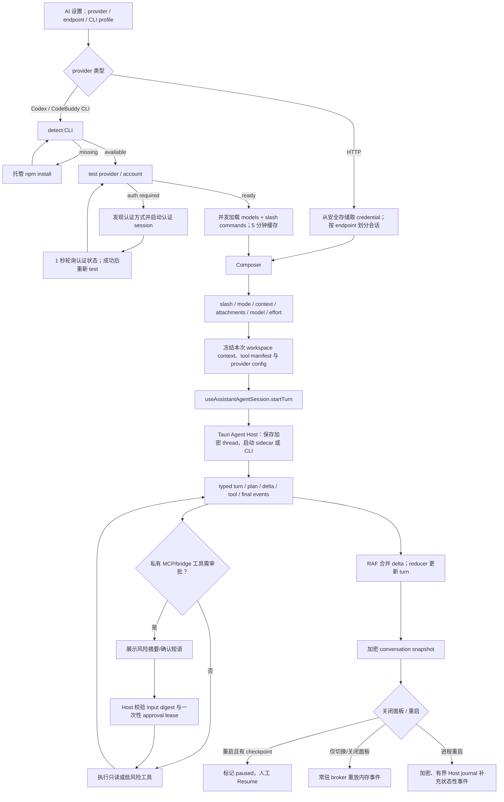

# Assistant：OxideStudio 与 DBX / ChartDB 流程差距审计

> 审计日期：2026-08-12（Asia/Shanghai）
> 文档性质：当前工作树的实现与验证快照，不是发布承诺
> OxideStudio 基线：`feature/dbx-lsp` / `3131d55152cccdbee0263d802a7a200cbc20daaa`（`feat(enterprise): enforce managed gateway negotiation`）+ 本轮未提交改动
> DBX 参考快照：`sources/dbx` / `main@baec487a21f15f9dfc4065a3a96a163e612ff222`
> ChartDB 参考快照：`sources/dbchart` / `main@c24936a402bb3e24b4858f05282d69a04fcfe25b`

## 1. 结论

OxideStudio 已有一条完整但仍需加固的 Assistant 主路径：provider 配置、CLI 检测/托管安装/认证/能力测试、模型与命令 catalog、composer、Agent Host turn、私有工具桥审批、加密会话快照及人工恢复均已具备。本轮又完成了光标感知 slash/IME、共享 side panel 关闭语义、Codex 式模型/推理强度 UI、catalog 缓存 hook、后端 default/effort 解析、HTTP 会话信任域隔离、workspace 级常驻事件代理、hydration/重挂载事件重放、快照串行合并写入、`answer.delta` 的 RAF 批处理、加密且有界的 Host turn journal，以及托管 CLI 的版本与完整性锁定、原子激活和失败回滚。

面板关闭/切换造成的进程内事件缺口已经由常驻代理修复：代理最多保留 4,000 个 typed events，并按 `threadId + turnId + sequence` 在重挂载时补齐；它只重放 UI 投影，不重新调用工具或数据库 mutation。应用崩溃/重启的恢复链路也新增 Host journal：journal 使用同一加密 store，按 turn 最多保存 160 个状态性事件，单事件上限 24 KiB，并刻意跳过 `answer.delta` / `model.chunk`，避免逐 token 写入造成性能与敏感输出放大。快照写入已改成 750 ms trailing debounce、5 秒 max-wait 和单写入队列，只保留最后一份待写快照。上线前仍必须在真实 Tauri WebView、真实 Codex/CodeBuddy CLI 与真实审批/恢复场景中验证。

## 2. 参考边界与状态口径

### 2.1 DBX 与 ChartDB 的参考边界

| 参考 | 可作为 Assistant 直接参考的范围 | 不应作为直接参考的范围 |
| --- | --- | --- |
| DBX | 桌面 Assistant composer、光标感知 slash、模型/effort catalog、RAF 合并流式 delta、provider 设置和发送前快照；见 `sources/dbx/apps/desktop/src/components/editor/AiAssistant.vue:330-529,604-610,954-968,1526-1617,1704-1934,2001-2019,2130-2144,2651-2850`，catalog 见 `sources/dbx/apps/desktop/src/composables/useAiModelCatalog.ts:26-27,81-175` | DBX 的单组件生命周期、卸载即 cancel、静默吞掉持久化错误和相对轻量的 turn 状态不能替代 Oxide 的 typed Host、加密 checkpoint、审批 lease 与数据库变更安全边界 |
| ChartDB | 仅可参考“确定性 SQL 先行、LLM 作为受限转换辅助”的边界；其 OpenAI 配置见 `sources/dbchart/src/lib/env.ts:1-4`，SQL export LLM 路径见 `sources/dbchart/src/lib/data/sql-export/export-sql-script.ts:724-821` | ChartDB 没有桌面 Agent turn、CLI detect/install/auth/catalog、MCP/私有工具审批、事件恢复或会话 checkpoint。浏览器环境变量中的 API key 和直接 `createOpenAI` 调用不应迁入 Oxide 桌面安全架构 |

DBX 是本审计的 Assistant 直接参考；ChartDB 只用于划清参考边界。两个 `sources/` HEAD 都是本地快照，本轮未联网证明它们仍是远端最新提交。

### 2.2 状态口径

| 状态 | 含义 |
| --- | --- |
| 已完成 | 在本轮之前已有的 Oxide 主路径或安全能力；本审计只确认代码存在 |
| 本轮完成 | 当前未提交工作树已经实现，并有静态检查或本轮定向测试支撑；仍可能需要真实桌面验证 |
| 待做 | 尚未形成闭环，不能以已有相邻能力代替 |
| 不应迁移 | 参考仓库存在，但会降低 Oxide 的安全、恢复或架构质量 |

行号均对应上述工作树快照；继续修改同一文件后会自然漂移。

## 3. 端到端流程

### 3.1 全流程实现表

| 阶段 | Oxide 当前实现位置 | 当前状态 | 主要差距 |
| --- | --- | --- | --- |
| Provider 配置 | `src/store/useAiSettingsStore.ts`；HTTP/CLI config 组装与 secret 迁移在同 store，CLI secret revision 在 `src/services/tauri/ai.service.ts` | 已完成 | secret 仍只进入 Rust 凭据层；随机 revision 仅用于使进程内 catalog/probe 失效 |
| CLI detect / test | `src/components/workspace/AssistantSidebar.tsx`；运行态 `src/store/useAssistantCliSetupStore.ts`；commands `src-tauri/src/commands/ai.rs` | 本轮完成（进程内） | 同 identity 重挂载不重复探测；应用重启后的 Host job discovery 仍待补 |
| 托管 install | `src/components/workspace/AssistantSidebar.tsx`；`src-tauri/src/ai_cli/setup.rs` | 本轮完成（进程内） | Codex/CodeBuddy 使用精确版本与固定 SRI，临时目录验证后原子替换；后端 job ID 的 download/install/verify 状态可在 Sidebar 重挂载后继续轮询。应用重启会终止子进程，重启后的 job discovery 仍待补 |
| Authentication | Sidebar 启动/取消/轮询；运行态 `src/store/useAssistantCliSetupStore.ts`；Rust session `src-tauri/src/ai_cli/setup.rs` | 本轮完成（进程内） | Sidebar 重挂载会继续轮询现有 session；应用重启后的 session discovery 仍待补 |
| Models / commands catalog | `src/hooks/useAiCliCatalog.ts:9-195`；接入 `src/components/workspace/AssistantSidebar.tsx:320-328,1306-1355`；CodeBuddy ACP 缓存位于 `src-tauri/src/ai_cli/codebuddy.rs` | 本轮完成 | 前端 5 分钟缓存/单飞；后端模型+命令共享 capability 探测，按模型 effort 再以 identity+model 单飞，避免并发重复启动 ACP |
| Composer | `src/components/workspace/assistant/AssistantPromptBox.tsx`；挂载在 `src/components/workspace/AssistantSidebar.tsx` | 本轮完成 | slash 已按 caret token 解析并处理 IME；真实 WebView 几何/中文输入法仍待验 |
| Model / effort UI | `src/components/workspace/assistant/AssistantModelControl.tsx:70-162,180-656` | 本轮完成 | 已有同一 quick/advanced 面板、推力 slider、可折叠模型列表、普通 trigger 无 Zap；底层仍是 Radix portal popover，需真实桌面验证附着感和焦点 |
| Turn 创建 | `src/hooks/useAssistantAgentSession.ts:587-652`；service `src/services/tauri/agent-host.service.ts:436-477`；Host `src-tauri/src/agent/host.rs:700-813` | 已完成 | Host 接受后无“查询当前 active turn + sequence cursor”的重接契约 |
| Event / reducer | listen、hydration、进程内 broker 与 RAF helpers 位于 `src/hooks/useAssistantAgentSession.ts`；journal 在 `src-tauri/src/agent/host.rs` | 本轮完成 | 面板卸载期间常驻 broker 继续接收并按 sequence 重放；重启后再合并加密、每 turn 有界的 Host journal，绝不自动重放 mutation |
| 私有 MCP/bridge 审批 | UI `src/components/workspace/assistant/AssistantTurnProcess.tsx:65-100,667-802`；前端决定 `src/hooks/useAssistantAgentSession.ts:739-805`；Host 校验 `src-tauri/src/agent/host.rs:1253-1367,1810-2087,4695-4719` | 已完成 | 不能迁移成“一句确认即长期授权”；真实 Codex/CodeBuddy 工具桥审批仍待端到端验证 |
| Snapshot / persist | 前端 debounce/max-wait/single-writer queue 在 `src/hooks/useAssistantAgentSession.ts`；AES-GCM store 在 `src-tauri/src/agent/store.rs` | 本轮完成 | 750 ms trailing、5 s max-wait、同刻单写且保留最新快照；真实 WebView 写入计数仍待测 |
| Restart / Resume | restore 转 paused 并合并 journal：`src/hooks/useAssistantAgentSession.ts`；journal API/Host：`src-tauri/src/commands/agent.rs`、`src-tauri/src/agent/host.rs` | 已完成（人工恢复） | 恢复 UI 状态不等于恢复 provider 进程；CLI 明确重开新 turn，不是原进程续接，任何未知 mutation 均须人工核对 |
| Shared panel | close reducer `src/lib/workbenchLayout.ts`；panel 实例切换 `src/pages/workspaceRuntime.tsx` | 本轮完成 | 关闭活动侧栏不会再露出旧 panel；Assistant 卸载由进程内事件 broker 承接活动 turn |

## 4. 本轮已落地矩阵

| 项目 | 实现证据 | 测试证据 | 状态边界 |
| --- | --- | --- | --- |
| Slash 菜单可二次唤起 | `AssistantPromptBox.tsx:150-232` 使用 `dismissedCommandValue`，message 变化/textarea focus 清除 dismiss | `tests/frontend/assistant-agent-sidebar.test.tsx:1040-1123` | 本轮完成；仅覆盖整段 `/query` |
| 输入框上方 slash 浮层及工具栏互斥 | `AssistantPromptBox.tsx:189-193,234-805`，command 与 model panel 互斥，Popover side=`top` | 同上 | 本轮完成；真实缩放/窄宽碰撞待验 |
| 共享 first/secondary panel 关闭 | `workbenchLayout.ts:68-110` 清同侧 visibility、active 与 history；`workspaceRuntime.tsx:542-583` 只渲染 active tool | `tests/frontend/app-settings.test.ts:366-431`；`tests/frontend/workspace-assistant-entry.test.tsx:262-337` | 本轮完成；不代表 turn 生命周期已完成 |
| Codex 式模型 UI | `AssistantModelControl.tsx:70-162,180-656`：单一 popover、quick 推力 slider、Advanced、可折叠模型列表、按模型 effort、无 Zap | `tests/frontend/assistant-agent-sidebar.test.tsx:1124-1297` | 本轮完成；功能与层级对齐，非像素级复刻 |
| CLI catalog hook | `useAiCliCatalog.ts:9-195`：5 分钟 TTL、identity cache、single-flight、partial warning、force refresh、迟到结果隔离 | `tests/frontend/assistant-agent-sidebar.test.tsx:1298-1533` | 本轮完成 |
| Default / effort 后端修正 | Codex synthetic default 与具体 model：`src-tauri/src/ai_cli/codex.rs:159-167,353-430`；CodeBuddy 去重/模型隔离 `src-tauri/src/ai_cli/codebuddy.rs:467-573,663-672`；selection effort `src-tauri/src/commands/ai.rs:269-298` | Rust 单测位于 `codex.rs:463-524`、`codebuddy.rs:736-791`、`commands/ai.rs:859-873` | 本轮完成；本轮未执行 Rust suite |
| HTTP trust key | `AssistantSidebar.tsx:216,1603-1620` 按规范化 endpoint 分 conversation，排除 API key 和 model | `tests/frontend/assistant-agent-sidebar.test.tsx:97-120` | 本轮完成；32-bit 非加密 hash 的理论碰撞列为 P2 |
| Hydration event buffer | `useAssistantAgentSession.ts:337-342,449-465,1524-1539`；最多 2,000 events | `tests/frontend/assistant-turns.test.ts:13-37` | 本轮完成；只覆盖 listener 已挂载、snapshot 尚未完成的窗口 |
| Persist cleanup flush | `useAssistantAgentSession.ts` 在 scope 切换、effect cleanup 与 Host 启动前保存 | 定向前端 suite 覆盖恢复主路径和启动检查点，但没有写频率性能断言 | 本轮完成；启动前经同一单写队列同步落盘，失败时拒绝启动 Host；写放大列为 P1 |
| Host turn journal | `src-tauri/src/agent/store.rs`、`protocol.rs`、`host.rs`；Tauri command 与 `agent-host.service.ts` | Sidebar 恢复回归覆盖 journal 的 terminal answer 合并 | 本轮完成；AES-GCM 加密、160 个状态事件/turn、24 KiB/event；跳过 token delta，journal 故障不会阻塞存活 turn |
| RAF delta | `useAssistantAgentSession.ts:344-369,478-485,1541-1569` | reducer/event 定向 tests 通过；无真实 profiler 基准 | 本轮完成；非 delta 到达时立即 flush 以保持顺序 |

## 5. P0：必须先保证无丢失、无跨信任域

| ID | 差距/风险 | Oxide 精确位置 | DBX / ChartDB 对照 | 状态与最小修复 |
| --- | --- | --- | --- | --- |
| P0-1 | 面板关闭或切换到同侧其他 tool 后，Assistant 组件仍会卸载，而 Host turn 继续运行 | 卸载：`src/pages/workspaceRuntime.tsx`；常驻代理、live scope 与 sequence replay：`src/hooks/useAssistantAgentSession.ts`；加密 journal：`src-tauri/src/agent/host.rs`、`store.rs` | DBX 卸载直接 cancel，也没有可靠 replay，因此不能照搬；ChartDB 无对应实现 | **本轮完成**。常驻 listener 在面板关闭后继续收集事件，重开后补齐且不再次 `startTurn`；启动前同步保存恢复检查点，写入失败时不会启动 Host。重启后会合并 Host journal 的有界状态事件；这只恢复 UI 投影，绝不自动重放 CLI 或 mutation |
| P0-2 | Snapshot load 失败时，hydration 事件不能被静默丢弃 | `src/hooks/useAssistantAgentSession.ts` 的 restore catch/replay 分支 | DBX 没有加密 snapshot hydration；无可迁移补丁 | **本轮完成**。失败时合并常驻代理与本地 pending events，并按 sequence 去重后投影到现有 turn；buffer overflow 的用户可见诊断仍列 P1 |
| P0-3 | HTTP provider 历史此前可能跨 endpoint 共用；会造成上下文跨目标泄漏 | `src/components/workspace/AssistantSidebar.tsx:1603-1620` | DBX config id 天然分 catalog，但不是 Oxide conversation trust key；ChartDB 直接读 endpoint/key，无会话边界 | **本轮完成**。endpoint 规范化后独立 conversation；API key 不进入 id。后续只需把 32-bit hash 升级为抗碰撞 canonical digest（P2） |
| P0-4 | Hydration 前事件可能被 snapshot 覆盖 | `src/hooks/useAssistantAgentSession.ts:337-342,449-465,1524-1539` | DBX 没有这一层 Host/snapshot race | **本轮完成**。已在 listener 先挂、snapshot 后合并；2,000 上限仍需 overflow 可见性（P1） |
| P0-5 | 数据库/外部 mutation 审批若退化为弱确认，会破坏 input-bound lease | UI `AssistantTurnProcess.tsx:667-802`；Host `src-tauri/src/agent/host.rs:1253-1367,1906-1971,2727-2790,4695-4719` | DBX 的普通 AI 写入交互不具备 Oxide 的 database target/digest/lease 安全契约；ChartDB SQL 生成不负责安全执行 | **已完成，保持不迁移**。继续要求风险摘要、必要时确认短语、输入 digest 与单次 lease；不得用“是/继续”授予广泛权限 |

## 6. P1：恢复闭环、状态机和写入性能

| ID | 差距/风险 | Oxide 精确位置 | DBX / ChartDB 对照 | 建议 |
| --- | --- | --- | --- | --- |
| P1-1 | 高频 delta 不能触发每帧写快照 | `src/hooks/useAssistantAgentSession.ts` 的 latest snapshot、750 ms debounce、5 s max-wait 与 save queue | DBX `AiAssistant.vue:2001-2019` 也缺少强错误处理，不应照搬 | **本轮完成**。同一时刻只有一个 save 在途，等待期间只保留最新请求；scope 切换和卸载强制入队。后续补真实 WebView 写入计数基准 |
| P1-2 | CLI setup/auth 状态需要跨 Sidebar 卸载保留，避免重新 detect/test 和授权闪屏 | `src/store/useAssistantCliSetupStore.ts`；Sidebar probe/auth effects；Rust auth session map `src-tauri/src/ai_cli/setup.rs` | DBX store 的 config/catalog 生命周期更长 | **本轮完成（进程内）**。setup phase、认证 session id、methods、probe fingerprint/revision 与验证时间提升到 Zustand runtime store；相同 identity 在 5 分钟 TTL 内重挂载不重复探测，环境 revision 变化或 TTL 到期后重新验证，authorizing 会继续轮询。应用重启后的 auth job discovery API 仍待补 |
| P1-3 | 历史 turn 的 401/未登录错误不能长期污染已恢复的 provider | `src/components/workspace/AssistantSidebar.tsx` 当前 turn health 派生 | DBX 以当前 catalog/config request error 为主 | **本轮完成**。provider health 只读取最新 turn 的 error 或当前 Host error；后续可再增加 provider `validatedAt` 结构化状态 |
| P1-4 | 同名 environment key 的 secret value 轮换后必须使 catalog/probe cache 失效，但不能把 secret 放入 renderer key | `ai_cli_set_environment` 返回随机 opaque revision；`ai.service.ts` 仅在内存记录；`useAiCliCatalog.ts` 与 Sidebar fingerprint 纳入 revision | DBX signature 包含 config 内容，但不能直接把 secret 搬到 renderer | **本轮完成**。revision 使用随机 UUID，不从秘密散列；重启后前端 cache 本身为空。明文仍只进入 Rust 私有凭据文件和显式设置草稿 |
| P1-5 | Hydration buffer 满 2,000 后需要明确诊断；reducer 不应执行 `events × turns` 扫描；终态/取消 ACK 不能依赖单一易丢事件 | `src/hooks/useAssistantAgentSession.ts` 的 pending buffer、`applyBufferedAgentEvents`、final/cancel reconciliation；`src-tauri/src/agent/host.rs` 的 `turn_runtime_status` 与 journal | DBX 没有对应有界 typed event replay | **本轮完成**。overflow 已显示安全警告，事件先按 thread/turn 分组后从 O(E×T) 降为 O(E+T)；`final.answer` 成为完成兜底，取消 2 秒后由 Host runtime status 收敛；重启时从有界 journal 合并状态性事件。真实崩溃/恢复仍需端到端验证 |
| P1-6 | 托管安装需要版本锁定、校验、回滚与跨 UI 生命周期的进度重接 | `src-tauri/src/ai_cli/setup.rs`；Sidebar install action | DBX 的 provider binary 管理不能替代 Oxide 的桌面供应链要求 | **本轮完成（进程内）**。已固定 Codex `0.147.0`、CodeBuddy `2.135.0` 及官方 registry SRI；安装到同父目录临时目录，验证 package version/CLI 入口后原子替换，失败恢复旧目录。后端持有 job ID 和 `starting/downloading/installing/verifying` 状态，Sidebar 重挂载后继续轮询；应用重启会终止子进程，重启后的 job discovery 仍待补 |
| P1-7 | 长会话 DOM 需要有界，同时旧的活动/待审批 turn 不能卸载 | `src/components/workspace/assistant/AssistantConversation.tsx`；snapshot 最多保留最近 100 条 | DBX 同样是长列表组件；ChartDB 的画布虚拟/索引经验不能直接替代聊天语义 | **本轮完成**。默认挂载最近 30 个 turn，历史按 30 条展开；任何非终态 turn 即使更早也始终挂载。回归覆盖 45 条历史与早期待审批 turn |
| P1-8 | 模型 catalog 可由 provider 返回任意数量，Advanced 列表需要避免无界 DOM | `src/components/workspace/assistant/AssistantModelControl.tsx` | DBX model list 也直接渲染，`AiAssistant.vue` 无更强边界 | **本轮完成**。超过 10 项显示搜索；单次最多挂载 100 个 radio，并保证当前选择保留；123 项目录回归覆盖搜索与软上限 |

## 7. P2：一致性、精细交互与可维护性

| ID | 差距 | 位置 | 建议 / 状态 |
| --- | --- | --- | --- |
| P2-1 | Slash 需要支持光标中间、多行内容和 IME | Oxide `AssistantPromptBox.tsx` 的 `slashCommandTokenAtCaret`；DBX caret-aware 参考 `AiAssistant.vue:1526-1617` | **本轮完成**：按 `selectionStart` 解析光标前 token，只替换命中 range；composition 期间关闭建议，提交后再计算 |
| P2-2 | Codex 式面板功能已落地，但使用 Radix portal popover；真实桌面上可能出现窄 panel 碰撞、焦点返回或“浮窗感” | `AssistantModelControl.tsx:86-162`；测试 `assistant-agent-sidebar.test.tsx:1124-1297` | **本轮完成，验证待做**：先真实 Tauri 截图/键盘验证；若仍显浮离，再把 content 改为 composer 内 anchored layer，不复制 DBX 的嵌套 popover |
| P2-3 | HTTP conversation key 需要低碰撞且不得错误合并大小写敏感路径 | `AssistantSidebar.tsx` 的 `assistantConversationId`、`canonicalHttpDestination` 与 `nonSecretDestinationDigest` | **本轮完成**。改为固定长度 128-bit avalanche identity digest；URL host 由 URL 标准化，路径保留大小写，并清除 URL userinfo/hash；API key 与 model 不进入 identity |
| P2-4 | provider 原始错误与少量 setup 文案仍可能为英文，不能直接作为中文主交互文案 | `AssistantSidebar.tsx:1524-1699`；`src-tauri/src/commands/ai.rs`；`AssistantPromptBox.tsx:733-748`；语言包 `src/i18n/messages.ts` | **部分完成**：模型、推理、目录状态、重试、搜索、运行时/授权/模式阻断状态和无障碍标签已迁入 i18n；CLI 的未安装、需授权、超时和协议失败现以稳定 code 回传，授权路由不再依赖英文正则。下一步仅保留原始 provider 文本为可展开 detail |
| P2-5 | Assistant 关键 owner 文件偏大，增加状态耦合与回归面 | `AssistantSidebar.tsx` 1,621 行；`AssistantPromptBox.tsx` 963 行；`AssistantModelControl.tsx` 776 行；`useAssistantAgentSession.ts` 2,204 行 | 按 provider-setup state machine、composer overlays、turn event controller、snapshot writer 拆 owner；不是为了文件行数本身，而是为了独立生命周期测试 |
| P2-6 | 真实可访问性/动效尚无桌面证据 | model Escape/focus `AssistantModelControl.tsx:130-146`；slash focus `AssistantPromptBox.tsx:753-787` | 用键盘-only、200% zoom、reduced motion、中文 IME、窄 280 px panel 验证；保留现有 focus-return 和 motion-reduce |

## 8. 性能量化基线

### 8.1 测量条件

- 工作树：Oxide `3131d551...` + 本轮未提交改动。
- 命令：`npm.cmd run build`，实际通过 `tsc && vite build && node scripts/verify-frontend-bundle.mjs`。
- Vite：7.3.0；3,480 modules transformed；bundle verifier 报告 `1 startup module, no static import cycles`。
- 下表是本机生产产物静态尺寸，不是跨机器 SLA，也不等于首次启动网络传输量；Tauri 本地加载仍受解析、编译和 WebView cache 影响。

### 8.2 Bundle

| 指标 | 当前值 | 解释 / 门槛 |
| --- | ---: | --- |
| Assistant 懒加载 chunk | 251,730 B raw / 67,220 B gzip | `dist/assets/AssistantSidebar-C0RraHgE.js`；由 `src/components/workspace/ToolWindowPanel.tsx` lazy import |
| Assistant gzip | 65,871 B | 本轮用 Node zlib level 9 实测 |
| Assistant brotli | 55,507 B | 本轮用 Node zlib 实测 |
| 全部 JS assets | 117 files / 5,676,225 B raw | 包含 Monaco/DataGrid 等非 Assistant 懒加载能力，不能归因于本轮 Assistant |
| 全部 CSS assets | 3 files / 461,184 B raw | Assistant 样式包含在共享 CSS，当前没有独立 chunk 归因 |
| Build warning | 存在 `>650 kB` 的其他 chunks | Assistant chunk 本身低于该 warning；后续以 route/chunk graph 分析，不用总 raw size替代启动路径指标 |

建议设置回归预算：Assistant raw chunk 相对本基线增长超过 10%（约 269 KiB）或 gzip 超过 72 KiB 时必须解释；这只是审查阈值，尚未写入 CI。

### 8.3 DOM 上界与列表形态

本轮没有在真实 WebView 采集 DOM node 数，因此不伪造单一节点数。可以从代码得到以下可验证上界/公式：

| 区域 | 静态上界 / 复杂度 | 代码位置 |
| --- | --- | --- |
| Slash suggestion rows | 最多 8 行 | `AssistantPromptBox.tsx:169-188,772-805` |
| Text attachment chips | 最多 4 个；总 128 KiB；最终 prompt 最多 200,000 characters | `AssistantPromptBox.tsx:361-367`；`AssistantSidebar.tsx:835-845,921-938` |
| Conversation turns | 当前 DOM 为全部 `T` 个 turn，节点量 O(T)；row memo 降低无关重渲染但不减少节点 | `AssistantConversation.tsx:300-328,362-385` |
| Model list | 折叠时不挂载 model rows；展开为 `M` 个 provider models，O(M)，当前无硬上限 | `AssistantModelControl.tsx:388-512` |
| Snapshot retention | 最多 100 turns、8 resume requests | `useAssistantAgentSession.ts:503-514` |

下一次性能验收应在 1、50、100 turns，以及 20、100、500 models 下分别记录 DOM nodes、React commit p95、heap 和 panel open latency。

### 8.4 Reducer / delta / persistence

| 路径 | 当前量化特征 | 结论 |
| --- | --- | --- |
| Live `answer.delta` | 从“每个 delta 一次 state mutation”改为“每 animation frame 至多一次 mutation”；在 60 Hz 屏幕上的名义上限约 60 次 React 更新/秒，实际以刷新率为准 | **本轮完成**；若 provider 每秒产生 D 个 delta，React mutation 数从约 D 降为至多 min(D, refresh rate)，非 delta event 会先同步 flush 保序 |
| 每帧 reducer | `current.map(turns)` + 每 active turn 批次 `events.reduce`，约 O(T + Δ) | 100-turn 长会话仍需 profiler；可以用 turnId index 避免扫描全部 turns |
| Hydration replay | events 先按 `threadId + turnId` 分组，再对 turns 单次投影 | **本轮完成**：复杂度由 O(E×T) 降为 O(E+T)；2,000 本地上限溢出会显示安全诊断 |
| Catalog | 每 identity 5 分钟 TTL；models 与 commands 并发 2 个请求；相同 identity single-flight | **本轮完成**；模型/effort 切换不重启 catalog 请求 |
| Snapshot writes | 750 ms trailing debounce + 5 s max-wait；单写入 queue 在等待期间只保留最新 snapshot | **本轮完成**：消除 effect cleanup 导致的逐帧写放大；真实 WebView 仍需采集 writes/s |

这些 reducer/delta 数值是基于源码路径的确定性上界/名义刷新率推导，尚不是 Chrome/Tauri profiler 实测结果。

## 9. 应迁移与不应迁移

### 9.1 可继续吸收的 DBX 做法

- 光标前 slash token/range 解析：`AiAssistant.vue:1526-1617`。
- catalog signature、TTL、single-flight 与 model-scoped effort：`useAiModelCatalog.ts:81-175`；Oxide 已吸收并使用 opaque secure environment revision，不向 renderer 暴露任何环境变量值。
- RAF 合并 delta：`AiAssistant.vue:954-968,1845-1883`；Oxide 已按 typed event 顺序增强落地。
- 发送时冻结 provider/model/config，而不是读取随后变化的全局设置：`AiAssistant.vue:1704-1878`；Oxide 已在 `AssistantSidebar.tsx:835-919` 和 `useAssistantAgentSession.ts:587-652` 使用提交快照。

### 9.2 明确不应迁移

- 不迁移 DBX 的“组件卸载即 cancel”作为恢复策略；关闭工具窗不应等同用户取消任务。
- 不迁移 DBX 的静默 `.catch(() => {})` 持久化/能力错误处理；Oxide 必须向用户暴露安全、恢复和 catalog 状态。
- 不把 DBX 的普通确认交互用于数据库 mutation；保留 Oxide input digest、target review、confirmation phrase 和一次性 lease。
- 不迁移 ChartDB `window.env.OPENAI_API_KEY`/浏览器直连模式；Oxide credential 继续由 Rust/安全存储加载。
- 不以 ChartDB 的 LLM SQL export 代替 deterministic schema diff、preflight、apply、verify 和 journal。

## 10. 分阶段执行清单

### Phase 0：本轮 UI、catalog 与事件热路径（已落地）

- [x] Slash dismiss/reset 重入与输入框上方菜单。
- [x] 同侧共享 panel 关闭时不再回显旧 tool。
- [x] Codex 式单一模型面板、quick reasoning slider、Advanced 可折叠模型列表；普通 trigger 去 Zap。
- [x] CLI catalog 5 分钟缓存、single-flight、partial/error/refresh/late-result 状态。
- [x] Codex/CodeBuddy synthetic default、model-specific effort 与去重修正。
- [x] HTTP conversation 按非秘密 endpoint trust boundary 隔离。
- [x] Snapshot hydration event buffer、scope/cleanup persist flush。
- [x] `answer.delta` RAF batching 与 non-delta 顺序 flush。

### Phase 1：P0 后台 turn 可接回

- [x] 将 session/event owner 提升到 workspace 常驻层，切换 side tool 不销毁订阅。
- [x] Host 增加按 turn 有界、加密的状态事件 journal；重启恢复时与 snapshot/live buffer 按 sequence 合并。
- [x] Snapshot failure 时保留/应用 buffered events；overflow 明确告警并 reconcile。
- [ ] 覆盖“运行中关闭 Assistant → 切到 Commit → 再打开”的 delta/tool/final/status 无丢失测试。
- [x] 覆盖“运行中换项目/provider”时保存、取消和新 scope 隔离，确保旧事件不能写入新 conversation。

### Phase 2：P1 provider/setup 与持久化状态机

- [x] 拆分 snapshot latest-ref、debounce/maxWait、unmount-only flush，并在 Host 串行 coalesce。
- [x] CLI setup/auth/install 迁到 provider-scoped store，支持进程内 task/session reattach。
- [x] detect/test 添加 executable/environment-revision 5 分钟 TTL，避免反复启动子进程；过期后重新验证。
- [x] catalog signature 加后端非秘密 environment revision。
- [x] 历史 auth error 与当前 probe 分离；成功验证结果压过旧错误。
- [x] 托管 CLI 使用版本 pin、integrity、原子切换和回滚。

### Phase 3：P2 交互、DOM 与维护性

- [x] Slash 支持 caret-aware range replacement 与中文 IME。
- [ ] 真实 Tauri 验证 model/slash 面板在 280 px、200% zoom、reduced motion 下的几何和焦点。
- [ ] 为 50/100 turns 与 100/500 models 建 DOM/React profiler 基线，再决定窗口化阈值。
- [ ] HTTP trust key 改抗碰撞 digest。
- [ ] Provider/setup/error 文案完成 i18n，原始错误放可展开 detail。
- [ ] 将 provider setup、event controller、snapshot writer 从大 owner 中分离并建立独立测试。

## 11. 本轮验证与延后项

### 11.1 已执行

- `npm.cmd run build`：**通过**。包含 TypeScript strict check、Vite production build、frontend bundle graph verifier。
- `npm.cmd test -- --run tests/frontend/assistant-agent-sidebar.test.tsx tests/frontend/assistant-turns.test.ts tests/frontend/assistant-conversation-turns.test.tsx tests/frontend/app-settings.test.ts tests/frontend/workspace-assistant-entry.test.tsx`：**5 files / 86 tests 全部通过**。
- Bundle：Assistant chunk 255,440 B raw / 68,280 B gzip；1 个 startup module、无静态 import cycle。
- `cargo check --manifest-path src-tauri/Cargo.toml --no-default-features`：通过；目标 Rust 单测在 Windows 测试二进制链接阶段超过 120 秒，未产生失败诊断，留待最终验证阶段执行。

### 11.2 明确延后，不能据此宣称发布完成

- [ ] `cargo test --manifest-path src-tauri/Cargo.toml`，尤其是 Codex/CodeBuddy catalog/default/effort 和 approval/Host regression：本机已完成编译，但 Windows 测试二进制启动时以 `STATUS_ENTRYPOINT_NOT_FOUND` 退出，未进入任何断言；需修复本机运行库后重跑。
- [ ] 真实 Tauri 桌面分别验证系统 Codex CLI、托管 Codex CLI、CodeBuddy CLI 的 detect/install/auth/test/catalog。
- [ ] 真实账号下验证 auth 浏览器返回、取消、过期、Sidebar 卸载后重接；不得使用或记录真实 credential。
- [ ] 真实 CLI private MCP/bridge：只读工具、需确认写工具、拒绝、确认短语、lease 过期/重放、target 改变。
- [ ] 运行中关闭/切换共享 panel、切 provider、切项目、应用重启/崩溃后的事件与 snapshot/journal 恢复。
- [ ] WebView profiler：高频 delta 的 commits/s、snapshot writes/s、长会话 DOM/heap、model panel open p95。
- [ ] Windows/macOS/Linux 上托管 npm 安装路径、代理/离线/权限失败、版本回滚。
- [ ] 截图级 UI 验证：窄面板、缩放、深浅主题、中文 IME、键盘-only、screen reader、reduced motion。
- [ ] 重新 fetch 并记录 DBX/ChartDB 远端基线；本审计只保证本地 `sources/` 快照。

## 12. 发布门槛

只有在以下条件同时满足后，才可把 Assistant 标记为“完整闭环”：

1. Side tool 卸载/重挂载期间，active turn 通过常驻 event broker 按 sequence 接回且不重复执行；已有自动化回归，仍需真实 CLI 验证。
2. Snapshot 写入已由 trailing/max-wait/串行 queue 合并；仍需真实 WebView 写入计数证明。
3. CLI install/auth/catalog 在真实 Codex 与 CodeBuddy 上通过，并能重接安装/认证 session。
4. 私有 MCP/bridge 审批的 digest、confirmation、lease、拒绝和过期路径通过端到端测试。
5. Rust suite、前端定向 suite、production build 全部通过；真实 Tauri UI 完成窄宽、缩放、IME 与键盘验证。

在此之前，准确表述应为：**主流程、Codex 式 composer、进程内后台事件接回、快照合并写入和重启级加密 Host journal 已落地；真实 CLI/桌面与崩溃恢复验证仍待完成。**
