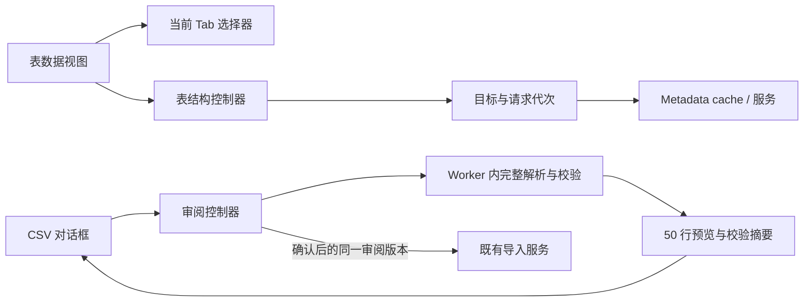

# DBX 对照：模块化、LSP、数据交换与页面性能

## 结论

**当前不能认定“已经充分组件化”“LSP 已完善”或“导入导出全面对齐 DBX”。** 常用工作流已有实现和回归，但模块责任、数据库适用范围、真实运行验证是三个不同问题。本轮直接修复了可复现的性能、状态与数据保真问题，其余明确列在下文。

对照来源为用户提供的 `source/dbx`，HEAD：`8e7d4c387f0bff0b237112028cdb697078eacc44`。此次核对本地源码，不将历史文档里的“已对齐”直接当作当前验收结论。参考仓库未修改。

## 1. 模块边界审计

审计开始时的规模：

| 模块 | 行数约 | 实际问题与边界 |
| --- | ---: | --- |
| `src/components/workspace/SchemaSidebar.tsx` | 11,538 | 树节点、菜单、导入导出、管理操作、连接与 metadata 生命周期仍集中；已有 `features/database-explorer` 可继续承接。 |
| `src/components/workspace/QueryEditor.tsx` | 4,783 | 已有执行控制器、LSP adapter、文档生命周期 hooks，但 inline AI provider、事件与编辑器 UI 仍耦合。 |
| `src/store/useTabStore.ts` | 4,793 | Tab、运行历史、查询、分页、编辑提交和资源释放共存；应分离纯 reducer 与执行服务。 |
| `src/components/workspace/TableDataView.tsx` | 2,552 | 整库订阅、结构/DDL 请求、导入导出、DDL mutation 与渲染共存；本轮抽离只读 inspection 生命周期。 |
| `src/components/workspace/TableDataTransferDialog.tsx` | 2,372 | 多组布尔状态协调目标创建、预览、执行、取消；已有请求指纹校验，仍需收敛成 review/execution 控制器。 |
| `src-tauri/src/commands/table.rs` | 27,993 | 含约 7,000 行测试，生产实现仍过大；表分页、格式编解码、导入执行、迁移、比较和备份应按领域拆包。 |
| `vendor/sql-lsp/src/server.rs` | 10,693 | transport 与语义功能仍未完全分开；新 `server/local_relations.rs` 只是第一步。 |

行数只是定位线索，真正验收标准是：同一状态只有一个 owner；组件不重复解析 SQL/数据；异步结果绑定目标与请求代次；切换页面不会导致无关组件重算或旧结果写回。

### 本轮实际抽离

- `src/features/table-data/useTableInspection.ts`：表结构、DDL、反向外键读取。列和索引无需等待较慢的反向外键请求；沿用现有 metadata cache。
- `src/hooks/useScopedAsyncResource.ts`：只读资源 `idle → loading → ready/error`；相同目标刷新保留内容，目标切换立即隔离旧内容，旧请求/卸载结果不能提交。
- `src/features/table-import/csvImportSession.ts`：CSV 解码、解析缓存、完整校验与有效审阅版本；完整行只在确认提交时读取。
- `src/features/table-import/csvAnalysisClient.ts`、`useCsvAnalysis.ts`、`src/workers/csvImport.worker.ts`：Worker 通信、请求路由、审阅状态与关闭释放。

## 2. LSP 逐项对照

DBX 的相关模块是 `apps/desktop/src/lib/sql/semantic/{tokens,dialect,model,completion,references,diagnostics}.ts`。它是前端 SQL 语义层，不等于覆盖所有数据库的通用 LSP。Oxide 的 Rust LSP 在协议能力上已有不少实现，不能仅凭目录结构判定缺失。

| 能力 | Oxide 当前实现/证据 | 对照结论 |
| --- | --- | --- |
| completion、hover、definition、references | `vendor/sql-lsp/src/server.rs` 对应 `LanguageServer` 方法；`tests/reference_uri_lsp_tests.rs` | 已实现；需要验证同一符号在四种入口中保持同一作用域。 |
| rename、signature、formatting、symbols、selection、semantic tokens、inlay | 同上对应 provider 方法；前端 `features/query-editor` adapters | 不是从零缺失；方言与未闭合语句的准确性不能由“支持 method”证明。 |
| WITH / MATERIALIZED / 多层 CTE | `server/local_relations.rs:cte_tables_before_cursor` 与相应单测 | 上轮已补 CTE 链、限定星号、局部遮蔽、递归显式列列表；不等于完整递归类型推导。 |
| 派生表及子查询地址 | `derived_tables_before_cursor`、`reference_uri_lsp_tests.rs` | 能推断常见 SELECT 输出和源 URI/行；字段血缘、复杂表达式及跨层重命名仍需逐例验证。 |
| 临时表 CTAS | `temporary_tables_before_cursor` | 本轮修复字符串内分号导致 SELECT 提前截断；回归 `SELECT ';' AS marker, 1 AS id` 两列均保留。 |
| LATERAL、APPLY、JOIN group | DBX `semantic/model.ts` row-source/scope 模型；Oxide `local_relation_source_starts` 与局部扫描 | Oxide 已识别部分入口，仍缺统一 scope graph 作为补全/导航/诊断共同数据源。不能把关键字识别称作全语义支持。 |
| 表函数、WITH ORDINALITY | `correlated_tables_before_cursor` 识别函数/显式相关列列表 | 显式列名可用；无列表时的函数返回结构、合成 ordinality 列及产品函数目录仍有专项工作。 |
| 投影别名可见性 | DBX `semantic/dialect.ts`；Oxide parser/方言分支 | ORDER BY、GROUP BY、HAVING 等策略需统一成方言接口，避免多个入口各自推断。 |
| 不完整 SQL / fallback | DBX cursor intent 带 confidence/fallbackReason；Oxide `CompletionContext` + 前端 fallback | Oxide 有恢复能力，但未知原因、metadata 完整性与 confidence 尚未形成统一结果。 |
| 超大 SQL | `LOCAL_RELATION_SCAN_MAX_BYTES = 512 KiB` | 当前超过限制直接跳过局部 relation 增强；保护性能但功能降级。后续应按 statement/revision 缓存，而非直接放大扫描上限。 |
| 增量解析 | `parser/sql.rs:parse_incremental` | 已有增量 parser；不能据此认定全部 feature 都共享增量语义快照，局部关系增强仍会扫描/复制文档。 |
| 真实数据库 metadata | driver capability、LSP session 与 metadata cache | 外置驱动目录出现产品名不代表有已交付 runtime。Oracle/SQL Server 等须按已安装驱动和真实版本验证。 |

更细的 SQL 语法对照见 [CLI / SQL 语义审计](cli-harness-and-sql-semantics-2026-09-15.md) 第 4、5 节。下一步核心工程是稳定 symbol ID + parent scope + projection + metadata resolver，共用只读语义快照；不是再向大组件增加关键词判断。

## 3. 数据浏览、导入导出对照

| 工作流 | DBX 源码 | Oxide 当前能力及差距 |
| --- | --- | --- |
| 表数据浏览 | `stores/queryStore.ts`、数据库驱动 | 已有服务端分页、过滤/排序、编辑、跨库预览和能力门禁；本轮修复表页对无关 Tab/任务更新的重渲染。 |
| 结果历史/切换 | `lib/tabs/tabResultCache.ts`、`stores/queryStore.ts` | Oxide 保留 5 个普通 run + 3 个 pinned run，内存引用不复制；DBX 有磁盘/IndexedDB 快照、容量/年龄和淘汰恢复。Oxide 尚无等价结果持久缓存。 |
| CSV 自定义映射导入 | `crates/dbx-core/src/table_import.rs` | 32 MiB/100,000 行审阅入口，编码/分隔符/范围/映射/类型校验；本轮移到 Worker，完整校验仍覆盖预览之外的行。 |
| 大 CSV / JSONL 导入 | 同上，相关原生导入模块 | Oxide `commands/table.rs` 有 512 MiB 上限、full-file preflight、500 行批处理、取消、事务和结果报告；不等于无界导入或所有驱动均支持。 |
| JSON / XLSX 导入 | DBX `table_import.rs` | Oxide 有原生预览与导入，当前文件上限各 32 MiB；电子表格/嵌套值保真及大型文件仍需真实样本矩阵。 |
| SQL 文件导入 | DBX `sql_file_import.rs`、进度/取消 | Oxide `commands/query.rs` 读取并校验 digest 后整段下发；上限 128 MiB，已有 shared import controller。尚非等价的逐语句流式进度、断点恢复和取消协议。 |
| 表导出 | DBX `table_export.rs`、`csv_export.rs`、`xlsx_export.rs` | Oxide 有 CSV/JSON/JSONL/Markdown/SQL/TSV/XLSX/Parquet/Arrow，受 driver capabilities 限制；原子临时文件、取消、类型转换报告已存在。 |
| 查询结果导出 | DBX `query_result_export.rs`，PG/MySQL/SQL Server/ClickHouse 单次查询流式读取 | Oxide DataGrid 主要序列化已加载结果，不能把它说成任意 SQL 的全量流式导出；需 backend cursor/session 与一致性协议。 |
| 重复结果列名 | 各自 query-result serializer | 本轮修复 Oxide JSON/JSONL 的 `id,id,id_2` 键碰撞，避免值被覆盖；数组结果中的每列保持独立字段。 |
| 数据库 SQL 备份 | DBX `database_export.rs` | Oxide `export_database_sql` 明确只支持内置 PostgreSQL 的 schema 导出，外置驱动拒绝；不是所有产品的整库备份。已有原子落盘，DBX 的 gzip/分卷 ZIP 不是当前等价入口；SQLite 专用 backup 的 gzip 属于另一流程。权限及目录依赖需实库验收。 |
| 表间迁移/比较 | DBX `table_import.rs` 等；Oxide transfer/compare planner | 已有目标审阅、结构对象闭集、事务/部分完成回执、取消。跨产品高级 index/CHECK/trigger/用户类型不能按同名语句直接复制。 |
| Mongo BSON / ES mapping | 各自专用模块 | Oxide 有 Mongo 专用迁移和 ES Console 支持，不能由关系型 Grid/CSV 能力外推所有文档类型保真。 |

**尚未完成的主要数据能力**：查询结果原生全量流式导出；SQL 文件逐语句任务协议；结果 payload 容量淘汰与恢复；数据库备份压缩/分卷等对齐；真实多驱动类型/取消/断连矩阵。

## 4. 状态管理修复与边界

本轮：

1. 表 inspection 的状态绑定 project/connection/driver package/database/schema/table/tab 与请求代次。快速切表、切非表页、重新刷新、卸载时，旧请求不能覆盖新的显示或 metadata store。
2. metadata 与反向外键独立完成；同一表刷新保留已知内容，不反复清空表头。读失败显示错误，不把可用数据替换为另一个表的数据。
3. CSV 的 `idle/analyzing/ready/error` 绑定源 bytes 与配置签名；改变映射/编码/范围后旧审阅不能提交。关闭释放 Worker，通信失败会结束 pending Promise；提交防重复。
4. Task Store 原来直接保留最近 30 项，可能将尚在运行的导入、导出或等待审批任务移除。本轮改为保留全部 running/waiting，只限制已结束历史为 30 项；长任务完成后的回执进入最新历史。

这不等于整个应用统一状态机完成：迁移、DDL mutation、连接恢复、LSP restart、查询取消和 Agent 持久任务各有权威边界。不能用一个全局 loading 布尔值代替它们，也不能让纯 UI 状态推断数据库已回滚。

建议领域契约：`OperationId + TargetFingerprint + Phase + Progress + Receipt`。写操作由 Rust/driver 返回 committed/rolled-back/partial/unknown；前端只投影，并把“提交成功但刷新失败”作为独立结果。已有 SQL import controller 的这条边界应保留。

## 5. 性能验证

### 可复现测量

样本：18,777,869 bytes，100,000 行 × 20 个 text 列。

- 初始同步路径：parse 约 1,778 ms，plan 约 3,086 ms（首次单次测量）。
- 同进程与 Worker 的对照基准使用同一个 `CsvImportSession`：同步分析 4,015 ms，主线程 16 ms 心跳最长间隔 4,020 ms；Worker 分析 4,405 ms，主线程最长间隔 29 ms。**这是 Node worker_threads 的事件循环隔离基准，不是 WebView FPS 或整应用 INP。**
- 回传预览 50 行，摘要 9,705 bytes；完整 100,000 行仍在会话内，确认时才读取。
- 组件渲染回归：20 次无关 Tab/Task 更新，DataGrid render 次数从 20 降为 0；当前表自身更新仍触发渲染。

数据记录：[benchmark.json](../output/qa-csv-20260915/benchmark.json)。

### 浏览器组件验收

使用真实 `CsvImportDialog` + Vite module Worker，独立测试页，不调用数据库：

- 小文件 3 行展示、确认后回传 3 行。
- 100,000 行展示前 50 行；确认后回传 100,000 行，首/末值分别为 `v0_0` / `v99999_0`。
- 分析中的取消入口可操作，关闭后显示取消且无数据库调用。
- 检查实际组件截图，列映射、预览、底部操作正常；没有以 happy-dom 冒充浏览器验证。

尚未测量：打包 Tauri 冷启动、真实连接切换、100+ Tab 的 result payload 内存上限、全链路 P95 输入/导航延迟和长时间运行资源曲线。浏览器 File 导入确认时仍需传递完整行，极大数据应使用既有原生 streaming 入口。

## 6. 后续工程优先级与完成标准

| 优先级 | 工作 | 完成标准 |
| --- | --- | --- |
| P1 | LSP 共享 scope/projection/符号快照 | completion/definition/references/rename 共用结果；嵌套同名、LATERAL、未闭合语句、Unicode 和大文件矩阵通过。 |
| P1 | Query payload repository | byte budget、pin 限额、LRU/磁盘淘汰、恢复中的 generation guard；切 Tab 不复制整份 rows。 |
| P1 | 查询结果流式导出 | 单次执行/一致性语义、backend cursor、取消、原子目标文件、类型保真和数据库连接释放测试。 |
| P1 | Transfer/DDL operation controller | 明确 preview/review/executing/cancelling/receipt；目标变化撤销审阅，旧回调不得改写新窗口。 |
| P2 | 巨型后端 table command 拆分 | import/export/transfer/compare 各自 service 与 codec；Tauri command 仅 DTO、授权、dispatch、response。 |
| P2 | Explorer/Editor UI 继续组件化 | 菜单、对象管理对话框、AI inline provider 独立；以 profiler 证明无关状态不传播。 |
| P2 | 打包性能基线 | 固定机器/数据集、冷启动与暖切换、100 Tab、百万行流式任务，记录 P50/P95、内存、长任务与取消耗时。 |

此清单是剩余工程工作，不能把本轮局部修复表述为所有页面已经稳定 60 FPS，也不能把 unit/browser fixture 通过表述为所有实库导入导出完成验收。

## 7. 本轮验证结果

- 前端：13 个测试文件、67 项通过，覆盖 CSV/session/Worker/关闭、表格订阅、跨库页面、迁移对话框、metadata cache、SQL import controller、JSON 导出与任务历史。
- SQL LSP：`cargo test --manifest-path vendor/sql-lsp/Cargo.toml --quiet`，318 项通过。
- `npm run build`：通过；CSV Worker 为独立 chunk，启动 bundle 检查无静态 import cycle。已有第三方 PURE 注解和大 chunk 提示仍在。
- 浏览器组件验收与事件循环测量见第 5 节。未连接真实数据库，未执行用户数据写入。
