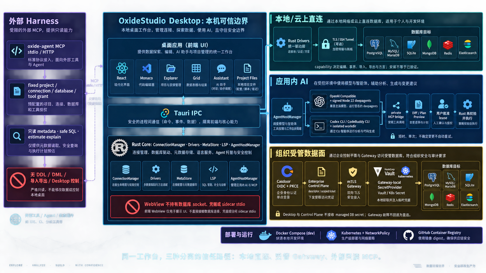
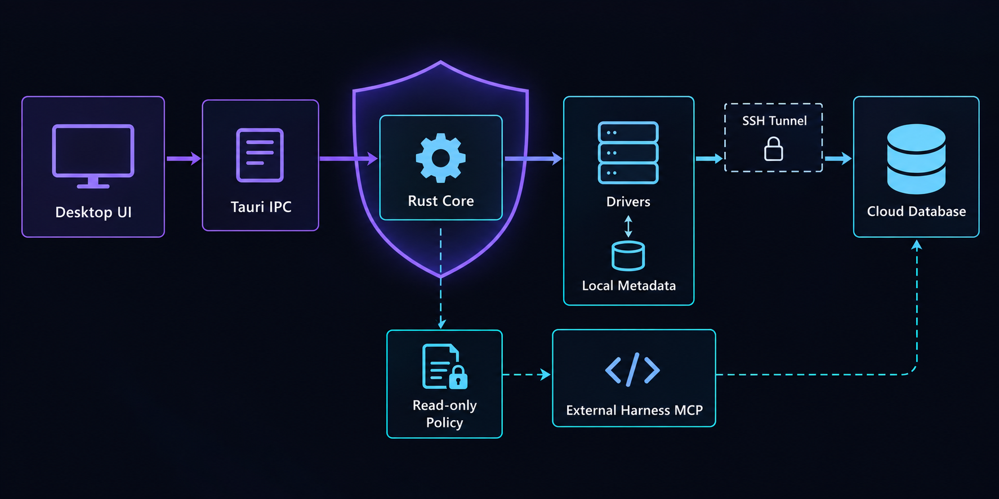
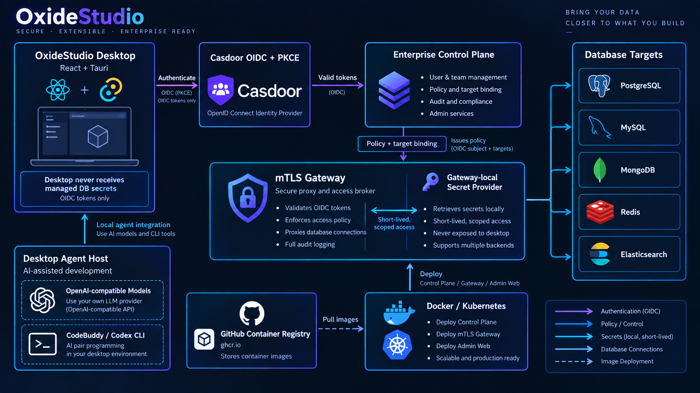
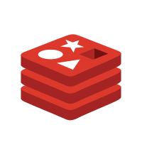
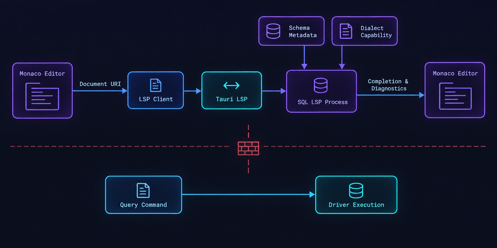
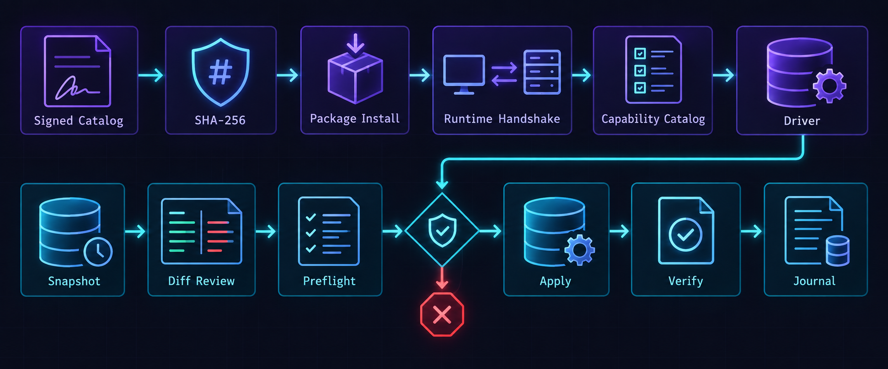
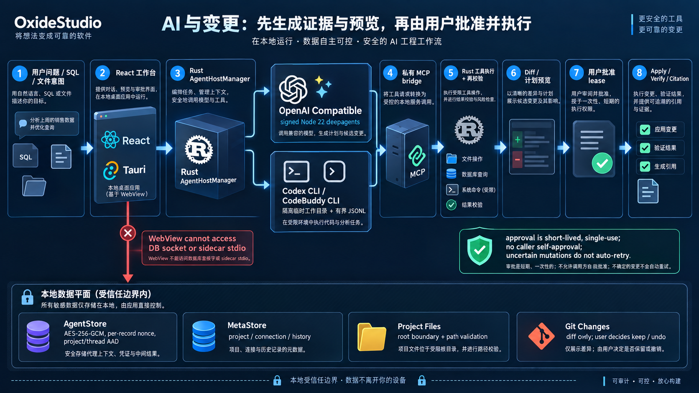
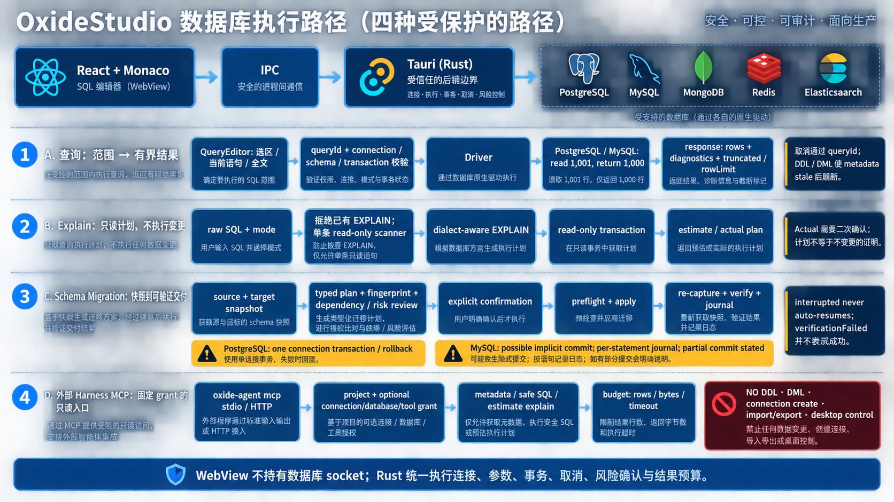

# OxideStudio 数据库工作台：完整架构、运行链路与外部平台

> `docs/intro` 的唯一总览文档。实现基线：`b609f79`。产品目录、连接 URL 或通用 SQL 补全不等于已验证支持；运行时 capability catalog、已激活 driver package 与 conformance evidence 才是事实来源。



OxideStudio 是本地优先的 Tauri 数据库工作台：React 负责界面和用户意图，Rust 负责连接、凭据、驱动、查询、事务、取消和安全校验；云上数据库是用户已保存的数据源，不是平台托管的数据服务。

## 审核结论：覆盖范围、已补齐内容与明确限制

本轮以 `src/`、`src-tauri/`、`enterprise/`、driver capability 与现有架构文档为依据重新核对。此前总览已说明桌面查询、MCP、驱动、迁移和 LSP，但对企业受管数据面、应用内 Agent、本地加密状态、Project Files/Git、四类数据库时序和部署平台的说明不足；现已补齐如下范围。

| 领域 | 本文现在说明的内容 | 必须保持的边界 |
| --- | --- | --- |
| 桌面工作台 | Explorer、SQL 编辑器、结果 Grid、对象管理、项目文件、Assistant 与状态域 | React/WebView 是交互层，不保存数据库 socket，也不是最终授权点。 |
| 查询与诊断 | 查询范围、`queryId`、有界响应、取消、结构化诊断、Explain 两次确认 | PostgreSQL/MySQL 普通查询读到第 1,001 行作为 sentinel，仅返回前 1,000 行；截断必须显式呈现。 |
| 多库与迁移 | 内置/签名 driver、capability、导入导出、schema snapshot/diff、journal | “可安装”不等于“可写/可迁移/有方言支持”；每项以 runtime capability 和 conformance evidence 为准。 |
| 编辑智能 | Monaco、SQL LSP、方言和 metadata overlay | LSP 只分析文本与无凭据 metadata，从不执行 SQL，也不持有连接。 |
| 外部 Harness | `oxide-agent` stdio/HTTP MCP、固定 grant、只读 SQL/Explain、预算 | 没有 DDL/DML、连接创建、导入导出、Desktop 控制或调用者自我批准。 |
| 企业受管数据面 | Casdoor OIDC/PKCE、Control Plane、mTLS Gateway、Gateway-local SecretProvider、Kubernetes/Registry 部署 | Desktop 与 Control Plane 都不接收 managed database secret；受管连接不回退为桌面直连。 |
| 应用内 AI 与文件 | Deep Agents、OpenAI-compatible、Codex/CodeBuddy CLI、AgentStore、Project Files、Git diff | 内部 Agent 的短期批准桥与外部 MCP 完全分离；Git 当前为只读状态/diff，不执行 stage、commit 或 push。 |

下文所写“当前”均指源码已有的能力；受管数据面的写入、DDL、迁移、导出、受管 MCP 登录等尚未完成的能力会 fail closed，不应由产品图、驱动名称或策略字段推断为可用。

## 架构边界、云上连接与外部 MCP



桌面请求沿 `Desktop UI → Tauri IPC → Rust Core → Drivers → target database` 前进。WebView 不直接持有数据库 socket；连接、项目、database/schema、事务、参数、取消和结果预算都在 Rust 可信边界检查。driver 使用 TLS、认证与可选 SSH Tunnel 接入本地、内网或云上数据库。

外部入口是独立的 `oxide-agent` MCP 进程，而不是 WebView 或桌面命令的远程代理。它按固定 project、可选 connection/database、工具白名单、行数/字节/超时预算工作；仅能读取脱敏连接摘要、缓存 metadata、PostgreSQL/MySQL 的只读 SQL、估算型 explain 和 SQL 上下文。没有 DDL/DML、连接创建、删除、用户/会话管理、导入导出或 Desktop 页面控制能力，调用方自报 approval 也不会提升权限。

```json
{
  "mcpServers": {
    "oxide-studio": {
      "command": "/absolute/path/to/oxide-agent",
      "args": ["mcp", "stdio", "--project", "<project-id>"]
    }
  }
}
```

生产 Harness 应继续固定 `--connection`、`--database`、`--tool`，并设置 `--max-rows`、`--max-result-bytes`、`--query-timeout-secs`。HTTP 默认 loopback；远程暴露需要 Host/Origin allowlist 与 TLS 反向代理或受信网络。

外部 AI 的可复制配置、工具清单、stdio/HTTP 生命周期与越权拒绝样例见 [外部 AI 接入指南](../EXTERNAL_AI_INTEGRATION.md)。这条公开路径不依赖应用内 Deep Agents，桌面界面也不需要保持打开。

## 企业受管数据面与外部平台：身份、策略、密钥和网络各归其位



企业模式不是把本地连接 URL 上传到云端，而是与本地直连并存的第二条、不可回退的数据路径。

| 连接来源 | 实际时序 | 谁持有数据库凭据 | 安全结果 |
| --- | --- | --- | --- |
| 个人/本地项目 | Desktop Rust core → 已保存的 driver → database | 用户设备的本地私有凭据 | 本机连接策略与数据库账号共同约束；可以使用 TLS/SSH Tunnel。 |
| 组织受管项目 | Desktop OIDC/PKCE → Control Plane descriptor/ticket → mTLS Gateway → Gateway-local SecretProvider → database | 仅客户网络内 Gateway | Desktop 不拿 URL/密码，Control Plane 不存 secret；Gateway 故障即拒绝，不降级为直连。 |

受管路径的完整授权顺序如下：

1. Desktop 以 Authorization Code + PKCE S256 向 **Casdoor** 登录；Control Plane 按 OIDC issuer、JWKS 和 token `aud` 校验身份，不使用或保存 Casdoor client secret。
2. Control Plane 返回无凭据 datasource descriptor，并为每个操作签发短时、受范围限制的 ticket。ticket 绑定 user、device、organization、project、source、action、resource path、policy revision、audience、nonce、expiry、rows/bytes budget 与 target binding。
3. Desktop 带设备证书和 ticket 通过 **mTLS gRPC** 访问客户网络中的 Gateway。Gateway 对 peer certificate、登记的 SHA-256 指纹、ticket、当前策略和 capability handshake 再次核验。
4. Gateway 才通过自身的 **SecretProvider** 解析 Vault 动态凭据/KV 或只读挂载的 Kubernetes Secret；解析后重新计算无凭据 target binding，验证 TLS 身份，再建立数据库 driver。
5. Gateway 返回受限 metadata 或有界只读结果，并以 append-only audit/outbox 留下可投递的审计事实；客户端只能按 descriptor 的更窄能力渲染 UI。

| 外部平台或组件 | 工程中的位置 | 数据/信任关系 |
| --- | --- | --- |
| Casdoor | OIDC identity provider；开发 Compose，生产可独立部署 | 只提供身份和 token；PKCE 流程不把 client secret 放进 Desktop/Control Plane。 |
| Enterprise Control Plane / Admin Web | `enterprise/control-plane`、`enterprise/admin-web` | 项目、成员、策略、descriptor、ticket 与审计；不保存数据库 URL、用户名、密码或 Gateway secret reference。 |
| Enterprise Gateway | `enterprise/gateway`，客户网络数据面 | 持有 mTLS 服务端身份并本地解析 secret；不提供通用 TCP tunnel。 |
| HashiCorp Vault / Kubernetes Secret CSI | Gateway-local `SecretProvider` | Vault token 和 K8s secret 以私有挂载文件读取；Gateway 不需广泛的 Kubernetes Secret API 权限。 |
| Docker Compose / Kubernetes | `enterprise/deploy/compose.yaml`、`enterprise/deploy/kubernetes/` | Compose 仅是 loopback 开发参考；生产基线要求 image digest、只读 root、seccomp、NetworkPolicy、mTLS passthrough 与集群实际联调。 |
| GitHub Container Registry | Enterprise Control Plane、Gateway、Admin Web 的镜像交付 | Kubernetes manifest 使用固定 `ghcr.io/...@sha256:<digest>`，而非浮动 tag。 |
| PostgreSQL、MySQL、MongoDB、Redis、Elasticsearch | 内置 driver 与 Gateway 受管只读 RPC 的当前数据族 | 受管模式目前开放 discovery/metadata/read-only query 的对应子集；策略名称不会自动激活未实现的写入能力。 |

<p>
  
  
  
  
  
</p>

上方为工程随附的数据库品牌图标；架构图中的图标是同一类外部平台的视觉锚点，具体接入能力仍以本文和 runtime catalog 为准。

## 实际客户端与查询管理


Explorer 是数据源和对象入口；中央区域组织查询与项目文件；右侧 Assistant 只在受控桌面会话内协作，不持有独立云端写权限。


连接定义保存后，后端准备可选 SSH transport，再由 driver `connect + ping`；成功才替换活动连接。Explorer 的 catalog/schema/table/column/index/FK/collection/key 来自 driver metadata，带 `loading / ready / stale / error` 和 `cache / remote` 来源。DDL/DML 后刷新 metadata，而不是把缓存当作远端事实。


查询选区、当前语句或全文会形成带 `queryId` 的有界请求，按连接、database/schema 与事务路由。响应包含列、行、类型、诊断、截断和取消状态；socket 与原生 cursor 不会交给 WebView。分页 cursor 绑定原连接，关闭标签、取消、断开或退出时释放。


对象菜单把读取、生成 SQL、导入导出和高风险管理动作明确区分。写入、维护、结构变更等动作只经桌面确认与 Rust command 执行；外部 MCP 没有等价 mutation tool。

### 功能地图：每个可见动作都有其后端权威路径

| 用户任务 | 工作台入口与典型状态 | Rust/driver 的权威动作 | 不能据此误推的能力 |
| --- | --- | --- | --- |
| 新建、测试、保存连接 | Connection Form、Explorer、connection task | 校验配置，建立可选 SSH transport，`connect + ping` 成功后才激活连接 | 测试成功不表示拥有 DDL/事务/导出权限；受管 descriptor 不等于本地连接配置。 |
| 浏览对象与搜索 | Explorer、schema/table/collection/key node、cache/remote 标记 | driver metadata 与 MetaStore cache；DDL/DML 后令缓存 stale 并刷新 | cache 不是远端事实；不同数据模型不会强行投影成 SQL 表。 |
| 编写/运行 SQL | Monaco、SQL Library、Query Tab、history/task 状态 | statement scope、参数、事务路由、query cancellation、诊断脱敏和结果预算 | LSP/补全结果不执行 SQL；外部 MCP 只开放受限只读子集。 |
| 查看和编辑表数据 | 分页 Table Tab、Value Editor、pending edits、FK navigation | dialect-aware 参数化 mutation、事务与确认 gate；服务端分页 | 默认可见或切换编辑开关不是写入授权；非关系型数据不能套用 Grid 编辑模型。 |
| 比较与理解结构 | Data Compare、Schema Diagram、Create Table、schema diff | 不可变 loaded-result snapshot、typed schema snapshot、FK/依赖 graph | Compare 不扫描整库或同步数据；Diagram 不是任意实时 Explorer tree 的副本。 |
| 管理与维护 | 用户/角色、会话、维护、对象菜单等受控界面 | 后端按 PostgreSQL/MySQL 方言引用标识符、执行确认后的命令并返回结构化错误 | 前端隐藏菜单不构成权限防线；MCP 不暴露对应管理调用。 |
| 导入、导出、传输 | 数据导入预览、列映射、导出/transfer 操作 | 有界解析、类型/NULL 验证、批量事务、编码器与 driver capability 的交集 | 格式可选不表示所有 driver 支持；跨连接传输可能部分提交，必须如实报告。 |

## SQL LSP 与方言：编辑智能不执行数据库操作



Monaco 把文档 URI、版本和 UTF-16 光标同步至 per-session bundled `sql-lsp`。Explorer cache 批处理为 schema metadata；当前受审 capability 选择 `languageId`、server dialect 和标识符引用。LSP 只返回补全、诊断、hover、格式化和文本编辑；它不持有数据库凭据，也不能执行 SQL。真正执行另走 query command、`ConnectionManager` 与选定 driver。

通用 package 显示为 `SQL generic`，只使用受审 PostgreSQL 或 MySQL 基线；未验证厂商语法不会伪装为精准诊断。Cypher、CQL 等非 SQL 语言保持纯文本或等待专用语言服务。

## 多库驱动、导入导出与结构迁移



| 路径 | 示例 | 信任与能力门槛 |
| --- | --- | --- |
| 内置 Rust driver | PostgreSQL、MySQL/MariaDB、SQLite、MongoDB、Redis、Elasticsearch 与部分专用 HTTP/配置系统 | 与应用一起编译；后端实现协议、metadata、取消和能力门禁。 |
| 签名 sidecar package | DuckDB、ClickHouse、RQLite、Kingbase、IoTDB、受管理 Java/JDBC | 签名 catalog、SHA-256、安全解包、目标平台、entrypoint、版本范围和 runtime handshake 均需通过。 |

产品必须从 `reference candidate → signed catalog → installed → ready + active → runtime capabilities → connection selector/LSP context` 逐级提升。已安装 package 不会自动获得写、事务、迁移、传输、导出或专用方言能力；每项都需 manifest、runtime handshake 与真实版本 fixture 的独立证据。JDBC 使用签名 Java 21 runtime 与哈希绑定 classpath，Host 不从系统 `PATH` 搜索 Java。

`DatabaseCapabilities` 决定数据模型、连接模式、SQL/对象浏览、事务、取消、DDL、Grid 修改、传输和导出格式。关系型数据才进入分页 Grid；document/key-value/search 使用对象工作区；time-series、graph、coordination、queue 需要专用 editor。Parquet/Arrow 还要求受审值编码，不能因为能浏览表就自动开放。

CSV 导入先有界解析，展示最多 50 行预览与显式源列到目标列映射；类型/NULL 校验和用户确认通过后才批量 mutation。交互式上限是 32 MiB、100,000 行和 200 个细节错误；PostgreSQL/MySQL 事务批次失败会回滚。表到表 transfer 是独立能力，要求表浏览、事务、受审分页/参数方言与 `supportsTableDataTransfer`，并必须如实报告跨连接的部分提交。导出只在 driver 声明与当前构建编码器的交集内进行。

Schema migration 不接受前端传来的任意执行 SQL。后端使用 snapshot、审阅 plan ID、typed target、fingerprint 和独立风险确认；执行前重新捕获目标、重算 plan/fingerprint、运行 preflight，随后 apply、recapture、verify 并写 journal。PostgreSQL 使用单连接事务；MySQL 的潜在隐式提交以逐条 journal 和非原子确认呈现；SQLite 受支持路径先建立恢复备份、做即时写事务与 `foreign_key_check`。`verificationFailed` 表示提交后未能验证，不会伪装为成功；中断不自动续跑。

## 技术栈与后续阅读

| 层 | 技术与职责 |
| --- | --- |
| 可信后端 | Tauri v2、Rust、Tokio、Serde、SQLx、rustls、russh：IPC、连接、驱动、事务和 SSH/TLS。 |
| 工作台 | React 19、TypeScript、Vite、Zustand、Monaco、Glide Data Grid：Explorer、编辑器、状态、结果与确认交互。 |
| 本机状态 | SQLite MetaStore、AES-GCM、私有文件权限：项目、连接、缓存、历史、迁移 journal。 |
| AI 与文件协作 | 签名 Node 22 `deepagents@1.10.8`、OpenAI-compatible provider、Codex CLI、CodeBuddy CLI、私有 MCP bridge：Agent 编排、受控工具、证据与 Patch Preview。 |
| 外部工具 | `oxide-agent`、Clap、RMCP、Axum/Tower：独立 CLI 与只读 MCP stdio/HTTP；其 scope/budget 与应用内 Agent 审批桥不同。 |
| 企业平台 | Casdoor OIDC/PKCE、mTLS Gateway、Vault/Kubernetes SecretProvider、Docker Compose、Kubernetes、GHCR：身份、策略、客户网络数据面、密钥解析与可复现部署。 |

仅保留的独立介绍文档：[从需求到成品的交付链路](delivery-lifecycle.md)，其中说明前期规划、分批构建、人工校准、策略调整和验收。

## 工程模块地图：前端、Rust 核心与 Agent

统一架构图中的每一个框都对应可定位的工程模块，而不是概念性服务。

| 工程层 | 主要入口 | 运行时职责与约束 |
| --- | --- | --- |
| React 工作台 | `src/App.tsx`、`src/pages/workspace.tsx`、`src/components/workspace/` | 组合 Explorer、编辑器、结果面板、Assistant 与项目文件；负责呈现状态，不直接访问数据库或 sidecar stdio。 |
| Zustand 状态域 | `src/store/` | `project`、`connection`、`schema`、`tab`、`task`、`history`、`settings`、`project-files`、AI view model 各自保存不同生命周期；跨域副作用放入领域函数，不散落在组件 click handler。 |
| 前端服务适配 | `src/services/tauri/`、`src/services/lsp/` | 收敛 `invoke()` 参数、camelCase 映射、错误类型、LSP 文档同步和路径检查；UI 不应自行拼 IPC payload。 |
| Tauri command | `src-tauri/src/commands/` | `connection`、`query`、`schema`、`table`、`transaction`、`project_files`、`settings`、`store`、`lsp`、`ai/agent` 等按领域注册，负责输入校验、获取 State、调用 core/driver 和可序列化错误。 |
| Rust core | `src-tauri/src/core/` | `ConnectionManager` 维护活动 driver，`MetaStore` 保存项目范围 metadata，driver package registry 管理签名安装与激活，取消/事务/查询范围在此边界统一执行。 |
| AI / Agent | `src-tauri/src/agent`、`src-tauri/src/cli/` | 应用内 Agent Host 与外部 `oxide-agent` 分开；前者以审批 lease 接入桌面能力，后者以固定只读 grant 接入 MCP。 |

前端状态并非数据库真相。切换项目会清理连接/schema 快照；执行 DDL 后会让 metadata 失效并刷新；Query Tab、事务上下文与 Task 状态以会话为单位留在内存。项目、连接定义、历史和资源 artifact 才写入 MetaStore；provider secret 不与普通 UI store 混存。

## 应用内 AI、Project Files 与 Git：生成能力不能跳过桌面审批



应用内 Agent 与外部 Harness 的名字相近，但权限模型刻意不同：

| 路径 | 模型/进程 | 可见的工具边界 | 写入前的必经条件 |
| --- | --- | --- | --- |
| 应用内 Chat / Plan / Agent | Rust `AgentHostManager` 懒启动签名 Node 22 `deepagents@1.10.8`，使用 OpenAI-compatible provider | React 仅调用 `agent_*` command 并订阅 `agent://event`；sidecar 走版本/能力 handshake 和有界 JSON-RPC 2.0 stdio。 | 生成 `Diff / Patch Preview / Plan` 之后，用户在 Desktop 明确批准；Rust 再校验 scope、revision、lease 与工具输入。 |
| 应用内 Codex CLI / CodeBuddy CLI provider | Rust 为每个任务启独立临时工作目录，以有界 JSONL 和当次 Turn 私有 MCP bridge 通信 | bridge 的 endpoint/token 只属于当次 Turn，不是公开服务。 | approval lease 短时、单次、绑定输入；不确定 mutation 不自动 retry。 |
| 外部 `oxide-agent` MCP | 独立 Rust binary，stdio 或本地 Streamable HTTP | 固定 project/connection/database/tool grant；metadata、只读 SQL、估算 Explain、SQL context。 | 没有 mutation tool，因此不存在由外部调用者提交 approval 升权的路径。 |

本机状态也按职责分开存储：`MetaStore` 的 SQLite 保存项目、连接、metadata cache 与有界 history；`AgentStore` 的 `agent-state-v2.db` 独立保存 thread/checkpoint/artifact，采用 AES-256-GCM、每记录 nonce，并将 project/thread/namespace/checkpoint 等绑定为 AAD。主密钥只在用户私有 credential file 中；文件不可用时退回只存在于当前进程的加密 session store，绝不以明文落盘。

Project Files 的所有路径会先规范化到 project root，并拦截绝对路径、`..` 与 symlink 越界；文本写入用 SHA-256 revision 做乐观并发控制。Agent 文件写入沿同一边界，还必须携带精确 expected revision。Git 面板则只读地调用受限参数化 `git -C <canonical-root>`：只能查看 branch/status/All-Staged-Working diff，且有路径、输出和 8 秒执行预算；没有 stage、commit、checkout、push 或外部 shell string。

## 查询、事务与错误的真实生命周期



这张图把容易混淆的四条时序拆开：普通查询返回受预算约束的结果；Explain 只能包裹一条 read-only SQL，`Actual` 还要求二次确认；结构迁移只消费后端重新计算的 typed plan/fingerprint；外部 MCP 永远停在只读工具边界。图中的数据库标识用于显示当前内置主数据族，任何拼写或图形化简写均不替代下方精确的 capability 约束。

一次查询从编辑器范围解析开始，经过 command 的 `connectionId / database / schema / transaction` 校验，再由 `ConnectionManager` 选择当前 driver。driver 返回的 rows、metadata 或 diagnostic 先被转成有界 serializable response，最后由 tab/task store 统一处理完成、截断、取消或失败。WebView 不拿到连接对象，因此不能绕过取消、事务、参数化或行/字节预算。

事务也不是全局开关：它依赖 driver 明确声明 `supportsTransactions`。PostgreSQL/MySQL 等关系型路径可拥有命名事务会话；不具备该契约的 sidecar 不能被 UI 误渲染为可编辑 Grid。对外只读 Agent 会使用最强可用的只读边界；例如 SQLite 以引擎只读方式打开，避免只依赖 SQL 文本分析。

错误同样需要结构化：连接失败、权限错误、取消、超时、驱动 capability 不足、目标 scope 不匹配和结果截断是不同状态。显示“服务端已响应”不等于 mutation 成功；迁移还必须区分 rolled back、partially committed、verification failed 与 interrupted。

### 关系型与非关系型工作区不会伪装成同一张表

`DatabaseCapabilities` 先判断数据模型和已验证能力，再决定 UI 与命令。关系型数据使用 SQL/分页 Grid/事务与 schema metadata；MongoDB 走 collection/document 工作区，Redis 以 `db N` 和 key 为命名空间，Elasticsearch 使用 Kibana Console 风格的 request 文档与 Query DSL/mapping 补全。time-series、graph、coordination、queue、Parquet/Arrow 及外置 package 的专用体验必须各自完成能力声明、值编码和真实版本证据，不能因“可连接”而复用关系型写入或导出语义。

## Driver package 的完整性、回滚与版本证据

签名 catalog 是发现源，不是执行授权。下载缓存以 SHA-256 标识，支持严格 Range 续传；partial archive 未完成摘要复验前不能解压或执行。安装后仍要校验 manifest、签名、entrypoint、平台和 protocol，激活后还要由 sidecar handshake 再证明 runtime capability。

Driver Manager 还会把 **Active package** 与 **Verified server versions** 分开显示：只有当前激活 package 版本与签名 catalog release 完全相同，并且 release 带对应 conformance evidence 时，才可展示具体服务端版本已验证。缓存清理只清 catalog 归档，保留 active、previous rollback、保存连接固定的 packageVersion 与正在使用的 sidecar；未知文件或符号链接不做递归删除。

## LSP 的完整性与性能边界

bundled `sql-lsp` 来自 `vendor/sql-lsp` 子模块，构建时由 `src-tauri/build_prepare.sh` 写入二进制和相邻 manifest；manifest 记录 source revision、目标平台和 SHA-256，启动时不匹配即拒绝。每个 LSP 会话经 stdin/stdout JSON-RPC 隔离，前端 `didOpen/didChange/didClose`、取消与文档版本都会同步。

为避免编辑器智能反向造成数据读取或性能失控，LSP 只接收无凭据的对象 URI 与经过批处理的 metadata；项目 SQL 文件同步有数量、单文件和总字节上限，绝不暴露绝对路径、非 SQL 文件、依赖目录或 secret-like dotfile。大文档、补全数量、单项 payload 和 schema 解析均有上限；临时表、CTE、derived table 等局部关系仅作为编辑期 overlay，不写回数据库。

## 当前能力不能越过的公开边界

- **Driver 名称或连接表单不是承诺。** SQL Server 等未内置运行时必须走已签名外部 package；外置 family 需安装、验证、激活、handshake 与真实版本 conformance 后才进入 capability catalog。
- **LSP 不是数据库代理。** 未验证厂商语法保持 generic PostgreSQL/MySQL 基线或纯文本；Cypher、CQL 等需专用语言服务才可宣称精准智能。
- **外部 MCP 永远是只读。** 公开 stdio/HTTP runtime 不复用应用内 Agent 的 approval bridge；`approved`、`_meta.approved`、`--approve` 不能扩大 grant。
- **组织受管数据面当前是受限只读。** discovery、metadata 与各 provider 的安全 read subset 已有 RPC；mutation、transaction、DDL、migration、export、受管 `oxide-agent` 登录/MCP 仍不广告，且拒绝而非本地回退。
- **迁移、导入和跨库传输不把失败涂成成功。** migration 必须有 fingerprint/preflight/post-verify/journal；MySQL 可能的隐式提交必须以 partial commit 呈现；跨连接 transfer 和建表+导入的跨方言路径也需报告其原子性边界。
