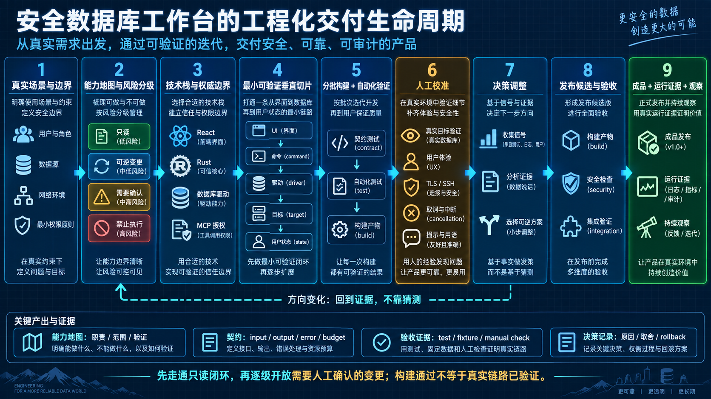
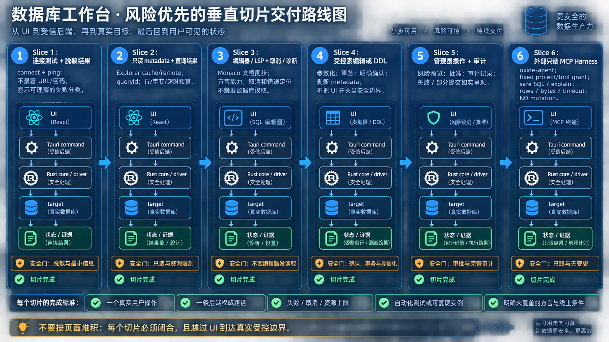
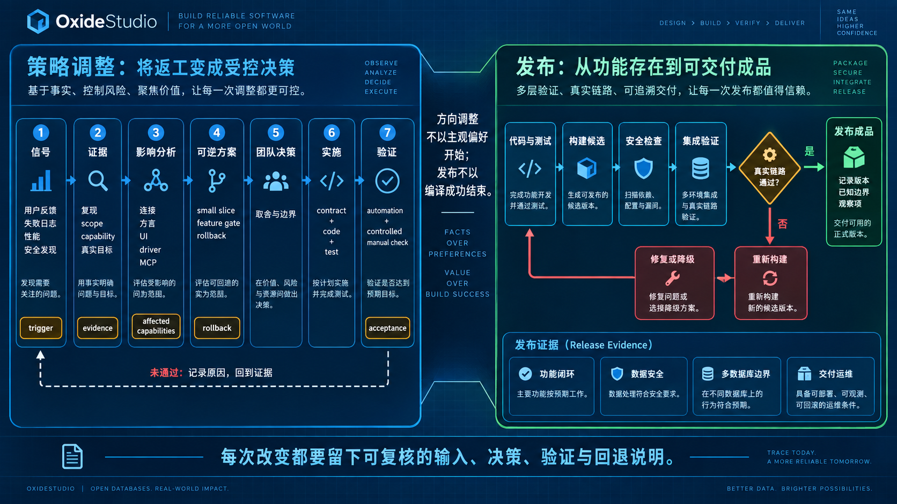

# 从需求到成品：数据库工作台的交付链路

> 这是一份面向 OxideStudio 的实施方法说明。它将当前仓库的真实架构边界作为约束，再给出从前期规划、分批构建、人工校准、策略调整到上线验收的可重复工作法。除明确标记为“当前实现”的部分外，其余均是建议流程，不表示仓库已经自动化执行。

## 1. 总体方法：先锁定证据与边界，再扩展体验

数据库工具的难点不只是把查询页面做出来，而是保证每条能力在连接、权限、方言、数据安全和外部自动化之间不发生越权。因此交付顺序应围绕不可逆风险安排：先确认目标、数据边界和后端能力，再搭建 UI 和智能体验；先把只读闭环走通，再逐级开放需要人工确认的变更。

每一轮都需要留下四类可追溯产物：

| 产物     | 解决的问题                                       | 建议位置                                     |
| -------- | ------------------------------------------------ | -------------------------------------------- |
| 能力地图 | 这个能力由谁负责、能操作到哪里、如何验证         | `docs/` 的架构/矩阵/ADR                      |
| 契约     | 前后端、driver、MCP 的输入、输出、错误与权限范围 | TypeScript types、Rust structs、schema、测试 |
| 验收证据 | 实现是否真的跑过而不只是“代码存在”               | 单元/集成测试、构建记录、受控手动检查        |
| 决策记录 | 为什么改变优先级、收紧范围或选择另一条实现路线   | ADR、issue/PR、版本说明                      |

## 2. 前期：从场景反推技术栈和产品特点

### 2.1 先用任务而不是组件开始

先写出用户的完整闭环。对于数据库工作台，至少应拆为以下几类，而不是笼统地称为“数据库管理”：

| 场景          | 用户目标                       | 首要风险                         | 首个可验收结果                    |
| ------------- | ------------------------------ | -------------------------------- | --------------------------------- |
| 查询与诊断    | 连接目标、写 SQL、理解结果     | 误连生产、超大结果、方言错误     | 可取消且有行数/诊断边界的查询结果 |
| 元数据浏览    | 找到库、schema、表、字段与约束 | 缓存过期、不同数据模型被错误统一 | 标明 cache/remote 状态的对象树    |
| 云上/内网接入 | 安全连入远程目标               | 凭据、TLS、SSH host key、跳板    | 测试连接与真实连接各自有明确结果  |
| 受控管理      | 修改结构、维护、管理会话/用户  | 不可逆变更、方言差异、权限不足   | 预览、确认、后端校验和刷新闭环    |
| 外部 Agent    | 在最小权限下获取事实           | 自动化越权、泄露数据、无限结果   | 项目固定、只读、带预算的 MCP 调用 |

这一步的产物应是“能力 → 后端权威模块 → UI 投影 → 证据”的地图。例如 MCP 不能只画一个“AI 工具”框，而要具体写出：项目 grant、连接/database/tool scope、只读 SQL 审核、行数/字节/超时预算和工具结果。

### 2.2 技术栈选择原则

当前工程的组合可以用作起点：Tauri/Rust 作为本地高权限边界，React/TypeScript 负责工作台交互，SQLx 与原生驱动承接协议差异，Monaco/LSP 处理编辑智能，`oxide-agent` + RMCP 提供外部只读工具面。选型不是为了堆技术名词，而是要为每条约束找到唯一的责任方。

| 决策问题                                       | 推荐原则                                      | 本工程中的落点                                           |
| ---------------------------------------------- | --------------------------------------------- | -------------------------------------------------------- |
| 谁可以持有数据库连接与凭据？                   | 放在可信后端，而不是 WebView                  | Rust `ConnectionManager`、driver、MetaStore/私有凭据边界 |
| 如何支持多种数据库而不让 UI 充满 `if driver`？ | 以 capability catalog 和 driver contract 分层 | 后端 capability catalog + driver 实现；UI 按能力开关     |
| 如何保证编辑器智能不扩权？                     | LSP 只提供语言与元数据能力，执行仍走后端命令  | bundled SQL LSP 与 Tauri command 分离                    |
| 如何让外部 Agent 可用但不变成运维后门？        | 只读工具、固定 grant、资源预算、独立进程      | `oxide-agent` stdio/HTTP MCP                             |
| 如何支持未来驱动而不承诺未交付产品？           | package 安装/签名/激活后才进入运行时目录      | signed external driver package 与 runtime catalog        |

### 2.3 前期的硬门槛

在开始大量页面或代码生成前，团队应先回答并记录：

1. 目标数据源、协议、认证、网络路径和最小数据库权限是什么？
2. 哪些动作是只读、可撤销、需要确认或完全禁止自动化？
3. 连接、项目、数据库、schema、事务和结果大小分别由哪个边界验证？
4. 哪些能力必须以真实服务验证，哪些可以先以契约/fixture 验证？
5. 产品文档中哪些是“当前实现”，哪些只是方向或缺口？

缺少这些答案时，优先做 discovery 或受控试验，不要用 mock UI 代替安全和生命周期结论。

## 3. 中期：分批构建、生成与人工调整

### 3.1 以垂直切片交付，而非按页面堆积

一个合格切片要从 UI 一直走到真实受控边界，再回到用户可理解的状态。推荐按风险由低到高推进：

每个切片都应包含：

- 一个用户可走通的操作；
- 一条后端权威路径；
- 明确的失败、取消和资源上限；
- 至少一个自动化测试或可复现实例；
- 写清楚本次没有覆盖的数据库、方言或线上条件。

### 3.2 如何使用代码/AI 生成

生成适合加速重复结构：类型、服务适配器、表单骨架、测试样例、文档矩阵和 UI 初稿；但必须由当前工程的契约约束生成结果。推荐流程是：

1. 先列出输入/输出 schema、授权范围、错误码与资源预算。
2. 在既有 feature、service、command 和 driver 目录中选择归属，避免把核心能力复制进组件层。
3. 生成小范围实现和同一边界的测试，而不是一次生成多个模块的大型重构。
4. 由人工检查命名、生命周期、事务、凭据脱敏、并发/取消和真实 UI 可用性。
5. 在真实或隔离的目标数据库上验证后，再扩展方言和能力范围。

生成代码的评审重点不是“看起来完整”，而是：是否绕过 Rust command、是否把密码/URL带入日志或响应、是否误把 capability catalog 当成静态前端表、是否允许外部 Agent 报称 `approved` 取得写权限。

### 3.3 人工校准不可省略的部分

以下内容必须在构建后人工检查，不能以编译通过替代：

| 校准对象      | 为什么需要人工判断                                  | 验证方式                                |
| ------------- | --------------------------------------------------- | --------------------------------------- |
| 查询与结果 UI | 语句范围、错误定位、截断和取消是否可理解            | 真实编辑器与目标连接的走查              |
| 云上连接      | DNS/TLS/SSH/权限错误常与本地 fixture 不同           | 测试连接、连接、断开与重连的分层验证    |
| 管理变更      | 确认文案和影响范围决定是否可安全执行                | 隔离环境的预览→确认→执行→刷新           |
| MCP Harness   | 客户端实现、token、Host/Origin 和范围收紧有部署语义 | stdio/HTTP 握手、工具发现、越权拒绝测试 |
| 多数据库差异  | 相同 UI 动作在不同方言可能不能等价实现              | capability matrix + 每族真实 fixture    |

## 4. 策略和方向调整：把“返工”变成受控决策

方向改变是正常的；失控来自没有判断条件。每次策略调整都应沿用同一张决策卡：触发信号、证据、受影响能力、可逆方案、推荐选择、验证标准和回退方式。

常见的正确调整方向包括：

- **先缩后扩**：某个 driver 或管理动作尚无真实验证时，不把它列为“已支持”，先保留只读或 preview-only 模式。
- **由 UI 判断改为后端强制**：一旦发现 UI 开关可绕过，就把权限、参数化、范围校验和事务边界收回 Rust。
- **由通用抽象改为能力矩阵**：当 MongoDB、Redis、Elasticsearch 与关系型数据库的语义不同，停止伪装成统一 SQL/表模型，改为 capability-driven UI。
- **由公网暴露改为本地/受信部署**：如果 MCP 无内建 TLS/OIDC，不把 bearer token 误用为多租户身份，改为 loopback、VPN、mTLS 或反向代理。
- **由全量生成改为小批验证**：生成式改动触及事务、认证或驱动协议时，拆到可回归的最小批次。

## 5. 后期：从“功能存在”到“可交付成品”

成品不是所有界面都出现，而是每个承诺能力都有对应的运行证据和清晰限制。发布候选前按四层验收：

| 层次     | 要回答的问题                             | 示例证据                                        |
| -------- | ---------------------------------------- | ----------------------------------------------- |
| 静态质量 | 类型、格式、链接和契约是否一致？         | TypeScript/Rust build、格式检查、schema/test    |
| 受控运行 | 主路径和失败路径是否实际执行？           | driver fixture、集成测试、MCP handshake         |
| 人工体验 | 人能否正确理解状态、风险和下一步？       | 截图/录屏、指定 viewport/theme 的走查           |
| 交付运维 | 安装包、配置、升级和安全限制是否可复现？ | release artifact、部署清单、token/rollback 说明 |

上图右半部分是发布门禁：代码与测试先形成候选，经安全检查和集成验证后判断真实链路是否通过；否决时选择修复或降级并重新构建，只有证据充分时才发布并记录版本、已知边界和观察项。它与左半部分的策略决策共用同一条原则：**不能用主观感觉代替证据，也不能用构建成功代替真实链路通过。**

最终文档应至少交付四样东西：

1. 面向使用者的连接、查询、管理和 MCP 接入说明；
2. 面向维护者的架构图、模块边界、技术栈和能力矩阵；
3. 面向发布者的配置、升级、回滚和安全检查清单；
4. 面向后续迭代的已知限制、未验证项和下一批优先级。

## 6. 将本方法映射到本仓库

| 阶段       | 当前可复用入口                                                                                       | 本阶段应新增/维护的证据                   |
| ---------- | ---------------------------------------------------------------------------------------------------- | ----------------------------------------- |
| 规划       | [统一架构与技术总览](README.md)、[当前架构](../architecture.md)、driver conformance 文档 | 能力地图、风险分级、ADR                   |
| 构建       | `src/features/`、`src/services/tauri/`、`src-tauri/src/commands/`、`src-tauri/src/drivers/`          | 同边界测试、最小可运行切片                |
| 校准       | `tests/frontend/`、`src-tauri/tests/`、真实数据库 fixture                                            | 人工走查记录、差异/性能证据               |
| 外部自动化 | [统一架构与技术总览](README.md)、`src-tauri/src/cli/`                   | 固定 grant、越权拒绝、HTTP/stdio 联通证据 |
| 发布       | `README.md`、`docs/UPDATES.md`、GitHub Actions workflows                                             | 版本、安装包、签名/更新与已知边界         |

最重要的交付原则是：功能的**权威状态和安全决策在后端**，前端是其可解释的操作投影；外部 Harness 是受限证据入口，而不是对桌面管理能力的远程复制。
